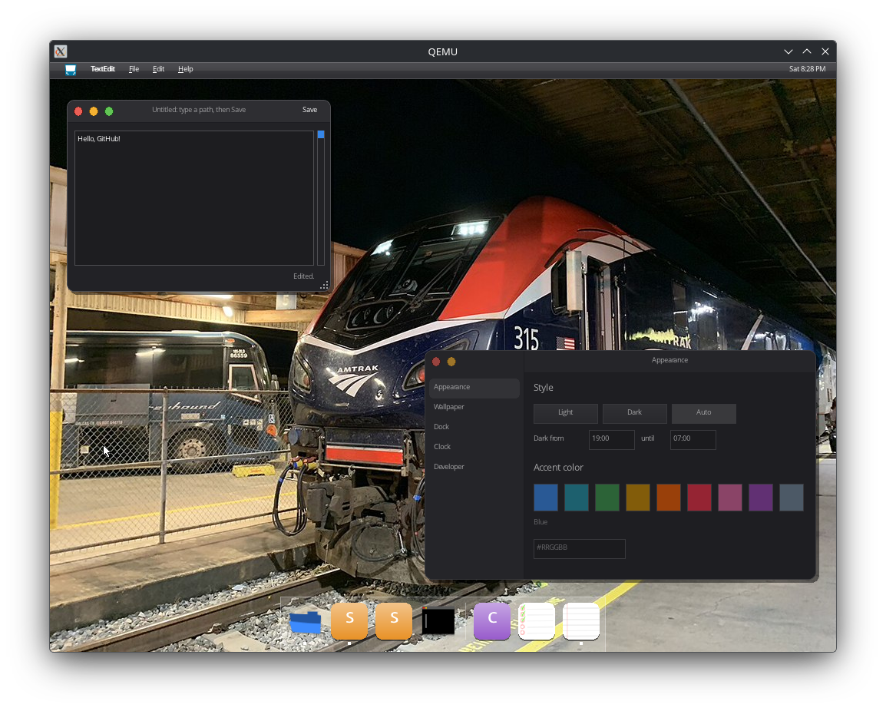

<p align="center">

</p>
<hr>
<p align="center">
  <b>a fun hobby operating system written in C# using the Cosmos framework</b><br>
  macOS-style interface with <a href="https://en.wikipedia.org/wiki/Bundle_(macOS)">bundled</a> Lua desktop applications
</p>

<p align="center">
  <a href="https://github.com/tonytins/VentureOS/blob/main/UNLICENSE"></a>
  
</p>

## 🚀Getting Started

See the Cosmos [installation guide](https://cosmosos.github.io/articles/user/install.html).

### Prerequisites

- [.NET 10 SDK](https://dotnet.microsoft.com/download) or later
- [Visual Studio Code](https://code.visualstudio.com/) or [Passenger IDE](https://passenger-ide.net)
- [Homebrew](https://brew.sh/) on macOS

#### Windows

Go to the [Releases](https://github.com/CosmosOS/Cosmos/releases) page on Cosmos' Github and download:

```
CosmosSetup-<version>-windows.exe
```

#### macOS/Linux

```
dotnet tool install -g Cosmos.Tools
cosmos install
```

### Building

From the repository root, `run.sh` checks the Cosmos tools, builds the kernel, and boots it in QEMU:

```
./run.sh              # boot with a window
./run.sh --headless   # boot with serial output only
./run.sh --vdb        # also forward vdb's port, 28455, to send apps in
```

To run each step yourself, point the Cosmos CLI at the kernel project:

```
dotnet test --project tests/Venture.OS.Common.Tests
cosmos check
cosmos build -p src/Venture.OS.Kernel
cosmos run -p src/Venture.OS.Kernel
```

### Using it

VentureOS boots to a shell. Type `help` to list the commands, and `desktop`
to open the desktop; VentureOS ▸ Return to Shell (Ctrl+Shift+Q) comes back.
[Writing apps](docs/writing-apps.md) shows how to add your own.

### Roundhouse

Roundhouse is VentureOS's IDE, for Linux, macOS, and Windows. It needs only the .NET SDK, not the Cosmos tools. Open an app's folder, or any file in it, and its files are listed: a `.uix` interface opens in a designer that draws it as VentureOS does, beside its text; Lua and other text in an editor; `Info.xml` as a form. File ▸ New App makes a window app to start from:

```
dotnet run --project src/Venture.Roundhouse -- rootfs/user/apps/Calculator.app/Contents/Resources/main.uix
dotnet test --project tests/Venture.Roundhouse.Tests
```

Roundhouse keeps a log, shown in its Log tab and written to a file a day, kept for a week, in its own folder of your local application data (`~/.local/share/Roundhouse/logs` on Linux): what it opened, saved, and ran, what VentureOS's apps printed in Run, and any error.

Run ▸ Run (Ctrl+R) runs VentureOS's desktop in a window beside the designer, with the app you're designing open as you've edited it, saved or not. Each run starts from a fresh copy of VentureOS's files, and an app's files stay inside that copy.

To draw a document into a PNG file without opening a window:

```
dotnet run --project src/Venture.Roundhouse -- --render main.uix main.png --dark --accent "#3A944A"
```

To build Roundhouse into packages for Linux (an AppImage and a `.tar.gz`), Windows (a zip), and macOS (`Roundhouse.app` in a zip), each needing nothing installed, see [packaging](packaging/README.md):

```
packaging/linux/package.sh
packaging/windows/package.sh
packaging/macos/package.sh
```

## ⚖️ No Copyright

Copyrights and any related rights for VentureOS are waived via the [UNLICENSE](UNLICENSE). Credit still appreciated.

The desktop's fonts keep their own licenses, which ship beside them in
`rootfs/system/fonts/`: Open Sans under the Apache License 2.0, and
Fira Code under the SIL Open Font License 1.1.
