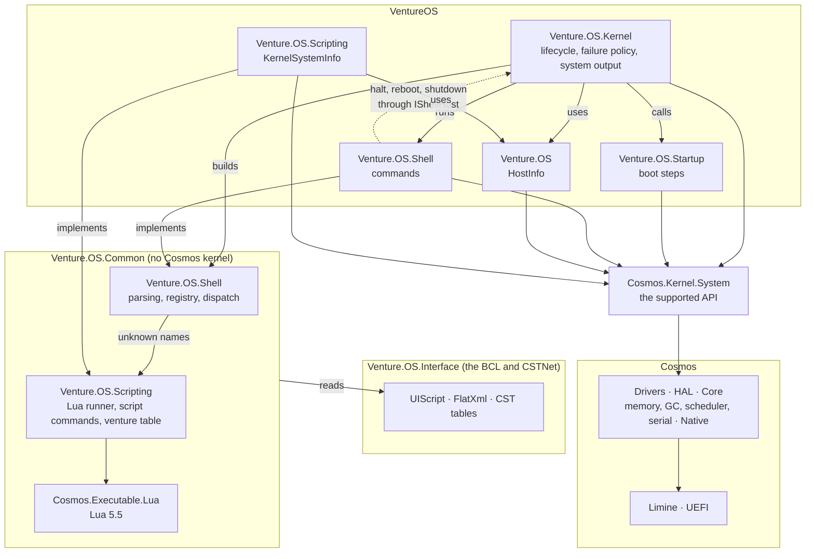
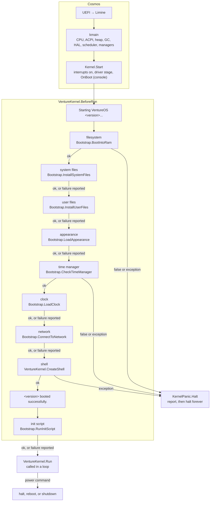
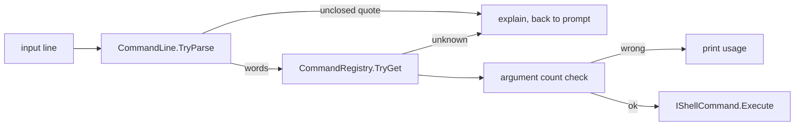

# VentureOS architecture

> **Last reviewed:** 2026-11-11 · **Last updated:** 2026-11-24 · **Change:** minor (testing: the system's tests and the apps' own) · **Target:** Cosmos gen3 3.0.99, x64 (ARM64 builds)

## Current state (2026-11-24)

What exists on `main` today. The numbered sections below describe the
design, and mark what's planned rather than built; where the code differs,
the code wins and this page is out of date.

- **Projects:** the kernel, `Venture.OS` (23 C# files, plus Lua system
  scripts and apps in `rootfs/`); a kernel-free library, `Venture.OS.Common`
  (the shell framework, Lua support, bundles, and the desktop's drawing); the
  interface formats, `Venture.OS.Interface` (UIScript, flat XML, and CST
  tables, needing only the BCL and CSTNet); and an xUnit v3 test project
  for the library, `Venture.OS.Common.Tests` (2,127 tests, and 296 for Roundhouse, including runs of
  the shipped scripts and library, `Dock.app` in a desktop, and the tutorial's example). The built-in
  apps' own tests are in their projects, in `projects/`, run by `airo test` (67 in all). Beside them, `vdb`, a Swift
  command-line tool in `tools/vdb` that sends apps to VentureOS (29 tests),
  and `airo`, a C# command-line tool in `src/Venture.Airo` that builds
  Roundhouse Projects into apps and runs their tests, on `Venture.Airo.Kit`,
  which Roundhouse shares (`Venture.Airo.Tests`, 53 tests).
  Namespaces: `Venture.OS`, `Venture.OS.Kernel`, `Venture.OS.Startup`,
  `Venture.OS.Shell`, `Venture.OS.Shell.Commands`, and
  `Venture.OS.Scripting`.
- **Platform:** Cosmos gen3 3.0.99 on .NET 10, compiled ahead of time to an
  ELF kernel that Limine boots from an ISO. x64 is the primary target; ARM64
  builds but hasn't been booted.
- **Boot:** nine steps, three critical (RAM filesystem, timer, shell) and six
  optional (system files, user files, the saved appearance, the clock's
  offset, network, and `init.lua` after the banner). A critical failure panics with a report; an optional
  one is reported and boot continues. Both paths are proven in headless
  boots.
- **Shell:** a command registry with eleven built-in commands (`help`, `desktop`,
  `clear`, `cd`, `lua`, `open`, `close`, `apps`, `halt`, `reboot`,
  `shutdown`), a current folder the prompt shows, `.app` bundles that open
  and close as processes, plus Lua script commands
  from `/mnt/system/commands` (`echo`, `info`, `net`, `clock`, `ps`, `kill`, and the file commands
  `ls`, `cat`, `write`, `mkdir`, `rm`, `df`, `pwd`) that reach the kernel
  through the `venture` table, and input split into a command and arguments
  with quoting. A failing command reports its error and
  returns to the prompt.
- **Storage:** a 32 MiB RAM disk, formatted FAT16 and mounted at `/mnt`,
  with the system files built into the kernel installed to `/mnt/system`,
  which nothing may change, and the user's to `/mnt/user`, which the user may.
  Nothing persists across boots.
- **Network:** DHCP on the first NIC when one is present. After boot, scripts
  resolve and ping, and with developer mode on, the desktop listens for vdb,
  which installs and opens apps sent from another computer (§8).
- **Desktop:** `desktop` opens a graphical desktop with a menu bar, a dock
  that opens the system's apps, and movable windows that show `.uix`
  interfaces, over the Earthset wallpaper, with apps' icons in the dock and
  About. Files is the desktop's own app, and Quick Look previews files.
  Apps open windows through `venture.ui`; `Notes.app` has one.
- **Not built yet:** keeping files across reboots,
  and published ISOs, which are ideas without a release. See the
  [roadmap](./ROADMAP.md); verified status is in the
  [scorecard](./scorecard.md).

---

## 1. Goals and principles

**Goals**

- A hobby operating system in C#, the spiritual successor to
  [TOMAS](https://github.com/tonytins/tomas/), built to production
  standards because I use it myself.
- First a usable shell OS: reliable boot, a shell with
  arguments, and commands to inspect and control the system.
- Then: a system that runs from RAM, extended in Lua: script commands, a
  system library, and apps that open and close cleanly as owners.
- Later: a Tiger-style desktop with `.uix` (UIScript) interfaces, files,
  networking, ARM64, and published ISOs. Keeping changes across reboots is
  optional.

**Principles**

1. **Cosmos owns the hardware; VentureOS owns the experience.** Drivers,
   memory, interrupts, the scheduler, the VFS, and the network stack come
   from Cosmos. VentureOS decides what runs at boot, what counts as fatal,
   what the user sees, and what the shell offers.
2. **Never crash uncontrolled.** During boot, critical steps panic
   deliberately and optional steps degrade. After boot, nothing may stop the
   system except the user's `halt` (§5).
3. **Observable without a screen.** Anything that tells you whether the
   system is healthy (boot step results, the version, failures, panics)
   reaches the serial log as well as the console, so a headless boot can
   check it (§6).
4. **One version string.** The version and build the user sees on screen
   are the ones in the serial log and in a panic report (§10).
5. **Stay on Cosmos's supported API.** VentureOS programs against
   `Cosmos.Kernel.System` and the `IBlockDevice` contract. Cosmos's
   experimental APIs (`COSMOS0001`–`COSMOS0003`) and plugs are a decision I
   make deliberately, not a default.
6. **Describe only what works.** Docs, the scorecard, and the changelog
   record what a build or boot has shown, and say plainly what hasn't been
   verified.
7. **Apps get the new look without changing.** As Apple's apps took on Dark
   Mode through semantic colours, a change to how the desktop looks, such
   as the title bar, hover, or a palette, reaches every app with no change
   to it. The desktop draws every frame and control, and styles say what a
   colour or size is for rather than what it is. Only a change to layout,
   such as a sidebar or resizing, is something an app opts into (§9).

### 1.1 Riding Cosmos's churn

Cosmos gen3 is young and moves fast. The 3.0.87 → 3.0.94 upgrade alone
renamed the filesystem, timer, network, input, and block-device namespaces
and two filesystem names. Its docs describe only the latest release. The
lesson is to keep Cosmos's surface small and in known places, so an upgrade
is a short list of mechanical fixes rather than a hunt.

**Rules I adopt now** (cheap today, expensive once the shell and storage
grow):

| Concern | Rule | Where |
|---|---|---|
| 2026-11-24 | minor | Testing (§12): VentureOS's tests cover the system; the built-in apps' tests live in their projects and run by `airo test` and Run ▸ Test. |
| 2026-11-24 | minor | Roundhouse: Run ▸ Test runs a project's tests a case a turn of the window's loop; `ProjectTests` steps through cases (`Next`) and takes unsaved edits. |
| 2026-11-24 | minor | Layout (§2): `projects/`, the built-in apps' projects with their Lua tests, which replace the C# tests that opened the shipped apps (Dock's stay until airo test has a desktop). VentureOS's tests stop pinning the standard look. |
| 2026-11-24 | minor | Layout (§2): `airo test` and apps' tests (`Venture.Airo.Testing`), run on a fresh simulated disk with no desktop; `SimulatedDisk` and `SimulatedSystem` move from Roundhouse into the kit for it, the system taking its version from whoever runs it. |
| 2026-11-24 | minor | Layout (§2): airo, the build tool (`src/Venture.Airo`, `airo build`), and `Venture.Airo.Kit`, which `RoundhouseProject` and `FolderNames` move into from Roundhouse so both build an app the same way; `Venture.Airo.Tests`. |
| **Namespaces** | Cosmos namespaces are imported once, in `GlobalUsings.cs`. A rename is a one-file fix. | `GlobalUsings.cs` |
| **Cosmos calls** | Hardware and subsystem setup goes through `Startup/` steps, not scattered through commands. | `Startup/Bootstrap.cs` |
| **Version pins** | `Cosmos.Sdk` and the `Cosmos.*` packages move together, in a change of their own, with a build and a headless boot. | `Venture.OS.Kernel.csproj` |
| **Docs drift** | Check an API exists in the pinned version before using it; the build is the quickest check. | [cosmos-gen3 skill](../.agents/skills/cosmos-gen3/SKILL.md) |
| **Experimental APIs** | Each one needs an explicit `<NoWarn>` and a deliberate decision from me, so a seam can't creep in unnoticed. | `Venture.OS.Kernel.csproj` |
| **Missing runtime pieces** | Not all of .NET links under Cosmos. `System.Xml` doesn't in 3.0.94 (it needs `RhGetMaxGcGeneration`, which Cosmos's runtime lacks), so VentureOS reads XML with its own `FlatXml`. Prefer explicit code over reflection-backed helpers such as `Enum.GetValues`. The kernel build, not `Venture.OS.Common`'s analyzers, is what finds these. | `Venture.OS.Interface/Xml/` |

The test: **a Cosmos upgrade should touch `GlobalUsings.cs`, `Startup/`,
and the project file, and nothing in the shell.**

---

## 2. Project layout

```text
VentureOS/
├─ src/
│  ├─ Venture.slnx                 the solution: the four projects below and the tests
│  ├─ Venture.OS.Kernel/           the kernel (Cosmos SDK): package pins and CosmosKernelClass in Venture.OS.Kernel.csproj
│  │  ├─ Kernel/                   Venture.OS.Kernel: VentureKernel (boot and the shell loop), KernelLog, KernelPanic
│  │  ├─ Startup/                  Venture.OS.Startup: Bootstrap (the boot steps) and BootRamDisk
│  │  ├─ Shell/                    Venture.OS.Shell: ConsoleShellOutput, and Commands/, one class per built-in command
│  │  ├─ Scripting/                Venture.OS.Scripting: KernelSystemInfo, ISystemInfo read from Cosmos
│  │  ├─ Vdb/                      Venture.OS.Vdb: VdbListener, vdb from the desktop's frame loop
│  │  ├─ Desktop/CanvasPainter.cs  draws the desktop on Cosmos's canvas with the system fonts
│  │  ├─ HostInfo.cs               name, version, and build number
│  │  ├─ GlobalUsings.cs           every Cosmos namespace, plus Venture.OS.Kernel
│  │  ├─ Bootloader/limine.conf    the Limine boot entry; asks for a 1024x768 framebuffer
│  │  └─ src/C/                    reserved for native C sources (empty)
│  ├─ Venture.OS.Common/           kernel-free code: no Cosmos, AOT-compatible, warnings as errors
│  │  ├─ Shell/                    Venture.OS.Shell: CommandLine, CommandRegistry, CommandShell, and the interfaces commands use
│  │  ├─ Scripting/                Venture.OS.Scripting: running Lua, script commands, owners, and the venture table
│  │  │                            (VentureLibrary, ShellLibrary, FilesLibrary), backed by ISystemInfo and IAppearance
│  │  ├─ Bundles/                  Venture.OS.Bundles: Bundle (Contents/Info.xml), AppManager, AppLibrary (venture.app)
│  │  ├─ Cryptography/             Venture.OS.Cryptography: SHA-256, HMAC, HKDF, and ChaCha20-Poly1305, for vdb
│  │  ├─ Vdb/                      Venture.OS.Vdb: vdb/1 without sockets (VdbSession), the seal, trust, and developer mode
│  │  ├─ Processes/                Venture.OS.Processes: AppProcess and the Supervisor, which AppManager opens apps through
│  │  └─ Desktop/                  Venture.OS.Desktop: UIView, windows, the menu bar, the dock, palettes, DesktopSession,
│  │                               and UiLibrary (venture.ui), all drawn through IPainter
│  ├─ Venture.OS.Interface/        the interface formats: the BCL and CSTNet, AOT-compatible, warnings as errors
│  │  ├─ UIScript.cs               Venture.OS.Interface: .uix (UIScript) documents, with menus, sidebars, and style roles
│  │  ├─ UIDocument.cs             a .uix as an editor holds it: its exact text, where everything sits, and its UIScript
│  │  ├─ Xml/FlatXmlEditor.cs      edits any flat XML's text in place, for UIDocument and InfoDocument
│  │  ├─ UIScriptSchema.cs         the attributes each element takes, as UIScript reads them, for editors
│  │  ├─ Xml/                      Venture.OS.Interface.Xml: FlatXml, for Info.xml, appearance.xml, and .uix files
│  │  └─ Strings/                  Venture.OS.Interface.Strings: StringTables, over CSTNet's CSTTable
│  ├─ Venture.Airo.Kit/            what airo and Roundhouse share, on Common and Interface; never in the kernel
│  │  ├─ Projects/                 Venture.Airo.Projects: RoundhouseProject (.rproj: Project.xml, App/, Interfaces/, assembling
│  │  │                            the .app) and FolderNames (what a new app or project may be called)
│  │  ├─ Simulation/               Venture.Airo.Simulation: SimulatedDisk (a fresh copy of rootfs/) and SimulatedSystem
│  │  └─ Testing/                  Venture.Airo.Testing: ProjectTests (a project's Tests/*.lua), AppUnderTest (its app on a
│  │                               fresh disk, with no desktop), and TestLibrary (the test table and the app it's handed)
│  ├─ Venture.Airo/                airo, the build tool (System.CommandLine): AiroCommand, airo build and airo test
│  └─ Venture.Roundhouse/          Roundhouse, VentureOS's IDE: an Avalonia app (Roundhouse) on Common and Interface
│     ├─ Bundles/                  Venture.Roundhouse.Bundles: OpenBundle, a bundle's files and their unsaved edits
│     ├─ Designer/                 Venture.Roundhouse.Designer: DesignMap (canvas points to elements), FrameDrag, FrameEdit,
│     │                            InspectorPanel, and DesignEdits (the library and selection edits)
│     ├─ Drawing/                  Venture.Roundhouse.Drawing: SkiaPainter, SkiaFonts, and SkiaImages
│     ├─ Simulator/                Venture.Roundhouse.Simulator: SimulatorWindow and SimulatedRun, over the kit's SimulatedDisk and SimulatedSystem
│     ├─ Vdb/                      Venture.Roundhouse.Vdb: Run on VentureOS (VentureOSRun, its window, TCP, and the identity file)
│     ├─ Welcome/                  Venture.Roundhouse.Welcome: WelcomeWindow, and RoundhouseSettings (recent items, Show at startup)
│     ├─ Highlighting/             Venture.Roundhouse.Highlighting: Grammars, TextMateSharp's grammars and CST's (cst.tmLanguage.json)
│     ├─ Logging/                  Venture.Roundhouse.Logging: RoundhouseLog (NLog), LogBuffer, LoggedOutput
│     ├─ Menus/                    Venture.Roundhouse.Menus: AppMenu, one list for the global menu bar and the ☰ button
│     ├─ TitleBars.cs              where the coloured bar can be the window's title bar
│     ├─ TitleBarPanel.cs          the bar's layout, as VentureOS's title bar's
│     ├─ WindowTitleBar.cs         the coloured bar both windows share, and making it the title bar
│     ├─ TitleBarStyles.axaml      the bar's look, and the FrameOnly decorations theme
│     └─ RenderCommand.cs          Roundhouse --render: a .uix drawn into a PNG file, with no window
├─ rootfs/                        files built into the kernel and installed at boot
│  ├─ system/                      installed to /mnt/system, which nothing may change
│  │  ├─ init.lua                  runs once after boot; prints the help hint, and runs developer.local.lua if a build has one
│  │  ├─ apps/                     Files, Dock, Settings, System Monitor, and Terminal
│  │  ├─ commands/                 Lua commands: echo, info, net, appearance, ps, kill, ls, cat, write, mkdir, rm, df, pwd
│  │  ├─ lib/venture/args.lua      the system library: the venture.args argument parser
│  │  ├─ interfaces/about.uix      every app's About window, and About VentureOS's fallback
│  │  ├─ interfaces/about_system.uix  About VentureOS: About and Credits panes in a sidebar
│  │  ├─ credits.txt               the credits About VentureOS shows
│  │  ├─ strings/                  the shared CST tables, 100 and up: _100_common.cst, the words buttons share;
│  │  │                            _101_desktop.cst, the desktop's own words
│  │  └─ fonts/                    Open Sans and Fira Code, with their licenses
│  └─ user/                        installed to /mnt/user, which the user may change
│     ├─ apps/                     Calculator, Notes (the sample app), and TextEdit
│     └─ settings/appearance.xml   the look a boot starts with, which Settings and appearance change
├─ tests/
│  ├─ Venture.OS.Common.Tests/     xUnit v3 tests for Venture.OS.Common and Venture.OS.Interface, with rootfs/ copied in
│  ├─ Venture.Roundhouse.Tests/    xUnit v3 tests that drive Roundhouse off-screen with Avalonia.Headless
│  └─ Venture.Airo.Tests/          xUnit v3 tests for airo and Venture.Airo.Kit, on sample projects of their own
├─ projects/                      Roundhouse Projects: the built-in apps, each with its Tests/, and about.rproj
├─ tools/vdb/                     vdb, a Swift command-line tool that sends apps to VentureOS (here until it has its own repository)
├─ packaging/                     Roundhouse's packages for Linux, Windows, and macOS, after CityLimits'; writes dist/
├─ docs/                          architecture, roadmap, scorecard, the tutorials (tutorial/), the HIG (hig/), the UIScript drafts, and vdb's protocol
├─ .agents/skills/                C# and Cosmos guidance for agents
├─ GitInfo.txt                    the base version, which every commit counts up from
├─ global.json                    opts dotnet test into Microsoft.Testing.Platform
├─ changelog.md                   user-facing history
└─ run.sh                         check, build, and run x64 locally (--headless for serial only, --vdb for vdb's port)
```

**Naming.** The kernel class is `VentureKernel` rather than `Kernel`,
because a class can't share its name with the `Venture.OS.Kernel`
namespace. Cosmos looks for `<RootNamespace>.Kernel` by default, so the
project file sets `CosmosKernelClass` to `Venture.OS.Kernel.VentureKernel`.

**Every .NET project lives under `src/`**, tests included, each in its own
folder and listed in `src/Venture.slnx`.

**Growth.** New subsystems (commands, drivers, filesystems) get their own
folder and namespace under `Venture.OS`, as `Kernel/`, `Startup/`, and
`Shell/` do. A new command is a class in `Shell/Commands/` plus one
`Register` call in `VentureKernel.CreateShell`.

---

## 3. Layering



**Rules:**

1. **Only `Venture.OS.Kernel` stops the system.** Boot steps report success
   with `bool` (critical) or by returning (optional), and throw when
   something unexpected happens. Shell commands ask the kernel to halt,
   reboot, or shut down through `IShellHost`. Neither calls `KernelPanic`,
   `Power`, or `Stop` itself.
2. **Boot steps don't know whether they're critical.** `VentureKernel`
   decides that when it runs them (§4), so the policy lives in one place.
3. **System messages go through `KernelLog`** (§6). Command output goes
   through `IShellOutput`, which writes to the console.
4. **VentureOS code reaches Cosmos only through `Cosmos.Kernel.System`**
   and `IBlockDevice`. Cosmos's internal namespaces (`Cosmos.Kernel.Core`
   and the HAL beyond `IBlockDevice`) are off limits.
5. **No `unsafe` code.** Cosmos keeps pointers in its Core layer; VentureOS
   has no need for them.
6. **`Venture.OS.Common` never references the Cosmos kernel.** It holds
   logic that doesn't need hardware, so it can be tested on ordinary .NET.
   `Cosmos.Executable.Lua` is the one Cosmos-named package it uses, because
   it runs on ordinary .NET too. Scripts reach the kernel only through
   `ISystemInfo`, which the kernel implements, and the desktop's look only
   through its `IAppearance`, which the desktop implements, so
   `Venture.OS.Scripting` and `Venture.OS.Shell` never name anything in
   `Venture.OS.Desktop`. Bundles may, since apps open windows. It builds
   with the AOT analyzers and warnings as errors, so code the kernel
   couldn't compile ahead of time fails there first. Its root namespace is
   `Venture.OS`, so a type keeps its namespace when it moves into it.
7. **`Venture.OS.Interface` references nothing but the BCL and CSTNet.** The
   formats interfaces are written in (UIScript, flat XML, and CST tables) read
   and test on their own, and VentureOS's drafts of them stay free of its
   desktop and scripting. CSTNet, CST.NET's package, is the format's own
   reader and has no dependencies. It builds like `Venture.OS.Common`, and its
   root namespace is `Venture.OS.Interface`: UIScript at its root, the CST
   tables in `Venture.OS.Interface.Strings`, and FlatXml in
   `Venture.OS.Interface.Xml`.

---

## 4. Boot



The filesystem, time manager, and shell steps are critical
(`RunCriticalStep`); the system files, user files, appearance, clock, network, and init script steps are
optional (`RunOptionalStep`). `init.lua` prints through `KernelLogOutput`, so
its output reaches serial too, and it can use the `venture` table. Ctrl+C or
Esc stops it, and so does a 10-second limit, so a script that never finishes
can't keep the shell from starting, even in a headless boot.

| Step | Kind | Succeeds when | On failure |
|---|---|---|---|
| Filesystem | critical | The RAM disk registers, formats as FAT16, and mounts at `/mnt` | Reports which of the three failed, then panics |
| System files | optional | Every file under `rootfs/system/` is written to `/mnt/system` | An invalid path or I/O error is reported and boot continues; the built-in C# commands still work |
| Appearance | optional | `/mnt/user/settings/appearance.xml` is read and its look used, or there's no file and the standard look stays; it runs after the user files, which ship the default | A file that can't be read is reported with why, and the standard look stays |
| Time manager | critical | Cosmos reports `TimerManager.IsInitialized` | Reports it, then panics |
| Clock | optional | `/mnt/user/settings/time.xml` is read and its offset used, or there's no file and the clock stays on UTC; it logs the time, or that the hardware clock isn't set. It runs after the time manager, which Cosmos's clock needs | A file that can't be read is reported with why, and the offset stays |
| Shell | critical | Every command registers | Registration only fails on a programming error, such as two commands with one name; it panics |
| Network | optional | Always returns; records the MAC and DHCP address when it can | No NIC, a DHCP timeout, or no address is reported; an exception is reported and boot continues |
| Init script | optional | `/mnt/system/init.lua` runs to the end, after the banner so the screen clear doesn't hide its output | A missing script or a Lua error (with its traceback) is reported, and the shell starts anyway |

A step is **critical** when the system can't do its job without it, so
running on would only make later failures harder to understand. Adding a
boot step means choosing its kind and saying why in the change.

Each step pauses for 0.5 s (`BootStepDelay`). That's deliberate: without
it, boot is too fast to read on screen.

---

## 5. Failure model

| When | What happens | How |
|---|---|---|
| A critical boot step returns `false` or throws | Deliberate panic: report, then halt forever | `RunCriticalStep` → `KernelPanic.Halt` |
| An optional boot step throws | Reported; boot continues without it | `RunOptionalStep` |
| A command throws | Reported; back to the prompt | `VentureKernel.Run` catches everything |
| Invalid input reaches a device or API | A specific exception (`ArgumentException`, `ArgumentOutOfRangeException`), caught by the boundaries above | e.g. `BootRamDisk` range checks |
| The user mistypes a command | The shell explains: unknown command, the usage line, or an unclosed quote; nothing throws | `CommandShell.Execute` |
| The user types `halt`, `reboot`, or `shutdown` | `Stop()` ends the loop and Cosmos halts the CPU; `Power.Reboot()` or `Power.Shutdown()` | `VentureKernel` through `IShellHost` |

**The panic.** `KernelPanic.Halt` writes a report with the version, the
failed step, and the reason (for an exception, its type name and message),
then calls `Power.Halt()` in a loop, because Cosmos's halt returns on the
next interrupt. Cosmos has a panic of its own, but it's internal. A forced
panic has been verified in a headless boot: the report reached serial, no
later step ran, and the shell never started.

**What isn't caught.** Interrupt and timer callbacks run outside these
boundaries, and an exception there halts the kernel. VentureOS registers
none yet. When it does, they must not throw, allocate, or block
([cosmos-gen3 skill](../.agents/skills/cosmos-gen3/SKILL.md) §4).

---

## 6. Output

| Channel | What goes there | API |
|---|---|---|
| Console | Everything the user reads: boot messages, the banner, command output | `Console` (Cosmos `KernelConsole`, set up by `base.OnBoot()`) |
| Serial | System messages, each line prefixed `[Venture] `, beside Cosmos's own `[KMAIN]`, `[KERNEL]`, and `[Kernel]` lines | `KernelLog.WriteLine` → Cosmos `Log` |

`KernelLog.WriteLine` writes serial first, then the console, so a message
survives even when the console is what failed. Serial is COM1 on x64, and
`cosmos run` connects it to the terminal. Command output stays on the
console only, so the serial log stays a record of the system's health
rather than a transcript.

---

## 7. Storage

```text
BootRamDisk (IBlockDevice, 512-byte blocks × 65,536 = 32 MiB)
  → FatFileSystemType, registered as "ramfat"
  → formatted FAT16 → mounted at /mnt
  → reachable through System.IO (File, Directory, streams)
```

- **`BootRamDisk`** validates its size when constructed (no zero sizes, no
  disk larger than one .NET array) and range-checks every read and write,
  throwing as Cosmos's `IBlockDevice` contract requires instead of
  overflowing or copying the wrong range.
- `/` is Cosmos's read-only virtual root, so files live under `/mnt`.
- **System files.** Everything under `rootfs/system/` is turned
  into byte arrays in generated C# at build time (`GenerateSystemFiles` in
  `Venture.OS.Kernel.csproj`), because Cosmos 3.0.94 doesn't expose Limine's
  modules, so the ISO can't hand the kernel loose files. At boot,
  `SystemDirectory.Install` checks every path, then writes the files to
  `/mnt/system`. The RAM disk starts empty, so the system files always match
  the kernel, and edits made on the running system are lost at reboot.
- **User files.** Everything under `rootfs/user/` is built in the same
  way (`SystemFiles.User`, tagged `Root="user"` in the project) and
  installed to `/mnt/user` by an optional step after the system files. The
  difference is protection: `venture.files` and the file commands refuse to
  change `/mnt/system` but may change `/mnt/user`, as on other systems.
  Cosmos's FAT16 keeps long file names (a 23-character name was read back in
  a boot test) and ignores case when looking names up.
- **Not built yet:** keeping files on a disk. VentureOS runs from RAM, as
  many small systems do; persistence is an idea on the roadmap, optional,
  and whether VentureOS formats blank disks itself is an open decision
  (§13). `cosmos run --disk <image>` attaches a disk when that work starts.

---

## 8. Network

- At boot, if Cosmos found a NIC, `ConnectToNetwork` reports its name and
  MAC and runs DHCP. Nothing caches the result: `net` reads `NetworkManager`
  directly, so it shows the current state. Under QEMU the default x64 NIC is an
  e1000e, and DHCP leases 10.0.2.15.
- `NetworkManager.Primary` is a struct handle that may name no device, so
  it's only read after checking `NetworkManager.DeviceCount`.
- **DNS.** DHCP registers the server it gives with Cosmos (`DnsConfig`), and
  `net` shows it. `venture.resolve(name)` asks it with `DnsClient`, waiting
  up to 3 seconds by default; an address passes through.
- **Ping.** `venture.ping(address)` sends one ICMP echo with `IcmpClient`
  and waits up to 2 seconds by default for the reply, which Cosmos times in
  10 ms steps. Both run in `KernelNetworkTools`, behind `INetworkTools` on
  `ISystemInfo`, and report every failure, a thrown one included, as a
  result. Names are checked first (`HostNames`), so a typo is reported
  rather than sent. An address on the local network that nothing answers
  takes Cosmos's own ARP wait before ours starts, several seconds; it's
  bounded by a count of tries, not a time, and can't be shortened without
  Cosmos's experimental packet API.
- Cosmos's limits apply: no TLS, and TCP doesn't retransmit.

### 8.1 vdb

vdb sends an app from another computer and opens it, while VentureOS can't
yet keep files or install from a disk. Its [design](./design/2026-11-18-vdb-design.md)
has the why, the [encryption design](./design/2026-11-19-vdb-encryption-design.md)
how it's sealed, and [docs/vdb](./vdb/README.md) the protocol.

- **Developer mode** (`VdbDeveloperMode`, on `ISystemInfo.Developer`) is off
  at every boot. Settings' Developer pane or `venture.developer.enable()`
  turns it on, until restart. `init.lua` runs `/mnt/system/developer.local.lua`
  when a build has one: a git-ignored file that turns developer mode on and
  trusts the owner's own vdb, so their builds need no prompt and nobody
  else's carries it.
- **Listening.** Sockets in Cosmos are safe on one thread only, and the shell
  blocks in `Console.ReadLine`, so vdb listens only while the desktop runs:
  `DesktopCommand`'s frame loop calls `VdbListener.Poll` each frame, which
  checks `Pending()` and `DataAvailable`, neither of which blocks, and reads
  at most 16 × 4 KiB a frame. Leaving the desktop stops listening. One
  computer at a time; a second is told it's busy.
- **The computer's side** is in Common too: `VdbClient`, blocking, over any
  line transport, and `VdbApp`, an app read and checked before it's sent.
  Roundhouse speaks vdb with them; the `vdb` tool has its own, in Swift.
- **The protocol** is in Common (`Vdb/`), with no sockets: `VdbSession` is
  handed bytes and the time and answers in lines, so it's tested without a
  kernel. Apps are staged in `/mnt/user/.vdb`, checked with `Bundle.Read`,
  and copied into `/mnt/user/apps`; a system app's identifier is refused.
- **Trust.** A computer is known by its identity, a 128-bit secret, and
  named on the network by its key ID, a hash of it (`VdbTrust`). An unknown
  key ID gets an alert with Trust and Deny, showing the key ID, and no close
  button; 60 seconds without an answer is Deny. On Trust, VentureOS asks for
  the identity (`pair`), the one time it's sent, and checks it gives the key
  ID. Trust lasts until restart.
- **Sealing.** After VentureOS's `hello`, every line is sealed by a
  `VdbChannel`: ChaCha20-Poly1305 with a key per direction from HKDF-SHA-256
  over the identity and both sides' nonces, and a counter for the nonce. A
  line that doesn't open closes the connection with nothing sent back. The
  cryptography is Common's own (`Cryptography/`: SHA-256, HMAC, HKDF,
  ChaCha20, Poly1305), since Cosmos has none, tested against the standards'
  vectors and .NET's implementations. VentureOS's nonces come from
  `VdbRandom`, the timestamp counter hashed with a count and a boot seed,
  which is not a cryptographic generator; the computer's nonce keeps the
  keys fresh regardless.
- **Output.** `HeldOutput.Echo` copies what apps print to a trusted
  computer, as `out` lines.
- **Failures** end the connection, or turn listening off with the reason in
  Settings; none reaches the desktop. With no NIC, turning it on reports
  that there's nothing to listen on.
- Under QEMU, `./run.sh --vdb` forwards port 28455 from the host.
- **The tool** is `vdb`, in Swift, in `tools/vdb/` (its [README](../tools/vdb/README.md)):
  `VdbKit` holds the client, over any line transport, the bundle reader, and
  the identity, kept in the configuration folder; its `VdbChannel` seals with
  swift-crypto; `TCPConnection` is POSIX or Winsock sockets with `poll`. Its
  tests replay the same recorded conversations VentureOS's do, and both
  sides reproduce `sealed-lines.txt`, sealed by Python's `cryptography`. While following output, it sends an empty
  line every 10 seconds to stay under the idle limit.

---

## 9. Shell

`VentureKernel.Run` prints a prompt, reads a line with `Console.ReadLine()`
(Cosmos provides line editing), and passes it to `CommandShell.Execute`.
Cosmos calls `Run` again as soon as it returns, so it never loops itself.

**The current folder.** `ShellContext.CurrentDirectory` starts at `/mnt`, and
the prompt shows it, as `/mnt> `. `cd [folder]` changes it (with no folder it
goes back to `/mnt`), and is built in because it changes the shell itself.
`ShellPaths.Resolve` works out a full path from what was typed: `..` and `.`
work, `..` at `/` stays there, and empty parts are skipped. Script commands,
runtime commands, `lua`, and the prompt (before each line, so `!cd` takes
effect) all run Lua from the current folder.



- **Parsing** (`CommandLine`): words are separated by spaces or tabs.
  `'single quotes'` are literal, `"double quotes"` allow `\"` and `\\`,
  and a backslash outside quotes makes the next character literal. An
  unclosed quote or a trailing backslash is reported, not thrown. The shell
  reads the command's name first (`CommandLine.TrySplitFirst`): a command
  that takes text rather than words (`ITextCommand`, such as `lua`) gets
  the rest of the line as typed, quotes included, so `lua print("x")`
  reaches Lua whole; text that starts with a quote and is one quoted word
  is read as that word, so `lua "print(1)"` still works.
- **Commands** (`IShellCommand`) declare a name (lowercase letters, digits,
  and hyphens), a one-line summary, a usage line, and their minimum and
  maximum argument counts. The shell checks the count before running a
  command, so commands don't repeat that check.
- **The registry** (`CommandRegistry`) rejects invalid and duplicate names,
  looks names up ignoring case, and lists commands in name order. `help`
  is generated from it. Names it doesn't know go to its sources
  (`ICommandSource`) in order, so a source can never replace a built-in.
- **Script commands** (`ScriptCommands`, the one source) are
  `/mnt/system/commands/<name>.lua` files. The directory is read on every
  lookup, so a script saved on the running system works at once; if it's
  missing, there are just no script commands. Only names that pass the
  registry's rule are looked up, so a name can't climb out of the directory.
  A script's leading `--` comments (`ScriptHeader`) give its summary, a
  `-- Usage:` line, and a `-- Needs:` line; it gets its arguments as `...`,
  and it checks them itself.
- **Where it lives.** The framework (`CommandLine`, `CommandRegistry`,
  `CommandShell`, `ShellContext`, the interfaces, and script commands) is in
  `Venture.OS.Common` and covered by tests, including real Lua runs on
  ordinary .NET. The built-in commands and `ConsoleShellOutput` are in the
  kernel, because they use Cosmos.
- **Output and power.** Commands write through `IShellOutput` and ask for
  halt, reboot, or shutdown through `IShellHost`, which `VentureKernel`
  implements. That keeps power calls in `Venture.OS.Kernel` and lets tests
  capture output later.

| Command | Does |
|---|---|
| `help [command]` | Lists the commands, or shows one's summary and usage |
| `clear` | Clears the screen |
| `cd [folder]` | Changes the current folder, or with none, goes back to `/mnt` |
| `open <app>` | Opens an app from `/mnt/system/apps` by name, or any `.app` by path |
| `close <app>` | Closes an open app, undoing what it set up |
| `apps` | Lists the system's apps, and which are open |
| `desktop [interface.uix...]` | Opens the desktop, with any `.uix` files as windows; Ctrl+Shift+Q goes back to the shell |
| `echo [text...]` | Lua script: prints its arguments on one line, separated by single spaces |
| `ls [-l] [folder...]` | Lua script: lists a folder, folders marked with `/`; `-l` adds type and size |
| `cat <file...>` | Lua script: prints files |
| `write [-a] <file> [text...]` | Lua script: writes a line to a file, or with `-a` adds it to the end |
| `mkdir [-p] <folder...>` | Lua script: makes folders; `-p` makes missing ones above too |
| `rm [-r] <path...>` | Lua script: removes files and empty folders; `-r` removes a folder and everything in it |
| `df [folder]` | Lua script: free and total space where a folder is stored |
| `pwd` | Lua script: the current folder |
| `info` | Lua script: version and build, commit, Cosmos version, uptime, and free and total memory |
| `appearance [light\|dark\|auto] [--accent #RRGGBB] [--from HH:MM] [--until HH:MM]` | Lua script: shows or switches the desktop's look, and saves it, as Settings does; auto is dark on the schedule |
| `lua [code]` | Runs one chunk of Lua 5.5 in a fresh interpreter, or with no code, opens a Lua prompt |
| `net` | Lua script: device, MAC, link, readiness, and IPv4 address, subnet, gateway, and DNS server |
| `resolve <name>` | Lua script: the address a host name has, through the DNS server DHCP gave |
| `ping [-c count] <host>` | Lua script: echo requests to a host, 4 by default and at most 20, with each reply's time |
| `halt` | Ends the shell loop; the CPU halts and the machine stays on |
| `reboot` | Restarts through ACPI |
| `shutdown` | Powers off through ACPI |

Uptime comes from `Stopwatch`, which Cosmos plugs to the CPU's timestamp
counter on x64, so it counts from when the CPU started. Under `cosmos run`,
QEMU runs with `-no-reboot -no-shutdown`, so `reboot` and `shutdown` pause
the virtual machine instead; without those flags both work.

**Lua.** `lua <code>` and script commands both run through `LuaRunner`,
on `Cosmos.Executable.Lua`, a Lua 5.5 interpreter from the CosmosOS
organization. Each run gets a fresh interpreter, disposed afterwards, so
nothing carries over. `print`, `io.write`, and `io.stderr` go through
`IShellOutput` (`ShellOutputWriter` joins pieces into lines), and relative
paths in `dofile` and `io.open` start at the shell's current folder. Lua errors are reported with
their traceback, and `os.exit` with a non-zero status as that status; neither
reaches the shell loop.

**The Lua prompt.** Plain `lua` opens `LuaRepl`, a read–eval–print loop in one
interpreter, so values carry over between lines until `exit`. It prompts with
`lua> `, so it can't be mistaken for the shell. A line is tried first as an
expression, whose value is printed (`1 + 1` prints `2`), then as statements;
one left unfinished, such as `for i = 1, 3 do`, continues at `...> `. Ctrl+C
or Esc stops only the running line: `LuaRunner.Create` hands the prompt a way
to clear the latched stop before each line. Errors show only their message,
and `os.exit` or the end of the input leaves the prompt. As in the reference
`lua`, an expression's value is printed even when it's incidental, so
`io.write('x')` also prints the file it returns. The prompt is written in C#
rather than with the package's `RunPrompt`, which uses the shell's own `> `
prompt and has no point between lines to clear the stop.

**The system library.** Lua modules that ship with the system live in
`/mnt/system/lib`, and `require` looks there only (`package.path` is set to
`/mnt/system/lib/?.lua` and `?/init.lua`; native modules are off). Modules
are namespaced under `venture.`, so plain names stay free for scripts and
apps. Tests load the shipped files with `require`, as scripts do.

`venture.args` is the first module: a command declares its arguments and
options, and gets parsing, clear errors, and a generated `--help`:

```lua
local options = require("venture.args").parse({...}, {
  name = "greet",
  summary = "Greet someone.",
  arguments = { "name" },
  options = { loud = { short = "l", summary = "Shout it." } },
})
if not options then return end
```

It reads `--name value`, `--name=value`, `-s value`, combined short flags
(`-lq`), and `--` before words that start with a dash; a dash then a digit
(a negative number, or an offset such as `-05:00`) counts as an argument. Option types are `flag`, `string`, and `number`. A user's
mistake prints the problem and the usage line and returns `nil`; a mistake in
the declaration is a Lua error, since it's the command's bug. It's opt-in, so
the shell's contract with commands doesn't change: they still get their words
as `...`. The shell can't see a script's options without running it, so
`help <command>` keeps showing the header, and `<command> --help` shows the
options.

**The `venture` table** is how scripts reach the kernel, in `lua` and in
script commands alike. Its functions return plain values or tables, and the
scripts do the formatting:

| Function | Scope | Returns |
|---|---|---|
| `venture.version()` | *(always)* | `{ name, version, build, commit, cosmos, display }` |
| `venture.uptime()` | `system` | Whole seconds since the CPU started counting, or `nil` |
| `venture.memory()` | `system` | `{ free, total }` in bytes, or `nil` |
| `venture.appearance()` | `system` | The desktop's look, `{ mode, accent }`: `"light"` or `"dark"`, and the accent as `#RRGGBB` |
| `venture.setAppearance(mode, accent)` | `system` | Switches to `"light"` or `"dark"`, with an optional `#RRGGBB` accent (the current one otherwise), and saves it; `true` (and why it wasn't saved, if it wasn't), or `nil` and why |
| `venture.time()` | `system` | The clock, `{ set, offset, zone }` (such as `"-05:00"` and `"UTC-05:00"`), and when the hardware clock is set, also `text` (`"Tue 3:45 PM"`), `year`, `month`, `day`, `hour`, `minute`, `second`, `weekday`, and `utc`; `nil` without a clock |
| `venture.setUtcOffset(offset)` | `system` | Sets the offset, written `-05:00`, `+5:30`, `-5`, or `UTC`, in quarter hours from -12:00 to +14:00, and saves it; returns as `setAppearance` does |
| `venture.command{...}` | `shell` | Registers a command for as long as its owner lasts; see **Owners** below |
| `venture.shell(line)` | `shell` | Runs a line as if typed at the shell; in `init.lua` and at the `lua` prompt |
| `venture.files.*` | `files` | Lists, reads, writes, and changes files; see **Files** below |
| `venture.net()` | `network` | `nil` without an adapter, else `{ device, mac, link_up, ready, address, subnet, gateway, dns }`; the last four are `nil` until IPv4 is configured |
| `venture.resolve(name, seconds)` | `network` | The address a host name has, or `nil` and why; waits 1 to 10 seconds, 3 by default |
| `venture.ping(address, seconds)` | `network` | Milliseconds for one echo's reply, or `nil` and why; waits 1 to 10 seconds, 2 by default |

**Scopes.** A script declares what it reaches with `-- Needs:` in its header,
like an app's permissions, such as `-- Needs: system, network`. Scopes are
broad, so new functions in an area don't need new names. Every function is in
the table, but one outside the declared scopes raises
`venture.net needs the network scope: add it to a script's -- Needs: line, or an app's needs in Info.xml`. A scope
VentureOS doesn't know keeps the script from running at all, with the reason, so a script
written for a newer VentureOS fails clearly rather than half working.
`help <command>` shows a script's needs. `init.lua` follows the same rule;
`lua` gets every scope, since it's the user typing. Scopes cover only the
`venture` table: Lua's own `io` still reaches files without declaring
anything, until persistence makes that matter.

**Files.** `venture.files` (`FilesLibrary`) lists, reads, and changes files,
with paths starting from the current folder. Failures a script should expect,
such as a missing file, return `nil` and a message, as Lua's `io` does, so a
command prints the reason and carries on; a wrong argument type is an error.

| Function | Does |
|---|---|
| `list([path])` | `{ {name, type, size}, ... }`, sorted by name; `type` is `"file"` or `"folder"` |
| `info(path)` | `{name, path, type, size}` |
| `read(path)`, `write(path, data, [append])` | Whole files, byte for byte |
| `mkdir(path, [parents])` | A folder; with `parents`, missing ones above too, and an existing one is fine |
| `remove(path, [recursive])` | A file or empty folder; with `recursive`, everything in it |
| `space([path])` | `{free, total}` in bytes, from the mount that holds the path |
| `resolve([path])` | The full path |

Nothing that changes files works inside `/mnt/system`
(`ISystemInfo.SystemDirectory`), or removes a folder holding it: it's
rebuilt at every boot, and a stray `rm -r` mustn't break the running system.
Reading it is fine.

**Running inside another system.** Where VentureOS runs inside another
system, as in Roundhouse's Run, `ISystemInfo.Root` is a `FileRoot`: a host
folder standing for VentureOS's `/`. The kernel has none, so nothing changes
there. Inside VentureOS's code, paths the system sets up (the apps' folders,
the settings) are the host's, and only paths crossing to or from scripts are
converted:

- In: every path `venture.files` touches, `venture.ui.preview` and `launch`,
  `window:setImage`, and `open <path>` (`AppManager`), through
  `FileRoot.ToHost`. `..` stops at `/`, as in VentureOS, and a path whose
  symbolic links lead outside the root is refused, as a failure the script
  sees.
- Out: `venture.app.path` and `resource`, and the dock's user apps
  (`AppManager.ScriptPath`), through `FileRoot.ToVenture`.
- Lua's own ways to the host are switched off, each saying so when called:
  `io.open`, `lines`, `popen`, `input`, `output`, `close`, and `tmpfile`;
  `os.execute`, `remove`, `rename`, `tmpname`, and `getenv`; `dofile` and
  `loadfile`; `package.loadlib` and `searchpath`; and `debug`. `require`
  keeps working, from the folders it was given, which a script can no longer
  change, and returns a module's name rather than the host's path to it.
  `io.write`, `io.read`, and `load` stay. VentureOS's own scripts use none of
  what's switched off.

This keeps an app's mistakes, such as a stray `rm -r /`, inside the run's
copy. It isn't a wall against hostile code running in the same process: a
link made between a path's check and its use isn't caught, though scripts
can't make links, and an error message can still name a host path.

**Owners and undo.** After the ideas in "A Programming Paradigm for
Spatiotemporal Composability", lasting Lua code runs as a `LuaOwner`: one
interpreter that outlives a single run, and a list of ways to undo what the
code set up. Ending the owner runs those undos newest first, then disposes
the interpreter, so nothing it set up outlives it. There are two owners:

| Owner | Lives | Its commands |
|---|---|---|
| `init.lua` | The whole boot; if it fails partway, its undos run at once, so no half-registered commands are left | Until shutdown |
| A `lua` prompt session | Until `exit` or the end of its input | Vanish on `exit`, restoring any script they replaced |

One-shot code (`lua code` and script commands) has no lasting owner, so
`venture.command` and `venture.shell` there explain that they only work in
`init.lua` and at the `lua` prompt.

At the prompt, a line starting with `!` runs the rest as a shell command, so
a command defined there can be tried, changed, and tried again before `exit`
clears it away. `venture.shell(line)` does the same from Lua. Each nested call
goes through C#, and a .NET stack overflow can't be caught, so
`venture.shell` refuses to nest more than 8 deep, which stops a command that
runs itself. A call back into an owner while other code in it is running
restores the caller's output and stop afterwards. The prompt prints the
handle a registration returns as `command "name"`.

`venture.command { name, summary, usage, run }` registers a command through
`RuntimeCommands`, the first command source, so it wins a lookup. Its undo
unregisters it and releases its `run` function; the handle it returns can run
that undo early with `:remove()`. A runtime command runs in its owner's
interpreter, so state carries over between calls, with its output going to
whoever ran it and its own Ctrl+C stop (`init.lua`'s 10-second limit covers
only its startup). `help <command>` shows `From:` its owner. Who may take a
name:

- No one can take a built-in command's name.
- A name another owner registered is taken until that owner ends or removes
  it; the same owner registering it again replaces its earlier command.
- Only code the user types (the `lua` prompt) may replace a system script
  command, and it says so: `echo now replaces the
  echo script until you exit.` `init.lua` and, later, apps can't, so nothing
  installed can quietly take over a system command.

`VentureLibrary` builds the table from an `ISystemInfo`, which
`KernelSystemInfo` implements by reading Cosmos on every call, so scripts see
current values. A value that can't be read reliably (an uptime counter with
no frequency, a page count that would overflow) is `nil`, and an exception
from a device becomes a Lua error that `pcall` can catch. Tests use a fake
`ISystemInfo` and run the shipped `info.lua` and `net.lua` against it.

**Stopping Lua.** Ctrl+C or Esc stops `lua` and script commands; `init.lua`
also stops after 10 seconds. `LuaRunner` takes a stop check (`ScriptStop`
builds time limits and combines checks; `KeyboardStop` reads the keyboard
without blocking) and installs it with the standard `debug.sethook` as a count
hook that runs every 1,000 instructions. A reason it returns becomes a Lua
error with that message, such as `Interrupted.`, reported like any other
error, with its traceback. Three things keep a script from escaping it:

- The stop latches. A key press is read only once, so once a check says stop,
  the runner keeps saying it, and the hook then runs on every instruction. The
  error escapes a `pcall` that catches it almost at once.
- `debug.sethook` keeps its hook per thread, and a new coroutine would inherit
  only the count, so `coroutine.create` and `coroutine.wrap` are replaced with
  versions that hook each new coroutine.
- `debug.sethook` is then replaced with a function that raises
  `debug.sethook is reserved by VentureOS`.

Keys typed while a script runs are read by the check and discarded.

Cosmos's limits apply: local time is UTC, `os.getenv` returns nil, and there
is no `io.popen` or `/tmp`.

**Bundles.** Like macOS, VentureOS treats some folders as one thing, with the
same shape for every kind:

```text
Notes.app/
└── Contents/
    ├── Info.xml      <App version="1"><Info identifier=... name=... /></App>
    ├── Lua/          code; main.lua runs when an app opens
    └── Resources/    images, .uix interfaces, and so on
```

The root element names the kind: `<App>` (`.app`), and later `<Theme>`
(`.theme`) and `<Library>` (`.library`). `Bundle.Read` checks the kind, so
handing a theme to something expecting an app says so. `<Info>` takes
`identifier` (required, reverse-DNS), `name` (required), `version`, `needs`
(scopes for all the bundle's code), `main` (an app's first script, by
default `Contents/Lua/main.lua`), and `icon`. Paths stay inside the bundle.
`Info.xml` follows UIScript's compatibility rules: a newer `version`, an
unknown `requires` feature, or an unknown element refuses the bundle with the
reason, and an unknown attribute is skipped and listed, to catch typos.

Both `Info.xml` and `.uix` files are read by `FlatXml`, because Cosmos can't
link `System.Xml` (§1.1). It reads exactly the subset they use: an
optional declaration, comments, one root whose elements hold attributes and
nothing else, the five standard entities, and numeric character references.
A caller that allows nesting (`allowNesting`, as `UIScript` and `UIDocument`
do) also gets elements inside elements, up to `FlatXml.MaximumDepth` (32)
deep; `Info.xml` and the settings files don't, so nesting stays refused
there. `Children` stays one list in document order, each element before
those inside it, with its `Parent` and `Depth`; `FlatXmlDocument.End` and
`ChildrenOf` recover the structure, and a flat document numbers its
elements as it always did. A `DOCTYPE`, text, nesting that isn't allowed,
CDATA, or an unknown entity is refused with its line. Each element also
records where it sits in the text (`FlatXmlElementSource`): its whole span,
its children included, the end of its name, where its closing tag begins,
and each attribute's span, value as written, and quote. `FlatXmlEditor`
inserts inside a given parent (opening up one written `<Name/>`), and
removes or moves an element among its siblings with everything inside it.
`UIScript` lets only a `<Menu>` and a `<Pane>` hold elements: a menu its
items, separators, and submenus, and a pane its controls; anything else
nested is refused, naming both elements, and opens in Roundhouse for text
editing only. Roundhouse's designer adds a menu item or a control inside its
menu or pane, unless that menu's items or pane's controls name it from
outside, and moves controls forward and back only among their siblings.
`FlatXmlEditor.MoveInto` and `MoveOut` move an element with everything in
it into a parent, last, or out to just after its parent, indenting each
line afresh; `UIDocument.MoveInto` also drops the `menu` or `pane` that
named the parent from outside.

`UIDocument` is a `.uix` as Roundhouse holds it: the exact text (a byte
order mark and line endings included, as strict UTF-8), those positions,
and the `UIScript` VentureOS reads from it, or why VentureOS refuses it. A
refused document, such as one with an element VentureOS doesn't know, opens
for text editing only. Edits change the text in place, so a document nobody
edited is written back byte for byte; Hudini's examples and every shipped
`.uix` are tested to do so. Each edit gives a new document and leaves the old
one as it was, and one VentureOS would refuse throws its `UIScriptException`
instead:

- `SetAttribute(element, name, value)` replaces a value between its own
  quotes, encoded for them (`FlatXml.EncodeValue`; tabs and line breaks
  become character references, so they read back), and leaves a value that
  already reads the same as written. A new attribute follows the last one,
  on the same line, or on a line of its own with the same indentation when
  the element's attributes are written one per line.
- `RemoveAttribute(element, name)` takes the attribute and the space before
  it, so one on its own line takes the line.

- `InsertElement(index, name, attributes)` writes `<Name a="1"/>` right
  after the element before it, on its own line indented as its neighbours,
  or on their line when they share one, with the document's own line
  breaks. A comment above the element now after it stays with that element.
- `RemoveElement(index)` takes the element, and its line when it's alone
  on one.
- `MoveElement(from, to)` moves an element exactly as written, which
  changes what's drawn in front.
- Both take the comments that describe the element with it: those right
  above it, with no blank line between. A comment past a blank line, or
  after another element on its line, stays, as do blank lines, so moving
  an element away and back keeps every element and comment but not always
  the blank lines between groups.

Elements are named by their index among the root's children, or
`UIDocument.Root`, since `<Window>` and `<Style>` don't always have names.

**The desktop.** `desktop` switches the screen to graphics until VentureOS ▸
Return to Shell (Ctrl+Shift+Q). The
layout and drawing live in `Venture.OS.Desktop` and draw through `IPainter`,
so they're tested against a painter that records pixels; the kernel's
`CanvasPainter` draws on Cosmos's full-screen canvas, with Open Sans for the
interface and Fira Code for monospace, loaded from `/mnt/system/fonts`.

- **Screen.** Limine is asked for 1024x768 in `limine.conf`; without it,
  QEMU's framebuffer is 1280x800. The text console uses the same screen.
- **Drawing.** The canvas doesn't blend, so the background is worked out
  once, as pixels, on the first frame, and each frame copies it, then draws
  on top. It's the look's wallpaper, a `Name.wallpaper` bundle in
  `DesktopAppearance.WallpapersFolder` (`/mnt/system/wallpapers`, found by
  `WallpaperCatalog`), its `-light` or `-dark` picture when it has one for
  the palette showing, scaled to cover the screen and cut from the middle;
  a change to the look's wallpaper redraws it on the next frame. With
  `sky`, a wallpaper that isn't there (said once in a message window), or a
  picture that can't be read, it's the sky, which `DesktopBackground` works
  out again when the palette changes (85 ms at 1024x768 under QEMU). A
  wallpaper's clear parts show the sky. `Canvas.Display` shows the finished
  frame at once.
- **Pictures.** A `DesktopImage` holds a picture's 0xAARRGGBB pixels and
  scales it by averaging (weighted by opacity, so clear pixels don't bleed),
  all in `Venture.OS.Common`. Decoding is the kernel's: the session is given
  a loader, `PngLoader`, which checks the size in the PNG header (up to 4096
  a side and 8 megapixels) before Cosmos's `Graphics.Png` decodes it, and
  says on serial why a picture couldn't be read. The session keeps each
  picture at the size it's drawn, read and scaled once, including those that
  failed. The wallpapers, Earthset (NASA's, from Artemis II, public domain)
  and Charger (the owner's photo, CC0),
  ship pre-scaled to 1024x768, so they aren't scaled at boot. `IPainter.DrawImage` blends by opacity; `CanvasPainter`
  copies an opaque picture and blends any other into the canvas's buffer.
  An app's icon is a `DesktopIcon`: pixels in exactly `#00FF01` are made
  clear first, at full size, so scaling smooths the edge; then an icon with
  four opaque corners is masked to the dock's rounded tile
  (`DesktopTheme.RoundedInset`, shared with the tiles), and any other keeps
  its shape over a soft shadow worked out once. The key applies to icons
  only, never wallpapers. Tools smooth edges into the key, so pixels up to
  three in from it are unmixed, from the inside out: one that lies, within
  24 per channel, on the line from the key to the color just inside it
  becomes that color at the matching opacity; one within 40 of the key is
  clear; anything else, such as a dark outline, is kept.
- **VentureOS's icon** (`DesktopSession.SystemIcon`,
  `/mnt/system/icons/VentureOS.png`) takes the VentureOS menu's title in
  the bar at 16 pixels, without a shadow, as Tiger's Apple did, and shows in
  About VentureOS. While the menu is open it's drawn as a silhouette in the
  highlighted text color, its light parts left clear
  (`DesktopImage.Silhouette`), so it reads as a symbol on the accent.
  Without it, the title is the name.
- **The clock** (`Venture.OS.Time.WallClock`) is the hardware clock, read
  through Cosmos's `DateTime.UtcNow` (CMOS on x64, PL031 on ARM64), moved
  by an offset from UTC the user sets in Settings' Clock pane, typed after a
  fixed "UTC" label, with the `clock` command,
  or `venture.setUtcOffset`, saved to `/mnt/user/settings/time.xml`
  (`<Time version="1" utcOffset="-05:00"/>`, read like `appearance.xml`).
  There's no time zone database, so no daylight saving: the offset is
  changed by hand. A hardware clock before 2000, as an unset one reads, is
  taken as not set. The menu bar shows the time on its right as Tiger did
  (`Tue 3:45 PM`, a status item, `MenuBar.Status`); the session checks the
  minute each frame, allocating nothing, and redraws only when it changes.
- **The menu bar's glass,** after Tiger: its gradient, then
  `MenuBarGloss` over the top half and `MenuBarSheen` along the top row,
  both translucent white from the palette, fainter in dark.
  A `.uix` `<Visual>` draws an image its owner supplies with
  `UIView.SetImage`, scaled to its frame. An app's documents get theirs
  from `venture.ui.open`, which reads each `<Image path>` beside the
  document through `AppWindows.LoadImage` (the kernel's `PngLoader`); a
  path that climbs out, or a file that can't be read, is reported in the
  app's messages and stays outlined; the About window's `icon` visual
  shows the app's icon, or VentureOS's, and is hidden for an app without
  one. A button with an image shows it scaled to the button (an image
  with several states, its first), ringed in the accent while checked.
  `window:setImage(name, path)` supplies one at run time, from beside the
  document, the app's bundle, or the system's folder
  (`AppWindows.SystemFolder`), or anywhere with the `files` scope.
- **Translucency.** The canvas's own drawing doesn't blend, so
  `CanvasPainter` blends a translucent fill (window shadows, the fade over
  inactive windows) into the canvas's buffer itself, with `FrameBuffer`,
  whose arithmetic Roundhouse's painter shares, so both land on the same
  values.
- **Roundhouse's painter** (`SkiaPainter`) keeps a frame of VentureOS's own
  pixels and draws everything but text through `FrameBuffer` and
  `DesktopImage`, as the kernel does, and text with Skia, from the same
  Open Sans and Fira Code files, so a text's width can differ by a pixel.
  `Roundhouse --render document.uix picture.png [--dark] [--accent
  #RRGGBB]` draws a document in a window over the sky, with its strings
  and images from beside it (`DocumentView`), with no window of its own.
- **Roundhouse's designer** lays the window out as Xcode's Interface
  Builder does: an outline, the canvas over the text (the Text button
  collapses the text), and an inspector. `DesignMap` is made from the
  window each drawing came from, so it matches it exactly: a point finds
  the frontmost control, then visual, then the window's background, and an
  element finds where it was drawn. `UIScriptSchema`, in
  `Venture.OS.Interface`, lists the attributes each element takes, grouped
  for an inspector, and only those a control's kind allows; tests set each
  one on the reader and check every shipped document against it.
- **The canvas** selects with a click (a resize handle of the selection
  first, then what `DesignMap` finds), drawing the outline and handles on
  their own layer, never into VentureOS's pixels. A drag redraws the canvas
  from a pending document (`FrameDrag` turns the drag into a `FrameChange`,
  never smaller than a pixel; `FrameEdit` writes only the attributes it
  changes, in whole pixels) and applies it once on release, so a drag is one
  Undo. The arrow keys nudge by 1 px, Shift by 8. At 200% each of VentureOS's
  pixels is two of the screen's, drawn without smoothing. Focusing the
  canvas doesn't scroll it, which would slide it under the pointer.
- **The outline** lists every element in file order as a tree, each
  indented by its depth, and shares the canvas's selection. A menu, pane, or
  sidebar that holds anything shows ▾, or ▸ when folded, which hides what it holds;
  `OutlineRows` maps rows to elements. Folds are kept by name, so edits keep
  them, and cleared when another document opens; selecting inside a folded
  one unfolds it. Left folds or goes up to the holder, Right unfolds,
  double-click toggles, and Tab and Shift+Tab are Edit ▸ Move Into (the
  menu, pane, or sidebar just before the selection, as its last child) and
  Move Out (to just after its holder). Insert adds a control or picture
  (Insert ▸ Picture, a `<Visual>` with its `<Image>` among the resources)
  to the sidebar, centred there, when the sidebar or something in it is
  selected and it has no panes, and otherwise to the pane on show or the
  window. A sidebar resizes from the edge that meets the content, its left
  when `edge="right"`. The outline keeps the keyboard across those
  edits and folds, as its rows are rebuilt. **The inspector** (`InspectorPanel`) builds its
  fields from `UIScriptSchema`, by group, with a check box for flags and a
  list for choices, plus an Other group for attributes VentureOS skips. A
  field commits on Enter or when it's left, through `SetAttribute` or, when
  emptied, `RemoveAttribute`, then `Apply`; a refusal shows under the field
  and leaves the document alone. Showing the same kind of element again only
  updates values, so typing isn't interrupted. While VentureOS refuses the
  text, both panes are disabled.
- **The library and selection edits** (`DesignEdits`) add a control in
  front, centred, named after its kind and set off from one already there;
  duplicate an element just in front with a new name; and move a control or
  visual past its next drawn neighbour of the same layer (visuals are all
  behind controls). Delete is `RemoveElement`. Each goes through one
  `Apply`, and the shortcuts act only while the canvas or outline has focus.
- **The window's other parts:** `DesignMap` also finds the title bar's
  items (`ToolbarItemBounds`), the title field, the sidebar, and each
  pane's row (`UIView.SidebarRowBounds`), and only the shown pane's
  controls; the rest of the window, its bar included, selects the `<Window>`. Each kind
  has its own handles (`FrameEdit.HandlesFor`): every one for a control or
  visual; the right and bottom edges and their corner for the window, which
  set its size; the right edge for the sidebar, which sets its width. The
  library (`DesignEdits.Parts`) adds toolbar items, the title field, menus,
  menu items and separators (joining the selected menu after its last
  entry), the sidebar, and panes, after the last. The canvas
  shows one pane (`MainWindow.ShownPane`), kept across edits: selecting a
  pane's row, or anything in a pane, shows it, and a control from the
  library joins it. Toolbar items restack among
  themselves, left to right.
- **Menus on the canvas:** a document's menus show above its window in
  VentureOS's own `MenuBar`, as Xcode shows an app's: the app's menu, named
  in bold, then the document's, with room below for the longest
  (`RenderCommand.Draw` with a bar). The bar gets new menus only when the
  document changes, so an open menu survives the canvas redrawing around it.
  Opening a menu selects its `<Menu>`, and choosing an item its
  `<MenuItem>`; Escape or a click elsewhere closes it. `MenuBar.TitleBounds`
  and `EntryBounds` say where a title and the open menu's entries were drawn.
- **Roundhouse's menus** are one list (`AppMenu`, `MenuCommand`,
  `AppMenuGroup`), after Passenger's: `AppMenu.Fill` makes it the window's
  `NativeMenu`, which Avalonia hands to the desktop's global menu bar (KDE's
  over D-Bus, macOS's own), refilled as what's enabled and checked changes;
  `AppMenu.Flyout` makes the same list the ☰ button's dropdown, and the
  button hides when `NativeMenu.IsNativeMenuExported` says the desktop has
  the menus. The shortcuts are window key bindings, so a focused editor or
  field handles its own first.
- **Bundles** (0.6.5xx): Roundhouse opens a bundle (`OpenBundle`,
  an `.app` or `.wallpaper` folder), from its folder or any file in it, which
  `OpenBundle.Find` finds by its nearest bundle-named folder. The left pane
  splits: the bundle's files (`OpenBundle.Tree`, folders first, a linked
  folder listed but not entered) over the outline. A folder opens on its
  first interface in `Contents/Resources`, or else its `Info.xml`. Leaving a
  file keeps its text in the bundle (`OpenBundle.Edit`), as strict UTF-8,
  until it's saved; text the same as what's saved isn't an edit. An
  interface opens in the designer from that text; other text files open in
  a file editor of their own, highlighted by TextMate's grammar for their
  extension (Lua, XML, CST, or none; `Grammars` adds CST's, built into
  Roundhouse, to TextMateSharp's), and edits reach the bundle as they're
  typed. A string table (`.cst`) is checked as VentureOS reads it, beside
  the documents that use it and over the shared tables, when it's shown
  and after a pause in typing (`StringTables.Check`): what's wrong goes to
  the status line, and to the Log when it changes, and a name no document
  finds is said. The designer reads tables through the bundle, so a
  table's unsaved text shows when its document is drawn again; pictures show in an image view; a file that isn't UTF-8 text says
  so. A file that can't be read is reported and what was shown stays.
  Unsaved files are marked ● in the list, which is rebuilt only when which
  files are unsaved changes. Save saves the file shown; Save All every file
  with edits, the designer's included, naming any that couldn't be saved.
  Undo, Redo, and the caret follow whichever editor shows. Run hands the run
  every unsaved file's text by path (`SimulatedRun.Start`'s edits), which
  replace those files in the run's copy of the app. Opening a bundle again
  re-reads its folder.
- **The centre** shows what's open on top (the canvas, the `Info.xml` form,
  another file's editor, a picture) and, below the divider, two tabs: Text,
  the XML of a `.uix` or `Info.xml` in one editor, and Log. Files without
  XML hide the Text tab and show the Log.
- **The log** (`RoundhouseLog`, NLog, set up in code) goes to the Log tab
  (`LogBuffer`, the newest 2,000 lines) and, in Roundhouse proper, to a file
  a day in its local application data, files older than a week deleted at
  start. It records opening, saving, making apps, runs, every status-line
  message, refused edits, what apps print in Run (`LoggedOutput`, under
  VentureOS), and errors: one on the window's thread that nothing caught is
  logged in full and reported in the status line, and Roundhouse carries on,
  so unsaved work isn't lost; any other is logged before the process ends.
  Tests keep the log in memory only.
- **Leaving unsaved edits:** opening another bundle or document, making a
  new app, or closing asks Save All, Don't Save, or Cancel
  (`UnsavedDialog`, through `AskToLeave`, which tests answer), naming the
  files (`UnsavedFiles`: the bundle's, or a document's outside one). Another
  file of the same bundle doesn't ask. Switching bundles lets go of the old
  file before the new bundle opens.
- **The `Info.xml` form** (`InfoForm`) edits a bundle's `Info.xml` through
  `InfoDocument` (`Venture.OS.Common`), which checks every edit with
  `Bundle.FromInfo`, the same checks `Bundle.Read` makes on a saved file, and
  edits in place with `FlatXmlEditor` (`Venture.OS.Interface`), the flat-XML
  core `UIDocument` now builds on too. Needs are check boxes, written in
  VentureOS's order; `main`, `icon`, and a wallpaper's `image` are chosen
  from the bundle's files; the icon shows through `DesktopIcon` as the dock
  shows it. A refusal shows under its field. The form updates in place
  after a change, keeping the focused field, and is built again only for a
  new bundle, files, or picture. Its text is in the Text tab: typing there
  re-reads it a moment after typing stops, and a form change goes into the
  text as the change alone, so Undo takes it back. An `Info.xml` VentureOS
  refuses shows why in the form's place, over its text.
- **Projects** (0.7.6xx, [design](./design/2026-11-20-roundhouse-projects-design.md)):
  a Roundhouse Project (`RoundhouseProject`, in `Venture.Airo.Kit` since
  0.8.1xx, so `airo build` makes the same `.app`; a `.rproj` folder) is where an
  app and its interfaces live while they're made: `Project.xml` (a version
  and a name), an optional `App/` laid out as a bundle's `Contents/`, and
  `Interfaces/` for loose `.uix` files. Only Roundhouse reads one. It opens
  as a bundle does (`OpenBundle` takes `.rproj` too), at its app's first
  interface; one Roundhouse can't read, such as a newer version, is refused
  and what was open stays. Its app becomes an `.app` only to run or export
  (`RoundhouseProject.Assemble`: `App/` copied to `Name.app/Contents/`,
  named by `App/Info.xml`, unsaved edits written in, checked by
  `Bundle.Read`), so an `.app` only appears where something runs it.
  File ▸ Export… writes it where you choose, asking before replacing one.
  Opening an `.app` outside any `rootfs/` offers to make it a project
  beside it (`RoundhouseProject.FromApp`), as File ▸ Open as Project…
  does; the `.app` is left as it was. Opened projects, apps, and loose
  interfaces are kept as recent items (`RoundhouseSettings`, in
  `settings.xml` in Roundhouse's per-user folder).
- **New** (File ▸ New): New App (`AppTemplate`, `NewAppWindow`) copies the
  window-app template beside Roundhouse (`Templates/WindowApp`: `Info.xml`,
  a `main.lua` that opens `main.uix`, and a window with a label and a button
  that counts presses, the app guide's window example) into a project's
  `App/`, writing the name and identifier into it (as values in XML, and
  only in a comment in Lua), then assembles it once to check it as
  VentureOS reads apps; one VentureOS refuses is removed, with the reason.
  With a project open, it adds the project's app, which a project holds
  one of; with none, it makes a project with its app. New Project makes an
  empty one. A name must make a folder on any system. The dialog suggests
  `dev.example.<name>` and the computer's documents.
- **Run** (0.6.4xx) opens VentureOS in its own window
  (`SimulatorWindow`, 1024x768, the kernel's screen) beside the designer.
  Each run starts from a fresh copy of `rootfs/` (`SimulatedDisk`), laid
  out as the kernel's RAM disk, in `mnt/system` and `mnt/user` under a
  temporary folder that's deleted when the window closes; Roundhouse
  carries `rootfs/` beside itself for this. `SimulatedSystem` is what the
  run tells scripts: the kernel's name, version, and build number for this
  commit, the computer's clock, and the run's uptime, leaving out the
  Cosmos version, network, and memory it can't read; its `Root` keeps
  scripts' paths within the copy (see **Running inside another system**).
  `SimulatedRun` sets VentureOS up as the kernel's `desktop` command does:
  `AppWindows`, `AppManager` over the copy's apps, `ScriptDesktop`, a shell
  over the Lua commands (there are no C# commands, such as `cd`), and a
  `DesktopSession` with Files as the fallback app. The app being designed is
  copied over its own copy, with the editor's text in place of what's saved,
  and opened; a document outside an app opens as a window. The window hands
  each frame (about every 16 ms) the pointer, the wheel, Ctrl and Alt
  shortcuts and VentureOS's special keys, and typed text, and shows the
  frame when it changed. All of a run's work happens in frames on the
  window's thread, so Lua that keeps one frame busy for 10 seconds
  (`SimulatedRun.FrameLimit`) is stopped, in place of the kernel's Ctrl+C.
  `DesktopAppearance` is process-wide and the designer uses it too, so a run
  keeps its own look, settings path, wallpapers folder, and time of day, and
  puts them in place only while it works (`SimulatedRun.Within`). Run
  folders carry Roundhouse's process ID, and a new run deletes those whose
  process has ended.
- **The welcome window** (`WelcomeWindow`, 0.7.6xx) shows when Roundhouse
  starts with nothing named and "Show at startup" is on, in the main
  window's place: Roundhouse's logo, name, and version with New Interface…,
  New App…, New Project…, and Open… under them, centred; the recent items
  beside them (`RoundhouseSettings`), each tagged project, app, or
  interface, one that's gone dimmed and removable; and a status bar that
  explains what's under the pointer and holds "Show at startup". It knows
  nothing of the main window: `MainWindow.ShowWelcome` gives it the
  actions, which show the main window and run there, and it closes once
  something's open, or comes back if nothing is, such as a cancelled
  dialog. File ▸ Close (Ctrl+W) closes what's open and shows it in the main
  window's place; File ▸ Welcome to Roundhouse shows it any time. Closing
  it with nothing else showing quits. Open… opens a project or app by its
  `Project.xml` or `Contents/Info.xml` (`MainWindow.Openable`).
- **Untitled interfaces** (0.7.6xx): File ▸ New ▸ New Interface (Ctrl+Alt+N)
  opens a blank interface (`MainWindow.BlankInterface`, a `<Window>` and
  nothing else) in the designer at once, with no questions, beside whatever
  project is open. Its text lives in the window's own folder
  (`RunCopies/untitled/Untitled.uix`), so the designer, Undo, and Run work
  on it as on any document; with nothing beside it, its images and strings
  are missing until it's saved, as the status line says. The first Save
  asks where it goes (`SaveInterfaceWindow`): the open project's app or
  interfaces, a new project's interfaces, or a file of its own; then it's
  written there and opened as an ordinary file. Leaving it with changes, by
  choosing another file, opening something, New, or quitting, asks first,
  and Save All there asks where. Run in Simulation runs it as a window of
  its own, even in a project.
- **Run's button** is a drop-down, "▶ Run ▾", of Run in Simulation
  (Ctrl+R) and Run on VentureOS (Ctrl+Alt+R), as the Run menu has them. A
  project's app runs from an `.app` assembled in a folder of the window's
  own (`MainWindow.RunCopies`), deleted when the window closes, opening at
  the window being designed; a loose interface in a project runs as a
  window of its own.
- **Test** (0.8.1xx, Run ▸ Test, Ctrl+U) runs the open project's tests, as
  `airo test` does, through the kit's `ProjectTests`, with every unsaved edit,
  the app's and the tests' alike, in place of what's saved. The desktop's look
  is the whole process's, so cases run on the window's thread, one a turn of
  its loop (`Dispatcher.Post` at background priority), and Roundhouse stays
  usable between them; a case stuck in a loop holds it until the 30-second
  limit. Each result goes to the Log under `Test`, warnings for failures,
  what the tests print goes there too, and the counts go in the status line.
  Closing or changing the project stops the run.
- **Run on VentureOS** (0.7.4xx, Ctrl+Alt+R) sends the app the open file
  is in, or the open project's, to a running VentureOS over vdb, as `vdb install --launch` does, with
  the editor's unsaved text in place of what's saved, and shows what it
  prints in a window of its own (`VentureOSRunWindow`) until Stop or the
  window closes. `VentureOSRun` does the work on a thread of its own, apart
  from the window: `VdbApp.Read`, then Common's `VdbClient` over
  `TcpLineTransport`, to `127.0.0.1:28455`, where `./run.sh --vdb` forwards
  VentureOS's port. It says hello with the `vdb` tool's own identity file
  (`VdbIdentityFile`), so VentureOS trusts the two as one computer. Its
  tests run it against VentureOS's own `VdbSession` on a loopback socket.
- **Packaging** (`packaging/`, after CityLimits') builds Roundhouse into
  self-contained packages from Linux or macOS: an AppImage and `.tar.gz`, a
  Windows zip, and `Roundhouse.app` zips for both Mac architectures, named
  for GitInfo's version. Each script publishes Roundhouse, checks its fonts
  and Skia came along, and runs it headless with `--render` where it can.
  appimagetool and its runtime are downloaded at pinned versions and checked
  against their SHA-256s. The icon is a placeholder, made from one PNG by
  `packaging/icons.sh`.
- **The coloured bar** (`WindowTitleBar`, shared by the main and welcome
  windows, with its look in `TitleBarStyles.axaml`) is the window's title
  bar (`ExtendClientAreaToDecorationsHint`, set by `WindowTitleBar.Attach`)
  where `TitleBars.Merges` allows: Windows, macOS, and a named Linux desktop
  that isn't a tiling window manager or WSL. On X11 that also needs
  Avalonia to draw the frame (`X11PlatformOptions.EnableDrawnDecorations`,
  experimental in Avalonia 12, as Passenger uses it), with a decorations
  theme (`FrameOnly`) that keeps the resizing edges and draws nothing else.
  The bar is laid out as VentureOS's own title bar (`TitleBarPanel`):
  VentureOS's close, minimize, and zoom dots, which Roundhouse draws on
  Linux, and the start items at the left; the document's name, with its app
  bundle or folder under it, centred in the bar when it fits clear of both
  ends and otherwise between them; the end items at the right.
  Double-clicking the bar zooms, in a window that can be resized; the
  welcome window can't, so its zoom dot is dimmed. Elsewhere the bar sits
  under the window manager's title bar.
- **Roundhouse's window** (`MainWindow`) shows a document's text in
  AvaloniaEdit, with TextMate's XML highlighting, beside the same drawing,
  redrawn 300 ms after typing stops. Text `UIScript` refuses leaves the
  last drawing up and puts the reader's message, with its line, in the
  status line, saying only the text can be edited until VentureOS reads
  it. The window holds the text as a `UIDocument` (`MainWindow.Document`),
  read again as the canvas redraws, so a save keeps the file's byte order
  mark and leaves a file nobody edited byte for byte. `Apply` shows an
  edited document by replacing only the text that changed, so the editor
  keeps its place and can undo it; the designer will edit through it. The Dark and accent switches set VentureOS's look
  (`DesktopAppearance.Use`) for Roundhouse's process and redraw; nothing is
  written to VentureOS's settings. Save writes the text exactly as edited.
- **Windows.** `WindowManager` keeps the windows back to front. Pressing a
  window brings it to the front and focuses it; its title bar drags it,
  kept on screen far enough to grab again; its close button closes it on
  release.
- **Panels** (0.7.3xx, [spec](./uiscript/README.md#panel)): a window whose document is a `<Panel>` with an `edge`
  (`UIWindow.Role` is `Panel`), and optionally `minWidth` and `minHeight`,
  read and checked as a window's. `WindowManager.Arrange` pins
  it each frame, a top one across the screen and a bottom one as wide as its
  shelf, centred. It has no title bar or frame, draws only its content,
  is drawn and found above every ordinary window, and is never focused,
  brought to the front, minimized, or zoomed; a press on it reaches its view
  without changing the window in front. The **work area**
  (`WindowManager.WorkArea`) runs from below the top panel, or `TopInset`,
  to the top of the bottom panel: new windows open in it and zoom fills it,
  and a window can't be dragged above it, though it can be dragged over a
  bottom panel, as on macOS.
- **Shelves** (`Shelf`, [spec](./uiscript/README.md#shelf)): the dock's drawing,
  moved out of the desktop so a `<Shelf>` control draws it, from its
  frame's left. Apps fill one with `window:setItems`, each item a table of
  `title`, `icon` (a PNG, which may be in any app's bundle, read once and
  kept by `AppWindows.Icon`), `open`, `group`, and `window`; a click is a
  `pressed` event with its index. `Dock.app` is one.
- **The unified title bar** (`DesktopWindow`), after CityLimits' window
  frame and GNOME's header bars: one flat band (`BarHeight`: 30 px, or 42
  with a subtitle or toolbar images) in `HeaderBar`, which blends with the
  content, with a faint `Separator` line under it and beside any sidebar.
  It has a red close button, an orange minimize button, and on resizable
  windows a green zoom button on the left, then the document's toolbar items (`<ToolbarItem>`) with
  `placement="start"`, the title, and the rest along the right end, each
  end in document order. An app's window shows a title only when the app
  gives one (`venture.ui.open`'s `title`, or `setTitle`, whose `nil` blanks
  it again), since the menu bar already names the app; without one the bar
  is blank, `DesktopWindow.Title` keeps the app's name for the dock and
  lists, and a subtitle takes the title's line in a 30 px bar. The
  desktop's own windows, alerts and About among them, keep their titles
  (`ShowsTitle`). Toolbar items report `pressed` on release. Items are flat,
  as GNOME's header bar buttons are, shaded only under the pointer or while
  held. An item with an `image` is a square showing it as a 16-pixel
  symbol: the key cleared, scaled, and drawn as a silhouette in the text
  color (`DesktopIcon.Symbol`, `DesktopImage.Silhouette`), dimmed when
  disabled, made once for each color, so it follows light and dark; its
  title is its hover text. One whose image wasn't supplied shows its title.
  A subtitle (`subtitle` on `<Window>`, or `window:setSubtitle`) shows
  under the title in the caption size and the secondary text color, the
  two centred together in the taller bar, the subtitle cut with an
  ellipsis to the title's room; an idle title field stays on the title's
  line, and an edited one takes the bar's middle.
  The title is centred in the window when it fits clear of both ends of
  the bar, and otherwise in the room between the items at each end, cut with an ellipsis.
  A `<TitleField>` makes the title editable, as Files' address bar is,
  after CityLimits' city name: it reads as a plain centred title, keeping
  its end when cut, and only that text takes clicks, so the bar around it
  still drags. A click starts an edit, which turns it into a field across
  all the room; Enter submits it under the field's name, and Esc or a
  click elsewhere puts the old text back; a click on the same window's
  toolbar keeps the edit, so an item can act on what was typed. Item and
  title widths come from the font, so they're laid out when drawn.
- **Resizing.** A document with `resizable="true"` on `<Window>` (a
  VentureOS attribute, which other readers skip and show a fixed window)
  gets a grip of dots in its bottom-right corner. Dragging it calls
  `UIView.SetWindowSize`, as Hudini's `setWindowSize`, with the content's
  new size: never below `minWidth` and `minHeight` (or the document's size
  without them), and kept on the screen. Controls follow their edge
  offsets, which measure from that size; a sidebar keeps its width. Apps
  get no event when their window resizes.
- **Palettes.** Every color the desktop draws with comes from the
  `DesktopPalette` in use, which `DesktopTheme`'s colors read each time
  something draws, so switching it reaches every window and app on the next
  frame. A palette is light or dark, with one accent, after GNOME's
  libadwaita (until 0.5, Distro Tycoon 2's, which tinted every surface
  with the accent): surfaces, text, and lines take libadwaita's neutral
  values, its translucent ones worked out once over the surface they lie
  on; the menu bar is neutral too. Only the accent and what it marks
  (selection, the open menu's highlight, focus) take its color, and the
  sky, shown without a wallpaper, takes its hue. The accents offered are
  GNOME's nine, GNOME blue (`#3584E4`) first and the standard. The accent
  is darkened on light and lightened on dark until it reads, and
  `ChosenAccent` keeps it as chosen. The desktop works out its sky again,
  once, when the palette changes.
  Settings, `venture.setAppearance`, and the `appearance` command switch
  it, and `DesktopAppearance` saves each change to
  `/mnt/user/settings/appearance.xml` (`<Appearance version="1" mode=...
  accent=... corners=... wallpaper=... darkFrom=... darkUntil=.../>`), which
  the appearance boot step reads. The look as chosen is a `DesktopLook`
  (`DesktopAppearance.Current`): light, dark, or `auto` on a schedule
  (dark from `darkFrom` until `darkUntil`, overnight when it's earlier),
  the accent, rounded or square corners, and the wallpaper by name or
  `sky`. Every attribute is optional, with the standard look's value, so a
  0.4 file reads as it did. An `auto` look follows the clock
  (`DesktopAppearance.TimeOfDay`, the kernel's `WallClock`, with its
  offset): the desktop calls `DesktopAppearance.Refresh` as each minute
  turns, which switches the palette when the schedule says, and keeps it,
  allocating nothing, otherwise. Settings' Style row has Auto and the two
  times. A newer version, an
  unknown mode, or a bad accent refuses the file and keeps the standard look;
  unknown attributes are skipped, and dropped when it's saved again. The
  file lives in RAM like the rest, so a change lasts until reboot, and the
  shipped file sets the look a boot starts with. A document's `<Style>` roles follow it; its hex
  colors stay as written, unless a `dark` twin replaces them.
- **Hover.** The window manager tells the window under the pointer where it
  is, unless a button is held or the pointer is over the menu bar or dock;
  every window gets this, not only the front one, which gets input. Over
  either the close or minimize button, both show their marks; a title
  field's text takes the accent; buttons and toolbar items lighten; and a
  sidebar row is shaded. No app does anything for it.
- **Hover text.** A control's `tooltip` names a `<String>`, whose text comes
  from the CST tables beside the document, named `_<id>_<name>.cst`
  (`StringTables`); for an app, its `Contents/Resources`. The table is the
  number at the end of the `<String>`'s `table` and the key is its `index`,
  as Hudini's hosts read The Sims Online's. CST.NET (`CSTNet`) reads each
  table to the CST specification, including keys above their values and
  numbered keys such as `3.label`; `StringTables` reads the file itself as
  UTF-8 and looks values up by key, not by position. A repeated key keeps
  the first value, and a value never closed is skipped. Tables are layered,
  as the specification's wrapper describes: the document's own, then the
  shared tables in `/mnt/system/strings` (`venture.ui.open` finds them from
  `AppWindows.SystemFolder`; Roundhouse's preview from its `rootfs/`). An
  app's tables are numbered below 100 and the shared ones from 100, and a
  table in the other's range is reported and skipped, so a key an app's
  table lacks never finds a shared table's text. An empty value is text.
  A value may instead be a reference, as some of The Sims Online's are
  (`U+0002<cst><cst_id>9</cst_id><string_id>2</string_id>…</cst>`):
  `StringTables` follows it one step, in either layer, and fills the
  text's placeholders with its `<string arg>` arguments, in order
  (`CstReference`, until CSTNet's `CSTLayers` takes references). One it
  can't follow (malformed, pointing nowhere, or at another reference) is
  reported and the text is missing.
  `_100_common.cst` holds the words buttons share (OK, Cancel, Save). Table
  problems and missing strings go to the
  app's messages. `_101_desktop.cst` holds the desktop's own words: the
  standard menus' titles and items, the VentureOS and app menus, About's
  window names and version line, the alerts' OK, Quick Look's kinds and
  sizes, and vdb's Trust question's title and buttons. `DesktopText` reads
  it by named key (`closeWindow`, `quitApp` with `%s` for the app) through
  `StringTables.Shared`, the shared layer alone; `AppWindows.Text` holds the
  system's, which the session and `venture.ui.alert` share, and a session
  or a test may be given its own. A missing word shows as `101:key` and a
  missing table as every word's key, each reported once to the shell's
  output (`Desktop: …`). Messages, developers' errors, and the kernel's log
  stay in code. After the pointer rests half a second on a control with
  hover text, `WindowManager` shows it in a box below the pointer, drawn
  over everything but the pointer, until the pointer moves or presses.
- **Sidebars.** A `<Sidebar>` runs down the window's left, its full height,
  in its own shade, as Nautilus has it in GNOME 45: the buttons sit on its
  top, and the title bar spans only the content, whose corner moves right
  by the sidebar's width. With `edge="right"` (0.8.2xx) it runs down the
  right instead, the content's corner stays at the window's left, and the
  bar's items end short of it; `DesktopWindow.SidebarBounds` says where it
  is for the frame and Roundhouse's designer. A sidebar may hold controls
  and visuals in place of rows (`UISidebar.HoldsContent`, each marked
  `InSidebar`): `UIView.Place` measures them from the sidebar's corner,
  level with the content's top, then moves them to the sidebar's edge, so
  drawing, hits, and resizing serve them as any control; such a sidebar
  has no list, and Lua's list calls on it say so. `UIView` keeps it as a selectable list placed left
  of that corner, so selection, scrolling, and Lua's list calls serve it
  unchanged; only its drawing differs: taller rows, no box, a rounded
  shade for the selection and hover, rows' icons as 16-pixel symbols in
  the text color (`UIListState.Icons`), and faint lines between groups
  (`GroupStarts`, which `window:setItems` fills from `{ separator = true }`;
  separators aren't rows). Clicks, hover, and scrolling count the lines'
  room. Files sets System apart from its places with one.
- **Panes** (0.7.4xx, [spec](./uiscript/README.md#panes)): a document's
  `<Pane>`s are its sidebar's rows, and a pane holds its controls (since
  0.7.7xx; a control's `pane` still puts one written outside it there, one
  form per pane) and visuals (since 0.8.2xx; their images stay at the
  root). `UIView` fills the rows from the panes, selects the
  first, and shows a control or visual in a pane only while that pane's row is
  selected (`IsShowing`), apart from what the app hides (`IsHidden`); a
  field whose pane goes away loses the keyboard. `window:setItems` refuses
  a sidebar of panes. Settings declares Appearance, Dock, Clock, and
  Developer in its `.uix`; its Lua only titles the window after the pane.
- **Rounded corners.** With `corners="rounded"` in the look, the
  standard, a window's four corners are rounded to a 10-pixel radius, its
  shadow too. Before a window draws, it reads back (`IPainter.ReadPixels`)
  what's under each corner; after, outside the curve that shows again, and
  along it the outline, blended by how much of each pixel the curve
  covers. Settings' Appearance pane switches them.
- **Zoom.** A resizable window has a green third button, which zooms it
  to fill the work area, between the menu bar and the dock, and a
  second click puts it back where it was, at its old
  size (`WindowManager.Zoom`). Moving or resizing a zoomed window forgets
  the old frame, so the next zoom fills the screen again. Over any of the
  three buttons, all show their marks; zoom's is a plus.
- **Minimize.** The orange button sends a window to the dock: it stays in
  the window list but isn't drawn, takes no input, and can't be in front.
  The dock shows each minimized window as a pale tile after the apps, past
  a divider; clicking the tile, or the app's icon when the app has no
  window showing, restores it. Keys go to the focused window, the wheel to the window under the
  pointer. Each window shows a `UIView`, which places a `.uix` document's
  controls as Hudini does, draws them, and turns input into Hudini's events
  (pressed, submitted, changed, selected), which the window's owner handles.
  A double-click (two presses on one item within 500 ms, timed by
  `DesktopInput.Time`) in a selectable list reports `submitted` with the
  item, as the spec has it.
- **The bar's place** (0.7.3xx): the bar is Files' top panel. Files opens
  `menubar.uix`, a top panel 26 pixels tall (the bar's 22 and 4 that windows
  keep clear of), when it starts, and the desktop
  (`DesktopSession.MenuBarApp`) draws the bar, and takes presses on it, only
  while that panel is open (`BarShows`); the panel, not `TopInset`, keeps
  windows below it. Shortcuts work either way. If Files ends, the bar goes
  with it, closing any open menu, and returns when the supervisor starts
  Files again, at once. There's one top panel: another app's is refused,
  with the reason. A desktop without a `MenuBarApp`, as in most tests, draws
  the bar itself and keeps room for it.
- **Menu bar.** `MenuBar` shows the VentureOS menu (About VentureOS, Return
  to Shell), then the active app's menu (Quit, Ctrl+Q), then the standard
  menus every app gets without asking: File, with Close Window (Ctrl+W) for
  whatever window is in front, and Help, with About the app, which fills the
  About window from the app's `Info.xml` (name, version, and an optional
  `description`) and belongs to the app. The focused window's `.uix` menus
  merge into the standard menu their `role` names, or whose title they
  match exactly, items first; the rest sit between View and Help. A
  standard item yields to a window's item with the same shortcut. File,
  Edit, and Help are always on the bar, with Help holding About VentureOS
  when no app is in front; their own items dim when they can't act, which
  the bar asks as it draws (`BarMenu.OwnEnabled`), and a dimmed item's
  shortcut falls through to the window. View, with no items of its own,
  shows only when an app adds to it. Edit holds Undo (Ctrl+Z), Redo
  (Ctrl+Shift+Z), Cut (Ctrl+X), Copy (Ctrl+C), Paste (Ctrl+V), and Select All
  (Ctrl+A), which act on the text with focus
  in the window in front (a text field or area, or its title field being
  edited), through one
  clipboard the session keeps (`DesktopSession.Clipboard`, for as long as
  the desktop is open). Pasting into a field turns line breaks into
  spaces and stops at its maximum length; pasting into an area reports
  `changed`, as typing does; a secure field can't be cut or copied. The desktop's own items are told apart by reference
  (`BarMenu.Own`), never by name. The active app is the app of the window last
  brought forward, or the app last opened from the dock. Clicking or
  press-drag-release chooses; Alt and a menu's hotkey opens it; the arrows,
  Enter, item hotkeys, and Esc work while a menu is open, and an open menu
  takes every key and the click that closes it. Open menus are a stack of
  levels, the drop-down and then each submenu: resting on a submenu's
  entry, Right, Enter, or its hotkey opens it beside the entry (on the
  left when the right has no room), with an arrow drawn on the entry; Left
  and Esc close the innermost; and moving toward an open submenu across its
  parent's other entries keeps it open (`MenuBar.HeadingInto`). A pointer
  resting off the menus keeps what the keys highlighted, since the desktop
  passes the pointer every frame while a menu is open. Shortcuts match from
  anywhere, the desktop's own first, inside submenus too, except a disabled
  submenu's. A chosen window item reaches the window
  as a pressed event with the item's name, and items are disabled and
  checked by name through the window's `UIView`. Titles and items are laid
  out when drawn, so the pointer hits what was last on screen.
- **Dock** (0.7.3xx, [design](./design/2026-11-18-dock-app-design.md)):
  `Dock.app`, a system app in Lua, which the desktop keeps running as it
  keeps Files (`DesktopSession.DockApp`). Its window is a bottom panel
  holding a shelf, which it fills from `venture.desktop.apps()` and
  `minimized()`: Files first, then the system's apps, the user's after a
  divider, and minimized windows after another, as the icon each app's
  `Info.xml` names, scaled to 48 pixels, or a colored tile with its initial,
  with a dot under open ones and the name over the one under the pointer. A
  click calls `venture.desktop.open(path)`, which is `AppWindows.OpenApp`:
  it opens the app from the current folder, with a new window if it opens
  none, or brings an open one forward, and makes it the active app either
  way (`ActivatedApp`); a window's tile calls `restore(id)`. A user app
  opens by its path, so it can't be mistaken for a system app with the
  same name. The desktop tells the dock when apps open, close, start, or
  end, or windows are minimized or restored, through
  `AppWindows.MarkDesktopChanged`, which reaches `venture.desktop.onChange`
  at most once a frame; the dock also looks again every 5 seconds, for apps
  installed meanwhile. If it's killed or crashes, the supervisor starts it
  again at once.
- **The dock's modes** (`DockMode`, `dock` in `appearance.xml`, Settings'
  Dock pane, `venture.setAppearance{ dock = ... }`): always visible, the
  default, keeps the work area above it; hide automatically, and hide when
  a window would cover it ("dodge"), let windows run to the bottom.
  `WindowManager` slides each bottom panel by `Shown`, over 150 ms against
  the frame's time, and the desktop draws while it slides. The pointer at
  the screen's bottom edge, or over the dock, shows it until a second after
  it leaves; dodge also shows it while no shown window overlaps where it
  sits. A hidden dock is below the screen, so nothing finds it there. A
  mode an older VentureOS doesn't know reads as always.
- **App output.** An app keeps the output it opened with, and the console
  would draw over the desktop, so apps opened from the dock, and every
  window event handler, write to one `HeldOutput` the kernel keeps. What
  they say while the desktop shows appears in a `DesktopAlert` window; when
  the desktop closes, anything left is printed and later lines go straight
  to the shell.
- **Windows that last.** The kernel keeps one `WindowManager` for the whole
  boot, so an app opened from the shell has its window waiting in the
  desktop. Leaving the desktop closes its own windows (About, messages,
  previews) and keeps apps' (`DesktopWindow.OpenedByApp`).
- **Apps quit with their last window.** When a window an app opened closes
  and the app has no other, the app quits, which closes its messages and
  removes its commands. Messages don't count, so closing one never quits
  its app.
- **The fallback app.** Files is to the desktop what Finder is to a Mac
  (`DesktopSession.FallbackApp`). The desktop starts it before anything
  else, with no window, since its job at the start is the menu bar; its
  windows open on the folder `desktop` was typed in, from New Window or
  its dock icon; it's
  first in the dock and always marked open; its menu shows whenever no
  other app is in front; it has New Window and no Quit; and closing its
  last window leaves it running. It's a kept process: after `close files`
  it's back on the next frame, and if it fails to start, the desktop keeps
  going while the supervisor tries again, waiting 2, 5, 10, then every 30
  seconds, with one message per new reason.
- **Quick Look** (`QuickLook`). A preview window for a path: a `.uix` file
  as its live interface, or why it can't show; text as its lines from the
  top, up to 64 KB; an app's name, identifier, version, and needs; a
  folder's item count; anything else, its size. A file is text unless its
  first kilobyte holds a zero byte. Previews belong to the desktop and close
  with it.
- **Input order.** The open menu, then shortcuts and menu hotkeys, then the
  bar, and the windows, panels first. A press belongs to what it landed on until
  release. Windows ask to close with `RequestClose`, and the window manager
  closes them at the end of the frame.
- **Opening.** `desktop` starts Files, then opens each `.uix` named on the
  command line in front of it, which previews an interface while it's
  written. About VentureOS, in the VentureOS menu, is the system's own
  window, `/mnt/system/interfaces/about_system.uix`, with the version filled
  in and `/mnt/system/credits.txt` in its Credits pane; when it can't be
  read, it opens every app's `about.uix` instead, and says why on serial. Those are read before the screen switches, so a broken document
  is reported in the shell.
- **Frame loop.** `DesktopCommand` reads the PS/2 mouse, wheel, and keyboard,
  and `DesktopSession` redraws only when they changed. The loop keeps the
  CPU busy while the desktop is open, so a frame where nothing changes
  allocates nothing (`IdleFrameTests`): per-frame lists are reused and
  copied out only when they hold something, loops over interfaces use
  indexes rather than `foreach`, which would allocate an enumerator, and
  the menu bar is rebuilt only when the active app or front window
  changes.
- **Leaving.** The console draws on the same canvas and can't be hidden, so
  leaving clears it, which redraws the shell; earlier shell output isn't
  kept. Any exception in the desktop clears back to the console and is
  reported, so the screen is never left in graphics. While the desktop is
  open, system messages go to serial only (`KernelLog.WriteSerialLine`).

**Interfaces.** `UIScript` reads `.uix` documents in the UIScript format (a
Draft, version 1), whose spec VentureOS keeps in
[uiscript/](./uiscript/README.md). Hudini kept it until 2026-11-20, and now
reads a subset of it. Version and `requires` are checked first; unknown
elements refuse the document and unknown attributes are listed; references,
sizes, and per-control attributes are validated, so a document reads
completely or not at all. Menus (`<Menu>`, `<MenuItem>`, `<MenuSeparator>`,
with hotkeys and Ctrl or Alt shortcuts, either holding their entries or
named by them with `menu`, and with submenus to any depth: a
`UIMenuEntry` whose `Submenu` is set, walked with `UIMenu.AllEntries`),
the sidebar (`<Sidebar>`, a list of
places beside the content), shelves, and panes are ordinary elements; they
were modules a document named in `requires` until 2026-11-20, and those four
names are still accepted (`UIScript.RetiredFeatures`) and mean nothing. Styles
take color roles (`secondaryText`, `panel`, ...), size roles (`caption` to
`largeTitle`), and `dark` twins of each color. It's tested against Hudini's
five example documents, copied into the tests with Hudini's license, so every
document Hudini reads reads the same here. Items in submenus are disabled
and checked by name like any other. `UIView` draws documents in desktop windows,
resolving each style once per palette, so styles with roles follow a switch
to dark or a new accent. `ShippedContrastTests` draws every shipped
interface in every palette and fails on any text below a 3 to 1 contrast.

**Apps.** `AppManager` opens, closes, and lists `.app` bundles. Opening one
reads its bundle, makes an owner named after the app with the app's `needs`,
and runs its `main` script from the current folder, stopped by Ctrl+C, Esc,
or a 10-second limit. If that fails, its undos run at once. Closing ends the
owner, so its commands vanish; an app can't be closed while its own code is
running, since its interpreter would vanish under it (`LuaOwner.IsRunning`).

- **Processes** (0.7.2xx, [design](./design/2026-11-18-processes-design.md)):
  every open app is an `AppProcess`, kept by `AppManager.Supervisor`, with an
  ID counting up from 1 and a record of how it ended (quit, closed, killed,
  or failed to start) and why. Its owner's `Gate` sends every run of its code
  (startup, events, timers, callbacks, and commands it registered) through
  `AppProcess.Run`, which drops work for a process that has ended; that's the
  one place to change for apps to run on threads of their own. An app whose
  process ends, however, leaves `AppManager.Running`.
- **Crashes:** a run of an app's code that fails once it's running (an error,
  or its time limit) is a fault; the third within a minute marks it crashed.
  It takes no more work, and `Supervisor.Tick` ends it, never in the middle of
  its code or of a frame's events; the desktop then says so, in front of the
  failures it explains. A failing startup ends it as failed to start.
- **Kept apps:** the desktop opens its fallback app, Files, with the `Always`
  policy, and the supervisor starts it again whenever it ends: at once when
  it's closed or killed, or on its first crash; after 2, 5, 10, then every 30
  seconds while it keeps failing; a minute of running settles it. The
  desktop ticks the supervisor every frame, and the shell after each command.
- **`ps` and `kill`:** `venture.processes()` lists the running apps (ID, name,
  identifier, state, seconds running, and whether they're kept), and
  `venture.kill(target)` ends one by ID, name, or identifier, refusing the
  app whose code is asking; both need the `system` scope. The supervisor
  reaches scripts through `ISystemInfo.Processes`, the same one the system's
  `AppManager` runs its apps through.

- **Finding an app:** by folder or `Info.xml` name in `/mnt/system/apps`,
  then `/mnt/user/apps`, ignoring case, or by path. A bundle opened by path
  from outside both folders says what it needs first, such as
  `Hello needs shell.`, as a note for developers; only `open` in the shell
  shows it, since people using the desktop needn't read about scopes, which
  are enforced either way. `apps` marks each app `system` or `user`.
- **One instance:** an app already open, by identifier, isn't opened again.
- **What its code gets:** the `venture` table through its `needs`, as any
  script; `venture.app` (`name`, `identifier`, `version`, `path`, and
  `resource(path)` for `Contents/Resources/`); `venture.cst` (`CstLibrary`:
  `get` and `format`, its text from `Contents/Resources/` and the shared
  tables, placeholders filled by CSTNet's `CST.Format`, and `nil` and why
  when there's none; other code's explains it's for apps); and `require` searching its
  own `Contents/Lua/`, then the system library. Apps can't replace system
  script commands, and `help` shows their commands as `From:` the app.
- **Windows** (`venture.ui`, `UiLibrary`; no scope since 0.6, and a `ui`
  in `needs` or `-- Needs:` is accepted and ignored): any script, app or not,
  gets `venture.ui.alert`, `preview`, and `launch` through `ISystemInfo.Desktop`
  (`ScriptDesktop`), since none calls the script back; an alert is printed
  while the desktop isn't on the screen (`WindowManager.IsShowing`). Only an
  app opens windows of its own:
  `venture.ui.open("main.uix", { title = ... })` opens a window from the
  app's `Contents/Resources/` and registers its undo, so quitting closes it.
  `window:on(name, fn)` keeps `fn` in the Lua registry and calls it through
  the owner for that control's or menu item's events, with an event table,
  writing to the held output and stopped after 5 seconds, since the desktop
  holds the keyboard. Methods (`setText`, `setItems`, `select`,
  `setDisabled`, and the rest) refuse names the document doesn't have.
  Code that isn't an app's gets an error saying only apps have windows.
  `venture.ui.preview(path)` opens Quick Look; `venture.ui.launch(path)`
  opens an `.app`, or brings an open one forward, with what it says going
  to the desktop's messages; `venture.ui.onNewWindow(fn)` gives the app
  New Window (Ctrl+N), which the dock also uses when the app has no window.
  The app menu shows Quit for every app but the fallback.
- **Text selection.** Text fields, text areas, and the title field share a
  `TextCursor`: a caret and the anchor a selection started from. Shift with
  the arrows, Home, End, Up, and Down extends it; an arrow without Shift
  leaves it at its edge; Ctrl+A selects everything; typing, Enter, and
  Backspace or Delete replace or remove it. A press places the caret at the
  nearest character and a drag selects up to the pointer. The title field
  selects all of itself when editing starts, as an address bar does. The
  selection is drawn in the selection color behind its text, and the
  desktop's Edit menu reaches it through `DesktopWindow.SelectedText`,
  `ReplaceSelectedText`, and `SelectAllText`.
- **Undo and Redo.** Every edit to text goes through `TextCursor`, which
  records it in its `TextHistory` as a `TextChange`: where, what was there,
  what replaced it, and the selection before and after. Undo reverts it and
  Redo applies it again, so the history keeps what changed rather than
  copies of the text. Typing joins one step until a space or line break;
  Backspace or Delete joins one step; a paste, a cut, or moving the caret
  starts another. Each text field, area, and title field keeps its own
  history, at most 100 steps. Text an app sets clears it, when the text
  changes; the title field starts over each time editing does. Before a
  step is undone, the text must still hold what it put there, or the
  history is cleared rather than applied to the wrong text.
- **Text areas** (`<TextArea>`, a VentureOS addition to UIScript's core). A
  multi-line entry: Enter adds a line, and typing reports `changed` with the
  text. Its text wraps at spaces, cutting a word too long for a line, and
  the wrapped lines are kept until the text or width changes; words are
  measured one at a time, so wrapping costs the same for any length up to
  its 65,536-character default limit. The arrows, Home, and End move the
  caret by those lines, a click places it, and the area scrolls by the wheel
  or its scroll bar and to keep the caret in view. Clicks are
  measured with the painter last drawn with. No selection or clipboard yet.
- **Shells for apps** (`venture.openShell()`, under `shell`). An app gets a
  shell of its own, with its own current folder, that writes to a caught
  output rather than the console: `session:run(line)` returns what the
  command printed and whether it cleared the screen, and a command's
  exception is reported there, since no shell loop sits under it. Its
  `ShellContext.HasConsole` is false, so `desktop` and the `lua` prompt,
  which use the console directly, refuse with a reason. A command's time
  doesn't count against the app's event limit (`LuaOwner.WithoutStop`):
  Ctrl+C or Esc stops scripts as anywhere, and the app gets 5 more seconds
  once it returns. Terminal.app is the shell in a window this way, with up
  to 500 lines kept, `exit` to close, and Shell ▸ Clear.
- **Fonts and following.** A `<Style>` may ask for `font="monospace"`, which
  the view draws through a painter that uses Fira Code. A `<TextArea>` with
  `follows="true"` jumps to its newest line when its text changes while it
  was scrolled to the end, as a log list does.
- **Scroll bars** (`UIView.ScrollBars.cs`, `ScrollBarStyle`, `scrollbars`
  in `appearance.xml`, Settings' Appearance pane, `appearance --scrollbars`,
  and `venture.setAppearance{ scrollbars = ... }`). Lists, text areas, and the sidebar's rows draw their
  own bar down their right edge once their content doesn't fit. UIScript
  has no `<Slider>`, nor scroll buttons, since 2026-11-24; the reader
  refuses either with what to do. The
  sidebar's bar is always automatic, so it never narrows the rows. A classic
  bar, the default, is Aqua's: 15 pixels taken from the content, a track,
  an up arrow at the top and a down arrow at the bottom, and a glossy thumb
  in the accent. An arrow scrolls a row and the track a page, both
  repeating every 50 ms after 350 ms held, the track stopping when the
  thumb reaches the pointer; the thumb drags. A text area wraps short of
  the bar only once its text doesn't fit at full width. An automatic bar
  takes no room: a thin thumb over the content while it scrolls, however
  it scrolls (the wheel, the caret, a log following, the app), or the
  pointer moves over it, and for a second after, wider while the pointer
  can grab it. A press on a bar never reaches the row or text under it, and
  leaves the keyboard where it was. The desktop draws only when something
  changes, so `WindowManager` gives every window's view the style and the
  frame's time (`TickScrollBars`), and draws while a bar is showing on its
  own, the frame after it hides, and while an arrow repeats.
- **Grids** (`<Grid>` and `<Item>`, `UIView.Grid.cs`, `UIGridState`).
  Items of one size, a picture scaled to its cell and kept, a color as a
  circle, or a plain tile with its title, in as many columns as fit,
  scrolling by rows with a bar of their own; a classic bar takes its room
  only once the rows don't fit, and the items wrap again in what's left.
  The chosen item is ringed in the accent, and titles show under every
  item, only the chosen one, or none, when the item's title is its hover
  text. A click reports `selected` with the index and the item's name
  (`UIEvent.Item`, `event.item` in Lua), and a second soon after
  `submitted`. The document lists items, and `window:setItems` replaces
  them, reading a picture by its `<Image>` name or its path, as `setImage`
  does; `items`, `selected`, and `select` work as on a list, and airo's
  `choose`, `rows`, and `chosen` too, choosing an item by its title or name.
- **Focus comes back.** A window that leaves the front remembers its focused
  field, and gets it back when it comes forward again (`UIView.RestoreFocus`),
  unless the click that brought it forward landed elsewhere in it.
- **Opening files with apps.** `venture.ui.onOpenFile(fn)` says how an app
  opens a file, and `venture.ui.launch(app, file)` (by path or by name,
  such as `"TextEdit"`) starts the app if it isn't open, then hands it the
  file. An app started with no window of its own, from the dock or by a
  launch with no file, gets one from its New Window. `AppManager` refuses to
  open an app whose main script is still running, so an app that launches
  itself while it starts can't recurse.
- **Timers** (`window:every(seconds, fn)`, `AppWindows.Every` and `Tick`).
  The session ticks them once a frame, from its clock, and redraws when one
  ran. A timer runs through the app's owner like an event handler, with the
  same output and 5-second limit, at least 0.1 seconds apart. It stops with
  its `stop()`, when its window closes, or when the app quits. Timers only
  run while the desktop shows, and lost time isn't made up: a late timer
  runs once and waits a whole interval again.

`Notes.app` ships as the example: a window with a text field, the list of
notes, Delete, and a Note menu, plus `note <text>`, `note -l`, `note -d <n>`,
and `note --clear`, both working on `notes.txt` in the folder it opened
from. [The tutorials](./tutorial/README.md) are the step-by-step guide; tests
build and run their example, so it can't drift from what works.

---

## 10. Version and build identity

- **Version:** [GitInfo](https://github.com/devlooped/GitInfo) reads
  `GitInfo.txt` at the repository root (base `major.minor.patch`), which it
  finds by looking up from the kernel project, and adds the number of
  commits since that file changed. At the root, every commit counts, docs
  included; GitInfo counts only commits under the file's folder otherwise,
  which is why it moved there in 0.5: in the kernel project's folder, it missed the
  library, the apps, and everything else that changes most now. A build
  needs the full history.
- **Moving `GitInfo.txt` resets the count.** GitInfo finds the file's last
  change with `git log` without following renames, so a move looks like a
  new base. Set a new base version in the same commit as any move, unless
  the count was 0 anyway: moving the project into `src/` started 0.2.0, the
  desktop started 0.3.0, and the move to the root kept 0.5.300, which no
  kernel commit had yet counted past.
- **Build number:** derived from the commit hash: its first four characters
  read as a number and reduced to at most six digits. It identifies a build
  but doesn't increase over time.
- **`HostInfo.DisplayVersion`** (`VentureOS 0.3.0 (Build 123456)`) is the
  one string used at the start of boot, in the banner, and in the panic
  report.
- **The changelog** records only versions with changes a user would notice,
  so its latest entry trails the version the kernel reports.

---

## 11. Build and run

- **Locally:** `dotnet test --project tests/Venture.OS.Common.Tests`, then
  `cosmos check` (always first before building: tool status and CLI updates),
  `cosmos build -p src/Venture.OS.Kernel`, then `./run.sh` (add `--headless`
  for serial only, and `--vdb` to forward vdb's port) or `cosmos run -p src/Venture.OS.Kernel --headless`. `--nic none`
  boots without a network card.
- **CI:** none for now. The kernel needs Cosmos's toolchain and doesn't build
  like a typical .NET project, so the workflow was removed (2026-11-11).
  Tests and builds run locally.
- **Not planned:** CI, an automatic headless boot check, and published ISOs,
  dropped from the roadmap (2026-11-11).

---

## 12. Testing and verification

| Kind | Today | Planned |
|---|---|---|
| Build | x64 and ARM64 with no warnings, locally | Nothing more |
| Boot | Headless boots by hand, read through `[Venture]` serial lines | Nothing more |
| Failure paths | A forced panic and a no-NIC boot, verified by hand | Kept as repeatable checks |
| Logic | xUnit v3 tests for `Venture.OS.Common` and `Venture.OS.Interface`, run locally | Each new kernel-free type comes with tests |
| Built-in apps | Lua tests in each app's project (`projects/<App>.rproj/Tests/`), run by `airo test` or Roundhouse's Run ▸ Test, each case on a fresh simulated VentureOS with no desktop | A desktop around the app, so Dock's tests can move to its project |
| Tools | xUnit v3 tests for airo and its kit, and for Roundhouse off-screen | Nothing more |

VentureOS's own tests cover the system, and never pin what ships: they don't
open a shipped app (Dock's tests aside, until `airo test` has a desktop) or
assert an app's layout or the standard look, so changing an app's design or a
default fails only that app's own tests. Rules over everything that ships,
such as every interface reading and keeping its contrast, stay in VentureOS's
tests.

xUnit v3 runs on Microsoft.Testing.Platform, which the .NET 10 SDK's
`dotnet test` only uses when `global.json` opts in; without it, `dotnet
test` stops with an error.

Cosmos's own test kernels use `Cosmos.TestRunner.Framework`. Whether it's
published for use outside the Cosmos repository hasn't been confirmed.

---

## 13. Open decisions

1. **Formatting disks.** Whether VentureOS formats a blank disk itself, or
   only mounts existing FAT partitions. The Cosmos docs warn
   against testing filesystem code on real hardware.
2. **Experimental Cosmos APIs.** None are used. Any future need, such as
   custom drivers through the driver kit, or a shorter ARP wait for `ping`,
   is a decision I'll make when it comes up.

Decided: no Telnet shell, since it would have no login and send everything
in the clear (2026-11-11).

## Revision history

| Date | Change | Summary |
|---|---|---|
| 2026-11-24 | minor | Desktop (§9), interfaces: `<Grid>` and `<Item>` in UIScript, the reader, the schema, and `UIView`; `setItems`, `items`, `selected`, and `select` on grids, `event.item`; airo chooses grid items. Roundhouse doesn't design grids yet. |
| 2026-11-24 | patch | Desktop (§9): the scroll bar style is chosen in Settings, with `appearance --scrollbars`, and through `venture.appearance` and `setAppearance`; an automatic bar shows however its content scrolls, and only for content that scrolls. |
| 2026-11-24 | minor | Desktop (§9), interfaces: `<Slider>`, `scrolls`, `direction`, and `orientation` leave UIScript and `UIView`; the reader refuses a slider or scroll button; TextEdit and Terminal drop theirs; airo's `app:slide` goes. |
| 2026-11-24 | patch | Desktop (§9): the sidebar's scroll bar is always automatic, whatever the style, so it takes no room from the rows. |
| 2026-11-24 | minor | Desktop (§9): lists, text areas, and the sidebar's rows draw their own scroll bars, classic (Aqua's, in the accent, arrows at each end) or automatic (a thin thumb over the content); `scrollbars` in `appearance.xml`. |
| 2026-11-24 | patch | Desktop (§9): text fields align their text by `alignment` while it fits, with the caret, selection, clicks, and placeholder; a right sidebar's window keeps its grip in the corner. |
| 2026-11-24 | patch | Desktop (§9): text areas align each line by `alignment`, the caret, selection, and clicks with them; Earthset's source is recorded. |
| 2026-11-24 | patch | Roundhouse (§9): the designer adds controls and pictures to a sidebar, moves them in and out of it, and resizes a right sidebar from its left edge. |
| 2026-11-24 | patch | Sidebars (§9): a sidebar may hold controls and visuals in place of rows, placed from its own corner on either edge. |
| 2026-11-24 | patch | Sidebars (§9): `edge="right"` puts a sidebar down the window's right, with the content at the left and the bar ending short of it. |
| 2026-11-24 | patch | About VentureOS (§2, §9): its own interface, `about_system.uix`, with About and Credits panes and the credits from `credits.txt`, falling back to the apps' `about.uix`. |
| 2026-11-24 | patch | Panes (§9): a pane holds visuals as well as controls, and `UIView` shows a visual only with its pane; the images stay at the root. |
| 2026-11-24 | patch | Desktop text (§9): alerts and Quick Look's summaries draw their text on the `panel` role, not a fixed light box; Quick Look's words and vdb's Trust question come from `_101_desktop.cst`. |
| 2026-11-24 | patch | Layout (§2): the app guide is split into `docs/tutorial/` (command-line, desktop, troubleshooting); `docs/writing-apps.md` points there. The HIG is in `docs/hig/`. |
| 2026-11-24 | minor | Desktop text (§9): the desktop's menus, About's names, and the alerts' OK come from `_101_desktop.cst` through `DesktopText`; a missing word shows its key and is reported once. |
| 2026-11-24 | minor | Title bar (§9): an app's window shows a title only when the app gives one; otherwise the bar is blank, and a subtitle takes the title's line (`DesktopWindow.ShowsTitle`). Alerts and About keep theirs. |
| 2026-11-20 | patch | Shell (§9): `ITextCommand` commands, `lua` among them, get the rest of the line as typed, so quotes in Lua code reach Lua. |
| 2026-11-20 | minor | Roundhouse (§9): the outline is a tree, indented by depth, with menus and panes folding; Edit ▸ Move Into and Move Out, and Tab and Shift+Tab in the outline, through `FlatXmlEditor.MoveInto` and `MoveOut`, which re-indent what they move. |
| 2026-11-20 | minor | Interfaces (§9): a `<Pane>` holds its controls, beside the flat form; the shipped apps' menus and Settings' panes nest; Roundhouse adds inside menus and panes by default and restacks among siblings. The Charger wallpaper ships beside Earthset. |
| 2026-11-20 | minor | Menu bar (§9): submenus open beside their entry from the pointer and the keys, and cross over without closing; a disabled submenu blocks its items and their shortcuts; a pointer resting off the menus no longer clears what the keys highlighted. Notes has Note ▸ Sort By (Order Added, Newest First, A to Z), changing only the list's order. |
| 2026-11-20 | minor | Interfaces (§9): nested menus and submenus. A `<Menu>` holds its items, separators, and submenus, beside the flat form; `UIMenuEntry.Submenu` and `UIMenu.AllEntries`; the spec's rules (one form per menu, submenus only nest and take no role, hotkeys per menu, names and shortcuts across depths). The menu bar shows a submenu's entry dimmed until it opens them; Roundhouse adds an item inside a nested menu and keeps a copy in its parent. |
| 2026-11-20 | patch | Roundhouse (§9): the main and welcome windows share `WindowTitleBar` (`TitleBarStyles.axaml` for its look), so the welcome window's bar is its title bar too, with its zoom dot dimmed. |
| 2026-11-20 | minor | Interfaces (§9): `FlatXml` reads nested elements when its caller allows (UIScript, `UIDocument`), with parents, depth, and a 32-level limit; `FlatXmlEditor` inserts inside a parent and moves or removes an element with what's inside it; `UIScript` refuses nesting until nested menus. |
| 2026-11-20 | minor | UIScript (§9): VentureOS keeps the spec, in `docs/uiscript/`, and Hudini reads a subset of it. Menus, sidebars, shelves, and panes are ordinary elements rather than modules, so they need no `requires`; the old names are accepted and mean nothing, and the designer no longer adds them. |
| 2026-11-19 | minor | Roundhouse's Run on VentureOS (§8.1, §9): Common's `VdbClient` and `VdbApp`; `VentureOSRun`, its window, `TcpLineTransport`, and the vdb tool's identity file in Roundhouse. |
| 2026-11-19 | minor | vdb sealed (§8.1): Common's own SHA-256, HMAC, HKDF, and ChaCha20-Poly1305; key IDs, pairing, and sealed lines in vdb/1 on both ends; `VdbRandom` for VentureOS's nonces. |
| 2026-11-19 | minor | Panes (§9): the `panes` feature, `<Pane>` and `pane` on controls; `UIView` shows one pane at a time; Settings declares its panes; Roundhouse's designer draws the rows and the shown pane, and switches it from the canvas. |
| 2026-11-19 | minor | UIScript: `<Panel>` in place of `<Window role="panel">`, which is no longer read; Dock.app and Files' menu bar use it, and Roundhouse's designer resizes it as a window. |
| 2026-11-19 | minor | Platform: Cosmos 3.0.99, from 3.0.97, with no code changes. |
| 2026-11-19 | minor | Desktop (§9): the dock's modes, always visible, hide automatically, or hide when covered, sliding; `dock` in `appearance.xml`; Settings' Dock pane. |
| 2026-11-19 | minor | Desktop (§9): the menu bar is Files' top panel (`MenuBarApp`, `BarShows`); one top panel at a time. |
| 2026-11-19 | minor | Desktop (§9): the dock is `Dock.app`, a kept process, filled through `venture.desktop`; the C# `Dock` is gone. |
| 2026-11-19 | minor | Desktop (§9): panels and the work area in `WindowManager`; `Shelf`, drawn by `<Shelf>` and the dock; Roundhouse draws panels as designed. |
| 2026-11-19 | minor | UIScript: `role` and `edge` on `<Window>`, and the `shelf` module, read but not yet drawn (0.7.3xx). |
| 2026-11-19 | minor | Apps (§9): `ps`, `kill`, `venture.processes()`, and `venture.kill()`; `ISystemInfo.Processes`. |
| 2026-11-18 | minor | Apps (§9): crashes (three failures in a minute) and kept apps, restarted by the supervisor; Files is one. |
| 2026-11-18 | minor | Apps (§9): every app runs as a process, through `AppManager.Supervisor` and its owner's `Gate`. |
| 2026-11-18 | minor | vdb (§8.1): the `vdb` tool. Files (§9) starts without a window. |
| 2026-11-18 | minor | vdb (§8.1): developer mode, the protocol in Common, the desktop's listener, the Trust alert, `developer.local.lua`, and `run.sh --vdb`. |
| 2026-11-18 | minor | Roundhouse (§9): NLog and the Log tab; `Info.xml` in the Text tab under its form; a prompt before leaving unsaved edits; opening another bundle from the designer no longer crashes. |
| 2026-11-18 | minor | Roundhouse (§9): New App, a window app from the template beside Roundhouse, checked by `Bundle.Read`. |
| 2026-11-18 | minor | Interface formats, bundles, and Roundhouse (§9): `FlatXmlEditor`, moved out of `UIDocument`; `Bundle.FromInfo` and `InfoDocument`; the `Info.xml` form. |
| 2026-11-18 | minor | Roundhouse (§9): editors for a bundle's other files (Lua highlighted, text, pictures), unsaved marks, Save All, and every unsaved file in Run. |
| 2026-11-18 | minor | Roundhouse (§9): the start of 0.6.5xx, bundles: `OpenBundle`, the navigator over the outline, and edits kept per file. |
| 2026-11-18 | minor | Roundhouse (§9): a document's menus in VentureOS's menu bar above the canvas's window, selecting menus and items; `MenuBar.TitleBounds` and `EntryBounds`. |
| 2026-11-18 | minor | Roundhouse (§9): Run runs VentureOS's desktop in a window over a fresh, rooted copy of its files, with the app being designed as edited, its own look, and a 10-second frame limit. |
| 2026-11-18 | minor | Scripts (§9): `ISystemInfo.Root` and `FileRoot`, which keep scripts' paths within a folder where VentureOS runs inside another system, and switch off Lua's own file and program access there; none in the kernel, which is unchanged. |
| 2026-11-18 | minor | Roundhouse (§9): the start of 0.6.4xx, Run: a simulator window over a fresh copy of `rootfs/` and Roundhouse's own `ISystemInfo`; the bar's title on one line. |
| 2026-11-18 | minor | Layout (§2) and Roundhouse (§9): `packaging/`, after CityLimits', builds Roundhouse for Linux, Windows, and macOS; a placeholder icon. 0.6.3xx, the designer, is complete. |
| 2026-11-18 | minor | Roundhouse (§9): the window, title bar items, title field, menus, and sidebar in the designer, with each kind's own handles and the features they need added to `requires`. |
| 2026-11-18 | minor | Roundhouse (§9): the bar replaces the window manager's title bar on X11 (Avalonia's drawn frame, as Passenger), laid out as VentureOS's title bar with its window dots. |
| 2026-11-18 | minor | Roundhouse (§9): menus exported to the desktop's global menu bar and behind ☰, a merged blue-to-teal title bar with its own window buttons on Linux, compact panes, and a status bar. |
| 2026-11-18 | minor | Roundhouse (§9): the library, Duplicate, Delete, Forward, and Backward, each one edit through `UIDocument`. |
| 2026-11-18 | minor | Roundhouse (§9): the outline, sharing the canvas's selection, and the inspector, built from `UIScriptSchema`, committing through `UIDocument` and showing refusals under the field. |
| 2026-11-18 | minor | Roundhouse (§9): the canvas selects, moves, resizes, and nudges, each drag one edit through `Apply`; 100% and 200% zoom. |
| 2026-11-18 | minor | Roundhouse (§9): the designer's layout, `DesignMap` from canvas points to elements, and `UIScriptSchema` of each element's attributes; the start of 0.6.3xx. |
| 2026-11-18 | minor | Interface formats and Roundhouse (§9): comments right above an element move and go with it; Roundhouse holds its text as a `UIDocument`, saving byte for byte, and `Apply` shows an edit as the change alone. 0.6.2xx is complete. |
| 2026-11-18 | minor | Interface formats (§9): `UIDocument` adds, removes, and moves elements, laid out as their neighbours, leaving comments where they are. |
| 2026-11-18 | minor | Interface formats (§9): `UIDocument` sets and removes attributes in place, laid out as the element's others are, refusing an edit VentureOS would refuse. |
| 2026-11-18 | minor | Interface formats (§9): `FlatXml` records where each element and attribute sits in the text, and `UIDocument` holds a `.uix` as an editor does, written back byte for byte; the start of 0.6.2xx's round trip. |
| 2026-11-18 | minor | Drawing (§9): Roundhouse's window, a document's text beside its live drawing, redrawn after typing stops, keeping the last good drawing when the text is refused; light, dark, and the accent switch in the window. |
| 2026-11-18 | minor | Drawing (§9): `FrameBuffer` holds the fill, blend, copy, and read-back arithmetic the kernel's painter used, now shared with Roundhouse's `SkiaPainter`, which draws everything but text through it and text with Skia in VentureOS's fonts; `DocumentView` opens a `.uix` with its strings and images for apps and Roundhouse alike; `Roundhouse --render` draws one to a PNG file. |
| 2026-11-18 | minor | Layout (§2): Roundhouse's projects, `src/Venture.Roundhouse` (Avalonia 12) and `tests/Venture.Roundhouse.Tests` (headless), in the solution; the kernel's build doesn't change. |
| 2026-11-18 | minor | No `ui` scope (§9): apps open windows without asking, and `ui` is accepted and ignored; every script gets `venture.ui.alert`, `preview`, and `launch` through `ISystemInfo.Desktop`, an alert printed without the desktop on the screen. |
| 2026-11-18 | minor | Docs: the UIScript drafts move to `docs/uiscript/`, whose README says VentureOS's UIScript is a superset of Hudini's and lists what it adds; Hudini adopted the menus, sidebar, and styles drafts, which say so; a new title bar draft covers `subtitle`, and toolbar items' `image` and `placement`. |
| 2026-11-17 | minor | Automatic dark mode (§9): an `auto` look switches light and dark by the clock as each minute turns; Settings and `appearance auto --from --until` set it. Every band of 0.5 is done. |
| 2026-11-17 | minor | Wallpapers (§9): the desktop shows the look's wallpaper from its bundle, light or dark, and follows a change; `venture.wallpapers()` lists them, and Settings picks one from thumbnails, the sky first. |
| 2026-11-17 | minor | Image buttons (§9): buttons draw their images, ringed in the accent when checked, and `window:setImage` supplies one at run time, from where an app may look. |
| 2026-11-17 | minor | Rounded corners (§9): windows' four corners and shadows rounded to 10 pixels when the look says so, by reading back what's under them (`IPainter.ReadPixels`); Settings switches them. |
| 2026-11-17 | minor | Look options begin (§9): `DesktopLook` with `auto` and its schedule, corners, and the wallpaper's name, saved in `appearance.xml` and read and set from Lua (`setAppearance` takes a table); `.wallpaper` bundles with `-light` and `-dark` variants, and Earthset in one. Corners, wallpapers, and the schedule aren't used yet. |
| 2026-11-17 | minor | Settings' panes (§9): Settings gets a sidebar with Appearance and Clock, the offset typed after a "UTC" label; an offset without a sign is ahead of UTC; the contrast test draws stacked controls one at a time. |
| 2026-11-17 | minor | Sidebars done (§9): Files sets System apart from its places; the app guide and the sidebar draft describe icons and groups. |
| 2026-11-17 | minor | Sidebar rows (§9): rounded shades for the selection and hover, rows' icons as 16-pixel symbols in the text color with every row's text lined up after them, and faint lines between groups; clicks, hover, and scrolling count the room the lines take. |
| 2026-11-17 | minor | Sidebars begin (§9): `window:setItems` takes a sidebar's rows as tables with `text`, an `icon` naming an `<Image>`, or `separator = true`, kept in `UIListState.Icons` and `GroupStarts`; separators aren't rows. Not drawn yet; a plain list refuses them. |
| 2026-11-17 | minor | Layout (§2): the kernel project is `src/Venture.OS.Kernel` (`Venture.OS.Kernel.csproj`), named for what it is; its assembly stays `Venture` and its namespaces `Venture.OS`. |
| 2026-11-17 | minor | Version (§2, §10): `GitInfo.txt` moved to the repository root, so every commit counts toward the patch, not only the kernel's. |
| 2026-11-17 | minor | GNOME's colors (§9): libadwaita's neutral surfaces, text, and faint lines in light and dark, a neutral menu bar, and GNOME's nine accents, blue the standard, in place of Distro Tycoon 2's tinted palette and eight swatches. |
| 2026-11-17 | minor | Flat header bar (§9): one color, `HeaderBar`, with faint separators under it and beside the sidebar, in place of the gradient and borders. |
| 2026-11-17 | minor | Header bars done (§9): flat toolbar items with symbols at either end, the subtitle (Files' item count), taller bars, and the green zoom button. |
| 2026-11-17 | minor | Header bars begin (§9): `subtitle` on `<Window>`, `image` and `placement` on `<ToolbarItem>`, drafted for Hudini and read but not drawn yet; each window has its own bar height (30, or 42 with a subtitle or toolbar images); apps' documents load their images. |
| 2026-11-17 | minor | Clock (§4, §9): `WallClock`, the clock boot step after the time manager (a boot-order change), `venture.time` and `setUtcOffset`, the `clock` command, Settings' Clock, and the time in the menu bar; `venture.args` takes a dash then a digit as a value. |
| 2026-11-20 | minor | Roundhouse (§9): the welcome window (`WelcomeWindow`) at startup, File ▸ Close and Welcome to Roundhouse, and Open… taking a project or app by its file. |
| 2026-11-20 | minor | Roundhouse (§9): untitled interfaces: New Interface opens a blank canvas at once, and the first Save asks where it goes (`SaveInterfaceWindow`). |
| 2026-11-20 | minor | Roundhouse (§9): projects open, run, and export; File ▸ New makes projects; stray `.app`s are offered as projects; Run is a drop-down; recent items are kept. |
| 2026-11-20 | minor | Layout (§2): Roundhouse's `Projects/` (`RoundhouseProject`: `.rproj` projects and assembling their `.app`) and `Welcome/` (`RoundhouseSettings`), not yet in its windows. |
| 2026-11-20 | minor | Roundhouse (§9): `.cst` tables highlighted (`Grammars`), checked as VentureOS reads them (`StringTables.Check`), and drawn in the designer from their unsaved text (`StringTables`' reader). |
| 2026-11-20 | minor | Apps (§9): `venture.cst.get` and `format`, and `window:string`, give apps' text from Lua, placeholders filled (`CstLibrary`); Files' item count comes from its table. |
| 2026-11-20 | minor | Hover text (§9): `StringTables` follows references between tables one step, with their arguments (`CstReference`). |
| 2026-11-20 | minor | Panels (§9): `<Panel>` takes `minWidth` and `minHeight`, as Hudini's core does since adopting it; the Hudini examples the tests read are its current ones. |
| 2026-11-19 | minor | Hover text (§9): string tables are layered, an app's (below 100) over the system's shared ones in `/mnt/system/strings` (100 and up), starting with `_100_common.cst`. |
| 2026-11-19 | minor | Layout (§2, §3), hover text (§9): CST.NET 2.1 (`CSTNet` 2.1.200) reads CST tables to the specification, in place of the transitional `CstTable`; rule 7 allows it in `Venture.OS.Interface`. |
| 2026-11-17 | minor | Menu bar (§9): VentureOS's icon in place of the VentureOS menu's name, a silhouette while open, and in About VentureOS; icons' smoothed edges unmixed from the key. |
| 2026-11-17 | minor | Pictures (§9): `DesktopImage`, `IPainter.DrawImage`, and the kernel's `PngLoader`; apps' icons in the dock and About (`DesktopIcon`: full backgrounds rounded to a tile, `#00FF01` clear for shaped icons), a `<Visual>`'s supplied image, and the Earthset wallpaper over the sky. |
| 2026-11-17 | minor | Platform: Cosmos 3.0.97, from 3.0.94. |
| 2026-11-12 | minor | Undo and Redo (§9): `TextChange` and `TextHistory` on every `TextCursor`, with typing grouped into steps and 100 steps a control; Edit's Undo (Ctrl+Z) and Redo (Ctrl+Shift+Z). |
| 2026-11-12 | minor | Docs: the roadmap is planned in releases now, and the route-milestone roadmap moved to `docs/history`; "Blue Water" and the alpha gate are no longer named here. |
| 2026-11-12 | minor | Network (§8, §9): `net` shows the DNS server DHCP registered; `venture.resolve` and `venture.ping` (`network`), through `INetworkTools`, and the `resolve` and `ping` commands. |
| 2026-11-12 | minor | Standard menus (§9): File, Edit, and Help are always on the bar, their items dimmed when they can't act; Help holds About VentureOS with no app in front. |
| 2026-11-12 | minor | Edit (§9): Cut, Copy, Paste, and Select All in the standard Edit menu while text has focus, in every app, through the session's clipboard; secure fields can't be copied. |
| 2026-11-11 | minor | Text selection (§9): fields, areas, and the title field share `TextCursor`; Shift-selection, Ctrl+A, click and drag, and typing over a selection; the title field selects all when editing starts. |
| 2026-11-11 | minor | Standard menus (§9): every app gets File (Close Window) and Help (About the app, from `Info.xml`'s new optional `description`); a window's menus merge in by `role` or title; a window's own shortcut wins over a standard item's; the About window is built in Common for VentureOS and every app. |
| 2026-11-11 | minor | Layering (§2, §3): `venture.appearance` and `setAppearance` reach the desktop through `IAppearance` on `ISystemInfo`, so Scripting no longer depends on Desktop (rule 6); the layout tree is redrawn by folder. |
| 2026-11-11 | minor | Layout (§2, §3): `Venture.OS.Interface`'s root namespace is its own; UIScript sits at its root, and the CST reader and FlatXml moved to `Venture.OS.Interface.Strings` and `.Xml`. |
| 2026-11-11 | minor | Layout (§2, §3): UIScript, FlatXml, and the CST reader moved from `Venture.OS.Common` to `Venture.OS.Interface`, which needs only the BCL; namespaces are unchanged (rule 7). |
| 2026-11-11 | minor | Layout (§2, §7): the system and user files moved from `src/Venture.OS/` to a top-level `rootfs/`, so the kernel project holds only code. |
| 2026-11-11 | minor | Layout (§2, §12): the test project moved to `tests/Venture.OS.Common.Tests`, as .NET projects usually lay it out. |
| 2026-11-11 | minor | Hover text (§2, §9): `CstTable`, a transitional reader for the settled part of the CST specification, and `StringTables`, which resolve an app's `<String>`s from tables beside its document; tooltips show after a half-second rest. |
| 2026-11-11 | minor | Settings (§4, §9): the appearance boot step (optional, after the user files) restores `/mnt/user/settings/appearance.xml`, which every change saves; Settings.app ships with the system apps. |
| 2026-11-11 | minor | Style roles (§9): color and size roles and `dark` twins on `<Style>`, drafted for Hudini; the shipped apps use roles; a contrast test covers every shipped interface in every palette. |
| 2026-11-11 | minor | Palettes (§9): `DesktopPalette`, light or dark from an accent after Distro Tycoon 2, behind `DesktopTheme`; `venture.appearance` and `setAppearance` (`system`) and the `appearance` command. |
| 2026-11-11 | minor | Hover (§1, §9): what the pointer rests on shows it, in any window, with no change to apps; principle 7, apps get the new look without changing; CI and published ISOs dropped from the plans (§11, §12). |
| 2026-11-11 | minor | Resizing (§9): `resizable` on `<Window>`, a grip, and `UIView.SetWindowSize`, with controls following Hudini's edge offsets; Files and TextEdit resize. |
| 2026-11-11 | minor | Sidebars (§9): windows draw a `<Sidebar>` down their left, full height, with the buttons on top; the view keeps it as a list; Files' bookmarks move into one. |
| 2026-11-11 | minor | Interfaces (§9): the `sidebar` feature and `<Sidebar>` in UIScript, drafted for Hudini; the desktop doesn't draw it yet. |
| 2026-11-11 | minor | Title bar (§9): titles are centred; a `<TitleField>` reads as a plain title until it's clicked, and only its text takes clicks; Files drops Go for Enter. |
| 2026-11-11 | minor | Terminal (§2, §9): `venture.openShell` gives apps shells of their own without the console; Terminal.app ships; styles take `font`, text areas `follows`; windows get their focus back when they come forward. |
| 2026-11-11 | minor | Text (§2, §9): `<TextArea>`; TextEdit ships with the user's apps; Files opens text files in it through `venture.ui.launch(app, file)` and `onOpenFile`. |
| 2026-11-11 | minor | Frame loop (§9): idle frames allocate nothing, which stopped memory churning between about 50 and 430 MiB (BUG-6). |
| 2026-11-11 | minor | Timers (§2, §9): `window:every` runs code on a schedule while the desktop shows; System Monitor ships. |
| 2026-11-11 | minor | The unified title bar (§2, §9): close, minimize, toolbar items, and an editable title field in one bar; minimized windows go to the dock; Files gets an address field and bookmarks; Notes moves to the user's apps; the desktop no longer shows what apps need. |
| 2026-11-11 | minor | User apps (§2, §4, §7, §9): `user/` installs to `/mnt/user`, which the user may change, in a new optional boot step; apps open from either folder, the system's first; the dock divides them; Calculator ships. |
| 2026-11-11 | minor | Double-click (§9): a selectable list reports `submitted` for a double-clicked item, and Files opens with it. |
| 2026-11-11 | minor | Files (§2, §9): the desktop's fallback app, started first and restarted with growing waits; Quick Look; `venture.ui.preview`, `launch`, and `onNewWindow`; About moves to the VentureOS menu only. |
| 2026-11-11 | minor | Version 0.3.0 (§10): a new base in `GitInfo.txt` for the desktop. |
| 2026-11-11 | minor | Apps with windows (§2, §9): `venture.ui` under the `ui` scope; windows last for the whole boot; an app quits when its last own window closes; event handlers write to the held output with a 5-second limit; Notes has a window. |
| 2026-11-11 | minor | The menu bar and dock (§2, §9): the VentureOS menu, the active app's menu, and the focused window's `.uix` menus with hotkeys and shortcuts; a dock that opens the system's apps; app output held while the desktop shows. Ctrl+Shift+Q, not Esc, returns to the shell. |
| 2026-11-11 | minor | CI removed for now (§2, §11, §12): the kernel doesn't build like a typical .NET project. The desktop's sky loses its bubbles. |
| 2026-11-11 | minor | Desktop windows (§2, §9, §11): windows show `.uix` interfaces through `UIView`, About VentureOS opens with the desktop, `desktop` previews `.uix` files, and translucent fills blend. CI moved to `dotnet.yml`, which builds the solution and runs the tests. |
| 2026-11-11 | minor | The desktop (§2, §9): `desktop` draws the sky and pointer through `IPainter` with the system fonts, at 1024x768, and Esc returns to the shell. |
| 2026-11-11 | minor | Interfaces (§2, §9): a UIScript reader matching Hudini's, tested on its examples, with a `menus` feature drafted for Hudini. |
| 2026-11-11 | minor | `Notes.app` ships in `/mnt/system/apps` (§2, §9), with a tested tutorial in `docs/writing-apps.md`. The missing-scope error now names both places a scope is declared. |
| 2026-11-11 | minor | Apps (§9): `open`, `close`, and `apps`; each app is an owner with its declared `needs`, `venture.app`, and its own modules first for `require`. |
| 2026-11-11 | minor | Bundles (§1.1, §2, §9): macOS-style `Contents/Info.xml`, read by `Bundle.Read` through `FlatXml`, since `System.Xml` doesn't link under Cosmos 3.0.94. |
| 2026-11-11 | minor | Files (§2, §9): `venture.files` under the new `files` scope, and `ls`, `cat`, `write`, `mkdir`, `rm`, `df`, and `pwd` as Lua commands; `/mnt/system` is read-only to them. `ui` is now the reserved scope. |
| 2026-11-10 | minor | The current folder (§9): the shell keeps one, the prompt shows it, `cd` changes it, and Lua runs from it. |
| 2026-11-10 | minor | Direction (§1, §7): VentureOS runs from RAM, with persistence later and optional; the desktop will use `.uix` (UIScript) interfaces. |
| 2026-11-10 | minor | The `lua` prompt as an owner (§9): its commands vanish on `exit`; `!` and `venture.shell` run shell commands, nested at most 8 deep. |
| 2026-11-10 | minor | Owners and `venture.command` (§9): `init.lua` runs as a `LuaOwner` and can register commands under the new `shell` scope; they're undone if it fails, and only user-typed code may replace system scripts. |
| 2026-11-10 | minor | The system library (§2, §9): `require` loads from `/mnt/system/lib`, and `venture.args` parses a command's arguments and options with a generated `--help`. |
| 2026-11-10 | minor | The Lua prompt (§2, §9): plain `lua` opens `LuaRepl`, where values carry over between lines and Ctrl+C stops only the running line. |
| 2026-11-10 | minor | Scopes (§9): scripts declare `-- Needs: system` or `network`; the `venture` table refuses undeclared functions, and unknown or reserved scopes keep a script from running. |
| 2026-11-10 | minor | Stopping Lua (§4, §9): Ctrl+C or Esc stops `lua` and script commands through a count hook, and `init.lua` also stops after 10 seconds. |
| 2026-11-10 | minor | `init.lua` (§2, §4): runs once after the banner as an optional step, with its output on serial through `KernelLogOutput`; it now prints the help hint. |
| 2026-11-06 | minor | The `venture` table (§2, §3, §9): scripts reach the kernel through `ISystemInfo`, and `info` and `net` are now Lua scripts. |
| 2026-11-06 | minor | Script commands (§2, §9): `/mnt/system/commands/<name>.lua` runs as `name` through a new command source, Lua output goes through `IShellOutput`, and `echo` is now a script. |
| 2026-11-06 | minor | System files (§2, §4, §7): Lua scripts under `src/Venture.OS/system/` are built into the kernel and installed to `/mnt/system` by a new optional boot step. |
| 2026-11-05 | minor | Lua (§9): `Cosmos.Executable.Lua` replaces `LuaCSharp`, and the `lua` command runs one chunk; the Lua library is no longer an open decision (§13). |
| 2026-11-05 | minor | `HostInfo` holds only the build's identity; the network fields it cached at boot were never read and are gone (§2, §3, §8). |
| 2026-11-05 | minor | The `echo` command, bringing the shell to eight commands (§9). |
| 2026-10-15 | minor | The shell framework moved into `Venture.OS.Common`, a library with no Cosmos reference, tested by `Venture.OS.Common.Tests` (xUnit v3, 59 tests) locally and in CI (§2, §3 rule 6, §9, §11, §12). |
| 2026-10-15 | minor | The project moved into `src/` (§2, §11), and the version base became 0.2.0 because moving `GitInfo.txt` resets GitInfo's count (§10). |
| 2026-10-15 | minor | The shell (§9): parsing, the registry, seven commands, and the shell boot step; layering and boot diagrams updated. Versioning corrected: only commits that change `Venture.OS/` raise the version. |
| 2026-10-15 | major | First architecture overview: principles, the rules for absorbing Cosmos changes, layout, layering, boot, failure model, output, storage, network, shell, versioning, build and CI, testing, and open decisions. |
