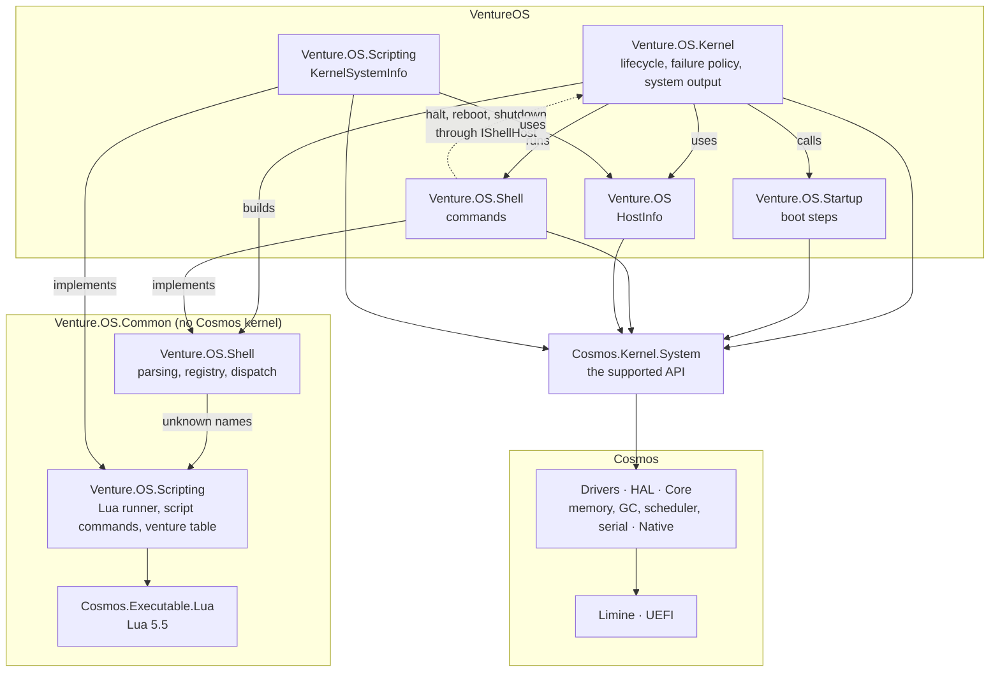
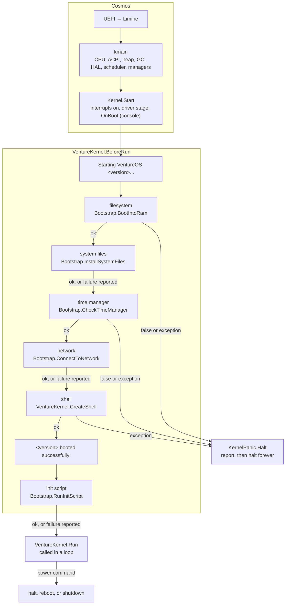
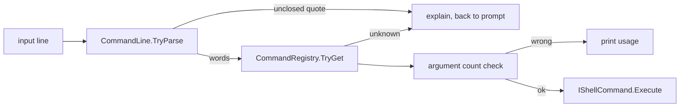

# VentureOS architecture

> **Last reviewed:** 2026-11-10 · **Last updated:** 2026-11-10 · **Change:** minor (RAM-first goals; the desktop direction) · **Target:** Cosmos gen3 3.0.94, x64 (ARM64 builds)

## Current state (2026-11-10)

What exists on `main` today. The numbered sections below describe the
design, and mark what's planned rather than built; where the code differs,
the code wins and this page is out of date.

- **Projects:** the kernel, `Venture.OS` (16 C# files, plus Lua system
  scripts in `system/`); a kernel-free library, `Venture.OS.Common` (15
  files: the shell framework and Lua support); and an xUnit v3 test project
  for the library, `Venture.OS.Common.Tests` (252 tests, including runs of
  the shipped scripts and library).
  Namespaces: `Venture.OS`, `Venture.OS.Kernel`, `Venture.OS.Startup`,
  `Venture.OS.Shell`, `Venture.OS.Shell.Commands`, and
  `Venture.OS.Scripting`.
- **Platform:** Cosmos gen3 3.0.94 on .NET 10, compiled ahead of time to an
  ELF kernel that Limine boots from an ISO. x64 is the primary target; ARM64
  builds but hasn't been booted.
- **Boot:** six steps, three critical (RAM filesystem, timer, shell) and three
  optional (system files, network, and `init.lua` after the banner). A critical failure panics with a report; an optional
  one is reported and boot continues. Both paths are proven in headless
  boots.
- **Shell:** a command registry with six built-in commands (`help`,
  `clear`, `lua`, `halt`, `reboot`, `shutdown`), plus Lua script commands
  from `/mnt/system/commands` (`echo`, `info`, `net`) that reach the kernel
  through the `venture` table, and input split into a command and arguments
  with quoting. A failing command reports its error and
  returns to the prompt.
- **Storage:** a 32 MiB RAM disk, formatted FAT16 and mounted at `/mnt`,
  with the system files built into the kernel installed to `/mnt/system`.
  Nothing persists across boots.
- **Network:** DHCP on the first NIC when one is present. Nothing uses the
  network after boot.
- **Not built yet:** file commands (Blue Water); `.app` bundles (Saluki); a
  desktop (Borealis); a CI boot check, ARM64 builds in CI, and published ISOs
  (every-stage work on the roadmap). See the
  [roadmap](./ROADMAP.md); verified status is in the
  [scorecard](./scorecard.md).

---

## 1. Goals and principles

**Goals**

- A hobby operating system in C#, the spiritual successor to
  [TOMAS](https://github.com/tonytins/tomas/), built to production
  standards because I use it myself.
- First a usable shell OS (the alpha gate): reliable boot, a shell with
  arguments, and commands to inspect and control the system.
- Then: a system that runs from RAM, extended in Lua: script commands, a
  system library, and apps that open and close cleanly as owners.
- Later: a Tiger-style desktop with `.uix` (UIScript) interfaces, files,
  networking, ARM64, and published ISOs. Keeping changes across reboots is
  optional.

**Principles**

1. **Cosmos owns the hardware; VentureOS owns the experience.** Drivers,
   memory, interrupts, the scheduler, the VFS, and the network stack come
   from Cosmos. VentureOS decides what runs at boot, what counts as fatal,
   what the user sees, and what the shell offers.
2. **Never crash uncontrolled.** During boot, critical steps panic
   deliberately and optional steps degrade. After boot, nothing may stop the
   system except the user's `halt` (§5).
3. **Observable without a screen.** Anything that tells you whether the
   system is healthy (boot step results, the version, failures, panics)
   reaches the serial log as well as the console, so a headless boot or CI
   can check it (§6).
4. **One version string.** The version and build the user sees on screen
   are the ones in the serial log and in a panic report (§10).
5. **Stay on Cosmos's supported API.** VentureOS programs against
   `Cosmos.Kernel.System` and the `IBlockDevice` contract. Cosmos's
   experimental APIs (`COSMOS0001`–`COSMOS0003`) and plugs are a decision I
   make deliberately, not a default.
6. **Describe only what works.** Docs, the scorecard, and the changelog
   record what a build or boot has shown, and say plainly what hasn't been
   verified.

### 1.1 Riding Cosmos's churn

Cosmos gen3 is young and moves fast. The 3.0.87 → 3.0.94 upgrade alone
renamed the filesystem, timer, network, input, and block-device namespaces
and two filesystem names. Its docs describe only the latest release. The
lesson is to keep Cosmos's surface small and in known places, so an upgrade
is a short list of mechanical fixes rather than a hunt.

**Rules I adopt now** (cheap today, expensive once the shell and storage
grow):

| Concern | Rule | Where |
|---|---|---|
| **Namespaces** | Cosmos namespaces are imported once, in `GlobalUsings.cs`. A rename is a one-file fix. | `GlobalUsings.cs` |
| **Cosmos calls** | Hardware and subsystem setup goes through `Startup/` steps, not scattered through commands. | `Startup/Bootstrap.cs` |
| **Version pins** | `Cosmos.Sdk` and the `Cosmos.*` packages move together, in a change of their own, with a build and a headless boot. | `Venture.OS.csproj` |
| **Docs drift** | Check an API exists in the pinned version before using it; the build is the quickest check. | [cosmos-gen3 skill](../.agents/skills/cosmos-gen3/SKILL.md) |
| **Experimental APIs** | Each one needs an explicit `<NoWarn>` and a deliberate decision from me, so a seam can't creep in unnoticed. | `Venture.OS.csproj` |

The test: **a Cosmos upgrade should touch `GlobalUsings.cs`, `Startup/`,
and the project file, and nothing in the shell.**

---

## 2. Project layout

```text
VentureOS/
├─ src/
│  ├─ Venture.slnx              solution
│  ├─ Venture.OS.Common/        kernel-free library: no Cosmos, AOT-compatible, warnings as errors
│  │  └─ Shell/                 Venture.OS.Shell: the shell framework
│  │     ├─ CommandLine.cs      splits a line into words
│  │     ├─ CommandRegistry.cs  commands by name; source of `help`
│  │     ├─ CommandShell.cs     parse, look up, check arguments, run
│  │     ├─ IShellCommand.cs    what every command declares
│  │     ├─ ShellContext.cs     what a command can reach
│  │     ├─ IShellOutput.cs     where commands write
│  │     ├─ IShellHost.cs       halt, reboot, shutdown, implemented by the kernel
│  │     ├─ ICommandSource.cs   another place to find commands, after the registered ones
│  │     └─ ShellOutputWriter.cs  a TextWriter that hands complete lines to IShellOutput
│  │  └─ Scripting/             Venture.OS.Scripting: Lua system support
│  │     ├─ EmbeddedFile.cs     a file built into the kernel image
│  │     ├─ SystemDirectory.cs  writes those files to disk, after checking every path
│  │     ├─ LuaRunner.cs        runs Lua for a command: output to the shell, errors reported
│  │     ├─ LuaRepl.cs          the interactive Lua prompt behind plain `lua`
│  │     ├─ ScriptCommands.cs   <name>.lua files as commands
│  │     ├─ LuaOwner.cs         lasting Lua code and the undo list for what it set up
│  │     ├─ RuntimeCommands.cs  commands registered with venture.command, and who may take which name
│  │     ├─ ShellLibrary.cs     venture.command, for code with a lasting owner
│  │     ├─ ISystemInfo.cs      what the kernel reports to scripts
│  │     └─ VentureLibrary.cs   the `venture` table
│  ├─ Venture.OS.Common.Tests/  xUnit v3 tests for Venture.OS.Common
│  └─ Venture.OS/
│     ├─ Venture.OS.csproj         Cosmos SDK project: package pins, CosmosKernelClass
│     ├─ GlobalUsings.cs           every Cosmos namespace, plus Venture.OS.Kernel
│     ├─ HostInfo.cs               name, version, and build number
│     ├─ Scripting/                Venture.OS.Scripting: KernelSystemInfo, ISystemInfo read from Cosmos
│     ├─ Kernel/                   Venture.OS.Kernel: the lifecycle and how the system reports and stops
│     │  ├─ VentureKernel.cs       the kernel class: BeforeRun (boot), Run (shell loop)
│     │  ├─ KernelLog.cs           system messages to serial and the console
│     │  └─ KernelPanic.cs         deliberate, reported halt
│     ├─ Startup/                  Venture.OS.Startup: boot steps
│     │  ├─ Bootstrap.cs           RAM disk, timer check, network and DHCP
│     │  └─ BootRamDisk.cs         in-memory IBlockDevice
│     ├─ Shell/                    Venture.OS.Shell: what needs Cosmos
│     │  ├─ ConsoleShellOutput.cs  IShellOutput on the console
│     │  └─ Commands/              one class per command
│     ├─ system/                   Lua system files, built into the kernel and installed to /mnt/system
│     │  ├─ init.lua               runs once after boot; prints the help hint
│     │  ├─ commands/              Lua command scripts: echo.lua, info.lua, net.lua
│     │  └─ lib/venture/args.lua   the system library: the venture.args argument parser
│     ├─ Bootloader/limine.conf    Limine boot entry
│     ├─ GitInfo.txt               base version
│     └─ src/C/                    reserved for native C sources (empty)
├─ global.json                  opts dotnet test into Microsoft.Testing.Platform
├─ docs/                        architecture, roadmap, scorecard
├─ .agents/skills/              C# and Cosmos guidance for agents
├─ .github/workflows/cosmos.yml CI: tests, then build with cached Cosmos tools
├─ changelog.md                 user-facing history
└─ run.sh                       check, build, and run x64 locally (--headless for serial only)
```

**Naming.** The kernel class is `VentureKernel` rather than `Kernel`,
because a class can't share its name with the `Venture.OS.Kernel`
namespace. Cosmos looks for `<RootNamespace>.Kernel` by default, so the
project file sets `CosmosKernelClass` to `Venture.OS.Kernel.VentureKernel`.

**Every .NET project lives under `src/`**, tests included, each in its own
folder and listed in `src/Venture.slnx`.

**Growth.** New subsystems (commands, drivers, filesystems) get their own
folder and namespace under `Venture.OS`, as `Kernel/`, `Startup/`, and
`Shell/` do. A new command is a class in `Shell/Commands/` plus one
`Register` call in `VentureKernel.CreateShell`.

---

## 3. Layering



**Rules:**

1. **Only `Venture.OS.Kernel` stops the system.** Boot steps report success
   with `bool` (critical) or by returning (optional), and throw when
   something unexpected happens. Shell commands ask the kernel to halt,
   reboot, or shut down through `IShellHost`. Neither calls `KernelPanic`,
   `Power`, or `Stop` itself.
2. **Boot steps don't know whether they're critical.** `VentureKernel`
   decides that when it runs them (§4), so the policy lives in one place.
3. **System messages go through `KernelLog`** (§6). Command output goes
   through `IShellOutput`, which writes to the console.
4. **VentureOS code reaches Cosmos only through `Cosmos.Kernel.System`**
   and `IBlockDevice`. Cosmos's internal namespaces (`Cosmos.Kernel.Core`
   and the HAL beyond `IBlockDevice`) are off limits.
5. **No `unsafe` code.** Cosmos keeps pointers in its Core layer; VentureOS
   has no need for them.
6. **`Venture.OS.Common` never references the Cosmos kernel.** It holds
   logic that doesn't need hardware, so it can be tested on ordinary .NET.
   `Cosmos.Executable.Lua` is the one Cosmos-named package it uses, because
   it runs on ordinary .NET too. Scripts reach the kernel only through
   `ISystemInfo`, which the kernel implements. It builds
   with the AOT analyzers and warnings as errors, so code the kernel
   couldn't compile ahead of time fails there first. Its root namespace is
   `Venture.OS`, so a type keeps its namespace when it moves into it.

---

## 4. Boot



The filesystem, time manager, and shell steps are critical
(`RunCriticalStep`); the system files, network, and init script steps are
optional (`RunOptionalStep`). `init.lua` prints through `KernelLogOutput`, so
its output reaches serial too, and it can use the `venture` table. Ctrl+C or
Esc stops it, and so does a 10-second limit, so a script that never finishes
can't keep the shell from starting, even in a headless boot.

| Step | Kind | Succeeds when | On failure |
|---|---|---|---|
| Filesystem | critical | The RAM disk registers, formats as FAT16, and mounts at `/mnt` | Reports which of the three failed, then panics |
| System files | optional | Every file under `src/Venture.OS/system/` is written to `/mnt/system` | An invalid path or I/O error is reported and boot continues; the built-in C# commands still work |
| Time manager | critical | Cosmos reports `TimerManager.IsInitialized` | Reports it, then panics |
| Shell | critical | Every command registers | Registration only fails on a programming error, such as two commands with one name; it panics |
| Network | optional | Always returns; records the MAC and DHCP address when it can | No NIC, a DHCP timeout, or no address is reported; an exception is reported and boot continues |
| Init script | optional | `/mnt/system/init.lua` runs to the end, after the banner so the screen clear doesn't hide its output | A missing script or a Lua error (with its traceback) is reported, and the shell starts anyway |

A step is **critical** when the system can't do its job without it, so
running on would only make later failures harder to understand. Adding a
boot step means choosing its kind and saying why in the change.

Each step pauses for 0.5 s (`BootStepDelay`). That's deliberate: without
it, boot is too fast to read on screen.

---

## 5. Failure model

| When | What happens | How |
|---|---|---|
| A critical boot step returns `false` or throws | Deliberate panic: report, then halt forever | `RunCriticalStep` → `KernelPanic.Halt` |
| An optional boot step throws | Reported; boot continues without it | `RunOptionalStep` |
| A command throws | Reported; back to the prompt | `VentureKernel.Run` catches everything |
| Invalid input reaches a device or API | A specific exception (`ArgumentException`, `ArgumentOutOfRangeException`), caught by the boundaries above | e.g. `BootRamDisk` range checks |
| The user mistypes a command | The shell explains: unknown command, the usage line, or an unclosed quote; nothing throws | `CommandShell.Execute` |
| The user types `halt`, `reboot`, or `shutdown` | `Stop()` ends the loop and Cosmos halts the CPU; `Power.Reboot()` or `Power.Shutdown()` | `VentureKernel` through `IShellHost` |

**The panic.** `KernelPanic.Halt` writes a report with the version, the
failed step, and the reason (for an exception, its type name and message),
then calls `Power.Halt()` in a loop, because Cosmos's halt returns on the
next interrupt. Cosmos has a panic of its own, but it's internal. A forced
panic has been verified in a headless boot: the report reached serial, no
later step ran, and the shell never started.

**What isn't caught.** Interrupt and timer callbacks run outside these
boundaries, and an exception there halts the kernel. VentureOS registers
none yet. When it does, they must not throw, allocate, or block
([cosmos-gen3 skill](../.agents/skills/cosmos-gen3/SKILL.md) §4).

---

## 6. Output

| Channel | What goes there | API |
|---|---|---|
| Console | Everything the user reads: boot messages, the banner, command output | `Console` (Cosmos `KernelConsole`, set up by `base.OnBoot()`) |
| Serial | System messages, each line prefixed `[Venture] `, beside Cosmos's own `[KMAIN]`, `[KERNEL]`, and `[Kernel]` lines | `KernelLog.WriteLine` → Cosmos `Log` |

`KernelLog.WriteLine` writes serial first, then the console, so a message
survives even when the console is what failed. Serial is COM1 on x64, and
`cosmos run` connects it to the terminal. Command output stays on the
console only, so the serial log stays a record of the system's health
rather than a transcript.

---

## 7. Storage

```text
BootRamDisk (IBlockDevice, 512-byte blocks × 65,536 = 32 MiB)
  → FatFileSystemType, registered as "ramfat"
  → formatted FAT16 → mounted at /mnt
  → reachable through System.IO (File, Directory, streams)
```

- **`BootRamDisk`** validates its size when constructed (no zero sizes, no
  disk larger than one .NET array) and range-checks every read and write,
  throwing as Cosmos's `IBlockDevice` contract requires instead of
  overflowing or copying the wrong range.
- `/` is Cosmos's read-only virtual root, so files live under `/mnt`.
- **System files.** Everything under `src/Venture.OS/system/` is turned
  into byte arrays in generated C# at build time (`GenerateSystemFiles` in
  `Venture.OS.csproj`), because Cosmos 3.0.94 doesn't expose Limine's
  modules, so the ISO can't hand the kernel loose files. At boot,
  `SystemDirectory.Install` checks every path, then writes the files to
  `/mnt/system`. The RAM disk starts empty, so the system files always match
  the kernel, and edits made on the running system are lost at reboot.
  Cosmos's FAT16 keeps long file names (a 23-character name was read back in
  a boot test) and ignores case when looking names up.
- **Not built yet:** file commands (Blue Water). VentureOS runs from RAM, as
  many small systems do; keeping changes on a disk is later and optional,
  and whether VentureOS formats blank disks itself is an open decision
  (§13). `cosmos run --disk <image>` attaches a disk when that work starts.

---

## 8. Network

- At boot, if Cosmos found a NIC, `ConnectToNetwork` reports its name and
  MAC and runs DHCP. Nothing caches the result: `net` reads `NetworkManager`
  directly, so it shows the current state. Under QEMU the default x64 NIC is an
  e1000e, and DHCP leases 10.0.2.15.
- `NetworkManager.Primary` is a struct handle that may name no device, so
  it's only read after checking `NetworkManager.DeviceCount`.
- **Not built yet:** DNS (DHCP reports a server, but it isn't registered),
  and any use of the network after boot (Pere Marquette).
- Cosmos's limits apply: no TLS, and TCP doesn't retransmit.

---

## 9. Shell

`VentureKernel.Run` prints a prompt, reads a line with `Console.ReadLine()`
(Cosmos provides line editing), and passes it to `CommandShell.Execute`.
Cosmos calls `Run` again as soon as it returns, so it never loops itself.



- **Parsing** (`CommandLine`): words are separated by spaces or tabs.
  `'single quotes'` are literal, `"double quotes"` allow `\"` and `\\`,
  and a backslash outside quotes makes the next character literal. An
  unclosed quote or a trailing backslash is reported, not thrown.
- **Commands** (`IShellCommand`) declare a name (lowercase letters, digits,
  and hyphens), a one-line summary, a usage line, and their minimum and
  maximum argument counts. The shell checks the count before running a
  command, so commands don't repeat that check.
- **The registry** (`CommandRegistry`) rejects invalid and duplicate names,
  looks names up ignoring case, and lists commands in name order. `help`
  is generated from it. Names it doesn't know go to its sources
  (`ICommandSource`) in order, so a source can never replace a built-in.
- **Script commands** (`ScriptCommands`, the one source) are
  `/mnt/system/commands/<name>.lua` files. The directory is read on every
  lookup, so a script saved on the running system works at once; if it's
  missing, there are just no script commands. Only names that pass the
  registry's rule are looked up, so a name can't climb out of the directory.
  A script's leading `--` comments (`ScriptHeader`) give its summary, a
  `-- Usage:` line, and a `-- Needs:` line; it gets its arguments as `...`,
  and it checks them itself.
- **Where it lives.** The framework (`CommandLine`, `CommandRegistry`,
  `CommandShell`, `ShellContext`, the interfaces, and script commands) is in
  `Venture.OS.Common` and covered by tests, including real Lua runs on
  ordinary .NET. The built-in commands and `ConsoleShellOutput` are in the
  kernel, because they use Cosmos.
- **Output and power.** Commands write through `IShellOutput` and ask for
  halt, reboot, or shutdown through `IShellHost`, which `VentureKernel`
  implements. That keeps power calls in `Venture.OS.Kernel` and lets tests
  capture output later.

| Command | Does |
|---|---|
| `help [command]` | Lists the commands, or shows one's summary and usage |
| `clear` | Clears the screen |
| `echo [text...]` | Lua script: prints its arguments on one line, separated by single spaces |
| `info` | Lua script: version and build, commit, Cosmos version, uptime, and free and total memory |
| `lua [code]` | Runs one chunk of Lua 5.5 in a fresh interpreter, or with no code, opens a Lua prompt |
| `net` | Lua script: device, MAC, link, readiness, and IPv4 address, subnet, and gateway |
| `halt` | Ends the shell loop; the CPU halts and the machine stays on |
| `reboot` | Restarts through ACPI |
| `shutdown` | Powers off through ACPI |

Uptime comes from `Stopwatch`, which Cosmos plugs to the CPU's timestamp
counter on x64, so it counts from when the CPU started. Under `cosmos run`,
QEMU runs with `-no-reboot -no-shutdown`, so `reboot` and `shutdown` pause
the virtual machine instead; without those flags both work.

**Lua.** `lua <code>` and script commands both run through `LuaRunner`,
on `Cosmos.Executable.Lua`, a Lua 5.5 interpreter from the CosmosOS
organization. Each run gets a fresh interpreter, disposed afterwards, so
nothing carries over. `print`, `io.write`, and `io.stderr` go through
`IShellOutput` (`ShellOutputWriter` joins pieces into lines), and relative
paths in `dofile` and `io.open` start at `/mnt`. Lua errors are reported with
their traceback, and `os.exit` with a non-zero status as that status; neither
reaches the shell loop.

**The Lua prompt.** Plain `lua` opens `LuaRepl`, a read–eval–print loop in one
interpreter, so values carry over between lines until `exit`. It prompts with
`lua> `, so it can't be mistaken for the shell. A line is tried first as an
expression, whose value is printed (`1 + 1` prints `2`), then as statements;
one left unfinished, such as `for i = 1, 3 do`, continues at `...> `. Ctrl+C
or Esc stops only the running line: `LuaRunner.Create` hands the prompt a way
to clear the latched stop before each line. Errors show only their message,
and `os.exit` or the end of the input leaves the prompt. As in the reference
`lua`, an expression's value is printed even when it's incidental, so
`io.write('x')` also prints the file it returns. The prompt is written in C#
rather than with the package's `RunPrompt`, which uses the shell's own `> `
prompt and has no point between lines to clear the stop.

**The system library.** Lua modules that ship with the system live in
`/mnt/system/lib`, and `require` looks there only (`package.path` is set to
`/mnt/system/lib/?.lua` and `?/init.lua`; native modules are off). Modules
are namespaced under `venture.`, so plain names stay free for scripts and
apps. Tests load the shipped files with `require`, as scripts do.

`venture.args` is the first module: a command declares its arguments and
options, and gets parsing, clear errors, and a generated `--help`:

```lua
local options = require("venture.args").parse({...}, {
  name = "greet",
  summary = "Greet someone.",
  arguments = { "name" },
  options = { loud = { short = "l", summary = "Shout it." } },
})
if not options then return end
```

It reads `--name value`, `--name=value`, `-s value`, combined short flags
(`-lq`), and `--` before words that start with a dash; negative numbers count
as arguments. Option types are `flag`, `string`, and `number`. A user's
mistake prints the problem and the usage line and returns `nil`; a mistake in
the declaration is a Lua error, since it's the command's bug. It's opt-in, so
the shell's contract with commands doesn't change: they still get their words
as `...`. The shell can't see a script's options without running it, so
`help <command>` keeps showing the header, and `<command> --help` shows the
options.

**The `venture` table** is how scripts reach the kernel, in `lua` and in
script commands alike. Its functions return plain values or tables, and the
scripts do the formatting:

| Function | Scope | Returns |
|---|---|---|
| `venture.version()` | *(always)* | `{ name, version, build, commit, cosmos, display }` |
| `venture.uptime()` | `system` | Whole seconds since the CPU started counting, or `nil` |
| `venture.memory()` | `system` | `{ free, total }` in bytes, or `nil` |
| `venture.command{...}` | `shell` | Registers a command for as long as its owner lasts; see **Owners** below |
| `venture.shell(line)` | `shell` | Runs a line as if typed at the shell; in `init.lua` and at the `lua` prompt |
| `venture.net()` | `network` | `nil` without an adapter, else `{ device, mac, link_up, ready, address, subnet, gateway }`; the last three are `nil` until IPv4 is configured |

**Scopes.** A script declares what it reaches with `-- Needs:` in its header,
like an app's permissions, such as `-- Needs: system, network`. Scopes are
broad, so new functions in an area don't need new names. Every function is in
the table, but one outside the declared scopes raises
`venture.net needs "-- Needs: network" in the script's header`. A scope
VentureOS doesn't know, or one it has reserved but doesn't offer yet
(`files`), keeps the script from running at all, with the reason, so a script
written for a newer VentureOS fails clearly rather than half working.
`help <command>` shows a script's needs. `init.lua` follows the same rule;
`lua` gets every scope, since it's the user typing. Scopes cover only the
`venture` table: Lua's own `io` still reaches the RAM disk, until `files`
replaces it (Blue Water).

**Owners and undo.** After the ideas in "A Programming Paradigm for
Spatiotemporal Composability", lasting Lua code runs as a `LuaOwner`: one
interpreter that outlives a single run, and a list of ways to undo what the
code set up. Ending the owner runs those undos newest first, then disposes
the interpreter, so nothing it set up outlives it. There are two owners:

| Owner | Lives | Its commands |
|---|---|---|
| `init.lua` | The whole boot; if it fails partway, its undos run at once, so no half-registered commands are left | Until shutdown |
| A `lua` prompt session | Until `exit` or the end of its input | Vanish on `exit`, restoring any script they replaced |

One-shot code (`lua "code"` and script commands) has no lasting owner, so
`venture.command` and `venture.shell` there explain that they only work in
`init.lua` and at the `lua` prompt.

At the prompt, a line starting with `!` runs the rest as a shell command, so
a command defined there can be tried, changed, and tried again before `exit`
clears it away. `venture.shell(line)` does the same from Lua. Each nested call
goes through C#, and a .NET stack overflow can't be caught, so
`venture.shell` refuses to nest more than 8 deep, which stops a command that
runs itself. A call back into an owner while other code in it is running
restores the caller's output and stop afterwards. The prompt prints the
handle a registration returns as `command "name"`.

`venture.command { name, summary, usage, run }` registers a command through
`RuntimeCommands`, the first command source, so it wins a lookup. Its undo
unregisters it and releases its `run` function; the handle it returns can run
that undo early with `:remove()`. A runtime command runs in its owner's
interpreter, so state carries over between calls, with its output going to
whoever ran it and its own Ctrl+C stop (`init.lua`'s 10-second limit covers
only its startup). `help <command>` shows `From:` its owner. Who may take a
name:

- No one can take a built-in command's name.
- A name another owner registered is taken until that owner ends or removes
  it; the same owner registering it again replaces its earlier command.
- Only code the user types (the `lua` prompt) may replace a system script
  command, and it says so: `echo now replaces the
  echo script until you exit.` `init.lua` and, later, apps can't, so nothing
  installed can quietly take over a system command.

`VentureLibrary` builds the table from an `ISystemInfo`, which
`KernelSystemInfo` implements by reading Cosmos on every call, so scripts see
current values. A value that can't be read reliably (an uptime counter with
no frequency, a page count that would overflow) is `nil`, and an exception
from a device becomes a Lua error that `pcall` can catch. Tests use a fake
`ISystemInfo` and run the shipped `info.lua` and `net.lua` against it.

**Stopping Lua.** Ctrl+C or Esc stops `lua` and script commands; `init.lua`
also stops after 10 seconds. `LuaRunner` takes a stop check (`ScriptStop`
builds time limits and combines checks; `KeyboardStop` reads the keyboard
without blocking) and installs it with the standard `debug.sethook` as a count
hook that runs every 1,000 instructions. A reason it returns becomes a Lua
error with that message, such as `Interrupted.`, reported like any other
error, with its traceback. Three things keep a script from escaping it:

- The stop latches. A key press is read only once, so once a check says stop,
  the runner keeps saying it, and the hook then runs on every instruction. The
  error escapes a `pcall` that catches it almost at once.
- `debug.sethook` keeps its hook per thread, and a new coroutine would inherit
  only the count, so `coroutine.create` and `coroutine.wrap` are replaced with
  versions that hook each new coroutine.
- `debug.sethook` is then replaced with a function that raises
  `debug.sethook is reserved by VentureOS`.

Keys typed while a script runs are read by the check and discarded.

Cosmos's limits apply: local time is UTC, `os.getenv` returns nil, and there
is no `io.popen` or `/tmp`.

---

## 10. Version and build identity

- **Version:** [GitInfo](https://github.com/devlooped/GitInfo) reads
  `GitInfo.txt` (base `major.minor.patch`) and adds the number of commits
  that changed the `src/Venture.OS/` folder since that file changed. Commits
  that only touch docs or CI don't change the version. CI checks out full
  history for this.
- **Moving `GitInfo.txt` resets the count.** GitInfo finds the file's last
  change with `git log` without following renames, so a move looks like a
  new base. Set a new base version in the same commit as any move: moving
  the project into `src/` started 0.2.0.
- **Build number:** derived from the commit hash: its first four characters
  read as a number and reduced to at most six digits. It identifies a build
  but doesn't increase over time.
- **`HostInfo.DisplayVersion`** (`VentureOS 0.2.0 (Build 123456)`) is the
  one string used at the start of boot, in the banner, and in the panic
  report.
- **The changelog** records only versions with changes a user would notice,
  so its latest entry trails the version the kernel reports.

---

## 11. Build, run, and CI

- **Locally:** `dotnet test --project src/Venture.OS.Common.Tests`, then
  `cosmos check` (always first before building: tool status and CLI updates),
  `cosmos build -p src/Venture.OS`, then `./run.sh` (add `--headless`
  for serial only) or `cosmos run -p src/Venture.OS --headless`. `--nic none`
  boots without a network card.
- **CI** (`.github/workflows/cosmos.yml`): on every push and pull request,
  runs the tests (before the Cosmos toolchain, so a failing test stops the
  run early), then builds x64. The Cosmos CLI, patcher, and toolchain are cached per Cosmos
  version and NuGet packages per project file, so tools are downloaded only
  when the pinned version changes.
- **Not built yet:** ARM64 builds and a headless boot check in CI, and
  published ISOs (every-stage work on the roadmap).

---

## 12. Testing and verification

| Kind | Today | Planned |
|---|---|---|
| Build | x64 with no warnings, locally and in CI; ARM64 locally | ARM64 in CI |
| Boot | Headless boots by hand, read through `[Venture]` serial lines | CI boots headless and fails on a panic or a missing banner |
| Failure paths | A forced panic and a no-NIC boot, verified by hand | Kept as repeatable checks |
| Logic | 59 xUnit v3 tests for `Venture.OS.Common`: parsing, the registry, and dispatch. Run locally and in CI | Each new kernel-free type comes with tests |

xUnit v3 runs on Microsoft.Testing.Platform, which the .NET 10 SDK's
`dotnet test` only uses when `global.json` opts in; without it, `dotnet
test` stops with an error.

Cosmos's own test kernels use `Cosmos.TestRunner.Framework`. Whether it's
published for use outside the Cosmos repository hasn't been confirmed.

---

## 13. Open decisions

1. **Formatting disks.** Whether VentureOS formats a blank disk itself, or
   only mounts existing FAT partitions (Blue Water). The Cosmos docs warn
   against testing filesystem code on real hardware.
2. **Telnet.** Whether to serve a shell over the network, given that it has
   no login and sends everything in the clear (Pere Marquette).
3. **Experimental Cosmos APIs.** None are used. Any future need, such as
   custom drivers through the driver kit, is a decision I'll make when it
   comes up.

## Revision history

| Date | Change | Summary |
|---|---|---|
| 2026-11-10 | minor | Direction (§1, §7): VentureOS runs from RAM, with persistence later and optional; the desktop will use `.uix` (UIScript) interfaces. |
| 2026-11-10 | minor | The `lua` prompt as an owner (§9): its commands vanish on `exit`; `!` and `venture.shell` run shell commands, nested at most 8 deep. |
| 2026-11-10 | minor | Owners and `venture.command` (§9): `init.lua` runs as a `LuaOwner` and can register commands under the new `shell` scope; they're undone if it fails, and only user-typed code may replace system scripts. |
| 2026-11-10 | minor | The system library (§2, §9): `require` loads from `/mnt/system/lib`, and `venture.args` parses a command's arguments and options with a generated `--help`. |
| 2026-11-10 | minor | The Lua prompt (§2, §9): plain `lua` opens `LuaRepl`, where values carry over between lines and Ctrl+C stops only the running line. |
| 2026-11-10 | minor | Scopes (§9): scripts declare `-- Needs: system` or `network`; the `venture` table refuses undeclared functions, and unknown or reserved scopes keep a script from running. |
| 2026-11-10 | minor | Stopping Lua (§4, §9): Ctrl+C or Esc stops `lua` and script commands through a count hook, and `init.lua` also stops after 10 seconds. |
| 2026-11-10 | minor | `init.lua` (§2, §4): runs once after the banner as an optional step, with its output on serial through `KernelLogOutput`; it now prints the help hint. |
| 2026-11-06 | minor | The `venture` table (§2, §3, §9): scripts reach the kernel through `ISystemInfo`, and `info` and `net` are now Lua scripts. |
| 2026-11-06 | minor | Script commands (§2, §9): `/mnt/system/commands/<name>.lua` runs as `name` through a new command source, Lua output goes through `IShellOutput`, and `echo` is now a script. |
| 2026-11-06 | minor | System files (§2, §4, §7): Lua scripts under `src/Venture.OS/system/` are built into the kernel and installed to `/mnt/system` by a new optional boot step. |
| 2026-11-05 | minor | Lua (§9): `Cosmos.Executable.Lua` replaces `LuaCSharp`, and the `lua` command runs one chunk; the Lua library is no longer an open decision (§13). |
| 2026-11-05 | minor | `HostInfo` holds only the build's identity; the network fields it cached at boot were never read and are gone (§2, §3, §8). |
| 2026-11-05 | minor | The `echo` command, bringing the shell to eight commands (§9). |
| 2026-10-15 | minor | The shell framework moved into `Venture.OS.Common`, a library with no Cosmos reference, tested by `Venture.OS.Common.Tests` (xUnit v3, 59 tests) locally and in CI (§2, §3 rule 6, §9, §11, §12). |
| 2026-10-15 | minor | The project moved into `src/` (§2, §11), and the version base became 0.2.0 because moving `GitInfo.txt` resets GitInfo's count (§10). |
| 2026-10-15 | minor | The shell (§9): parsing, the registry, seven commands, and the shell boot step; layering and boot diagrams updated. Versioning corrected: only commits that change `Venture.OS/` raise the version. |
| 2026-10-15 | major | First architecture overview: principles, the rules for absorbing Cosmos changes, layout, layering, boot, failure model, output, storage, network, shell, versioning, build and CI, testing, and open decisions. |
