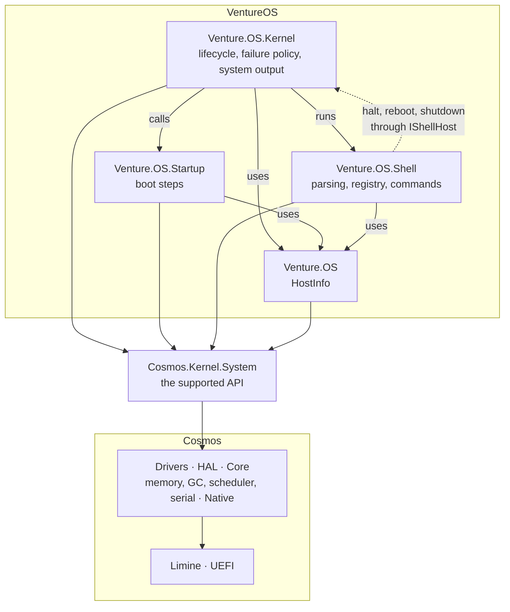
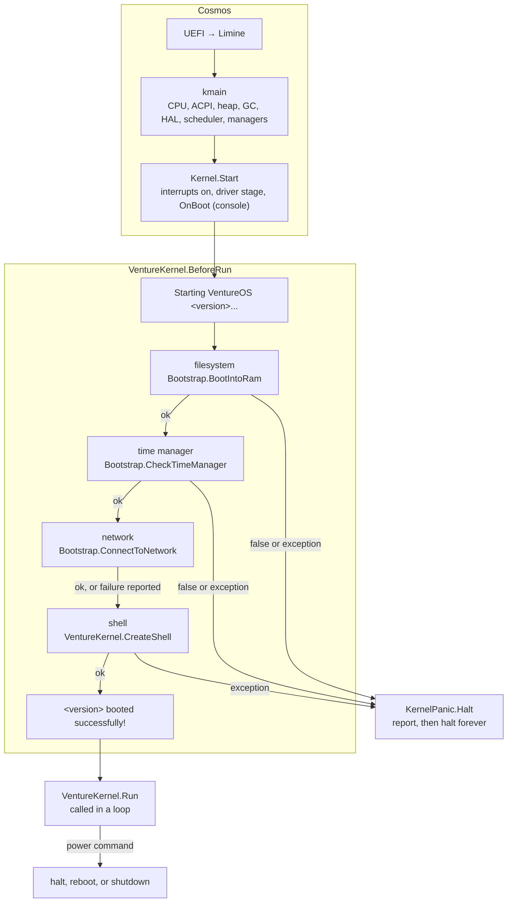
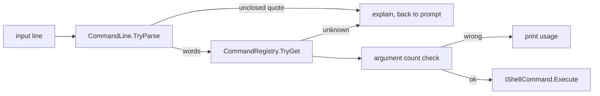

# VentureOS architecture

> **Last reviewed:** 2026-10-15 · **Last updated:** 2026-10-15 · **Change:** minor (project moved into `src/`; version base 0.2.0) · **Target:** Cosmos gen3 3.0.94, x64 (ARM64 builds)

## Current state (2026-10-15)

What exists on `main` today. The numbered sections below describe the
design, and mark what's planned rather than built; where the code differs,
the code wins and this page is out of date.

- **Project:** one kernel project, `Venture.OS`, with 22 C# files in 5
  namespaces (`Venture.OS`, `Venture.OS.Kernel`, `Venture.OS.Startup`,
  `Venture.OS.Shell`, `Venture.OS.Shell.Commands`). No test project yet.
- **Platform:** Cosmos gen3 3.0.94 on .NET 10, compiled ahead of time to an
  ELF kernel that Limine boots from an ISO. x64 is the primary target; ARM64
  builds but hasn't been booted.
- **Boot:** four steps, three critical (RAM filesystem, timer, shell) and one
  optional (network). A critical failure panics with a report; an optional
  one is reported and boot continues. Both paths are proven in headless
  boots.
- **Shell:** a command registry with seven commands (`help`, `clear`,
  `info`, `net`, `halt`, `reboot`, `shutdown`), and input split into a
  command and arguments with quoting. A failing command reports its error and
  returns to the prompt.
- **Storage:** a 32 MiB RAM disk, formatted FAT16 and mounted at `/mnt`.
  Nothing persists across boots.
- **Network:** DHCP on the first NIC when one is present. Nothing uses the
  network after boot.
- **Not built yet:** tests (Wolverine), persistent storage (Blue Water), Lua (Illini). See the
  [roadmap](./ROADMAP.md); verified status is in the
  [scorecard](./scorecard.md).

---

## 1. Goals and principles

**Goals**

- A hobby operating system in C#, the spiritual successor to
  [TOMAS](https://github.com/tonytins/tomas/), built to production
  standards because I use it myself.
- First a usable shell OS (the alpha gate): reliable boot, a shell with
  arguments, and commands to inspect and control the system.
- Later: persistent files, networking, Lua scripting, ARM64, and published
  ISOs.

**Principles**

1. **Cosmos owns the hardware; VentureOS owns the experience.** Drivers,
   memory, interrupts, the scheduler, the VFS, and the network stack come
   from Cosmos. VentureOS decides what runs at boot, what counts as fatal,
   what the user sees, and what the shell offers.
2. **Never crash uncontrolled.** During boot, critical steps panic
   deliberately and optional steps degrade. After boot, nothing may stop the
   system except the user's `halt` (§5).
3. **Observable without a screen.** Anything that tells you whether the
   system is healthy (boot step results, the version, failures, panics)
   reaches the serial log as well as the console, so a headless boot or CI
   can check it (§6).
4. **One version string.** The version and build the user sees on screen
   are the ones in the serial log and in a panic report (§10).
5. **Stay on Cosmos's supported API.** VentureOS programs against
   `Cosmos.Kernel.System` and the `IBlockDevice` contract. Cosmos's
   experimental APIs (`COSMOS0001`–`COSMOS0003`) and plugs are a decision I
   make deliberately, not a default.
6. **Describe only what works.** Docs, the scorecard, and the changelog
   record what a build or boot has shown, and say plainly what hasn't been
   verified.

### 1.1 Riding Cosmos's churn

Cosmos gen3 is young and moves fast. The 3.0.87 → 3.0.94 upgrade alone
renamed the filesystem, timer, network, input, and block-device namespaces
and two filesystem names. Its docs describe only the latest release. The
lesson is to keep Cosmos's surface small and in known places, so an upgrade
is a short list of mechanical fixes rather than a hunt.

**Rules I adopt now** (cheap today, expensive once the shell and storage
grow):

| Concern | Rule | Where |
|---|---|---|
| **Namespaces** | Cosmos namespaces are imported once, in `GlobalUsings.cs`. A rename is a one-file fix. | `GlobalUsings.cs` |
| **Cosmos calls** | Hardware and subsystem setup goes through `Startup/` steps, not scattered through commands. | `Startup/Bootstrap.cs` |
| **Version pins** | `Cosmos.Sdk` and the `Cosmos.*` packages move together, in a change of their own, with a build and a headless boot. | `Venture.OS.csproj` |
| **Docs drift** | Check an API exists in the pinned version before using it; the build is the quickest check. | [cosmos-gen3 skill](../.agents/skills/cosmos-gen3/SKILL.md) |
| **Experimental APIs** | Each one needs an explicit `<NoWarn>` and a deliberate decision from me, so a seam can't creep in unnoticed. | `Venture.OS.csproj` |

The test: **a Cosmos upgrade should touch `GlobalUsings.cs`, `Startup/`,
and the project file, and nothing in the shell.**

---

## 2. Project layout

```text
VentureOS/
├─ src/
│  ├─ Venture.slnx              solution
│  └─ Venture.OS/
│     ├─ Venture.OS.csproj         Cosmos SDK project: package pins, CosmosKernelClass
│     ├─ GlobalUsings.cs           every Cosmos namespace, plus Venture.OS.Kernel
│     ├─ HostInfo.cs               name, version, build number, network identity
│     ├─ Kernel/                   Venture.OS.Kernel: the lifecycle and how the system reports and stops
│     │  ├─ VentureKernel.cs       the kernel class: BeforeRun (boot), Run (shell loop)
│     │  ├─ KernelLog.cs           system messages to serial and the console
│     │  └─ KernelPanic.cs         deliberate, reported halt
│     ├─ Startup/                  Venture.OS.Startup: boot steps
│     │  ├─ Bootstrap.cs           RAM disk, timer check, network and DHCP
│     │  └─ BootRamDisk.cs         in-memory IBlockDevice
│     ├─ Shell/                    Venture.OS.Shell: parsing, the registry, running commands
│     │  ├─ CommandLine.cs         splits a line into words (kernel-free)
│     │  ├─ CommandRegistry.cs     commands by name; source of `help`
│     │  ├─ CommandShell.cs        parse, look up, check arguments, run
│     │  ├─ IShellCommand.cs       what every command declares
│     │  ├─ ShellContext.cs        what a command can reach
│     │  ├─ IShellOutput.cs        where commands write (ConsoleShellOutput.cs)
│     │  ├─ IShellHost.cs          halt, reboot, shutdown, implemented by the kernel
│     │  └─ Commands/              one class per command
│     ├─ Bootloader/limine.conf    Limine boot entry
│     ├─ GitInfo.txt               base version
│     └─ src/C/                    reserved for native C sources (empty)
├─ docs/                        architecture, roadmap, scorecard
├─ .agents/skills/              C# and Cosmos guidance for agents
├─ .github/workflows/cosmos.yml CI: build with cached Cosmos tools
├─ changelog.md                 user-facing history
└─ run.sh                       check, build, and run x64 locally (--headless for serial only)
```

**Naming.** The kernel class is `VentureKernel` rather than `Kernel`,
because a class can't share its name with the `Venture.OS.Kernel`
namespace. Cosmos looks for `<RootNamespace>.Kernel` by default, so the
project file sets `CosmosKernelClass` to `Venture.OS.Kernel.VentureKernel`.

**Growth.** New subsystems (commands, drivers, filesystems) get their own
folder and namespace under `Venture.OS`, as `Kernel/`, `Startup/`, and
`Shell/` do. A new command is a class in `Shell/Commands/` plus one
`Register` call in `VentureKernel.CreateShell`.

---

## 3. Layering



**Rules:**

1. **Only `Venture.OS.Kernel` stops the system.** Boot steps report success
   with `bool` (critical) or by returning (optional), and throw when
   something unexpected happens. Shell commands ask the kernel to halt,
   reboot, or shut down through `IShellHost`. Neither calls `KernelPanic`,
   `Power`, or `Stop` itself.
2. **Boot steps don't know whether they're critical.** `VentureKernel`
   decides that when it runs them (§4), so the policy lives in one place.
3. **System messages go through `KernelLog`** (§6). Command output goes
   through `IShellOutput`, which writes to the console.
4. **VentureOS code reaches Cosmos only through `Cosmos.Kernel.System`**
   and `IBlockDevice`. Cosmos's internal namespaces (`Cosmos.Kernel.Core`
   and the HAL beyond `IBlockDevice`) are off limits.
5. **No `unsafe` code.** Cosmos keeps pointers in its Core layer; VentureOS
   has no need for them.

---

## 4. Boot



The filesystem, time manager, and shell steps are critical
(`RunCriticalStep`); the network step is optional (`RunOptionalStep`).

| Step | Kind | Succeeds when | On failure |
|---|---|---|---|
| Filesystem | critical | The RAM disk registers, formats as FAT16, and mounts at `/mnt` | Reports which of the three failed, then panics |
| Time manager | critical | Cosmos reports `TimerManager.IsInitialized` | Reports it, then panics |
| Shell | critical | Every command registers | Registration only fails on a programming error, such as two commands with one name; it panics |
| Network | optional | Always returns; records the MAC and DHCP address when it can | No NIC, a DHCP timeout, or no address is reported; an exception is reported and boot continues |

A step is **critical** when the system can't do its job without it, so
running on would only make later failures harder to understand. Adding a
boot step means choosing its kind and saying why in the change.

Each step pauses for 0.5 s (`BootStepDelay`). That's deliberate: without
it, boot is too fast to read on screen.

---

## 5. Failure model

| When | What happens | How |
|---|---|---|
| A critical boot step returns `false` or throws | Deliberate panic: report, then halt forever | `RunCriticalStep` → `KernelPanic.Halt` |
| An optional boot step throws | Reported; boot continues without it | `RunOptionalStep` |
| A command throws | Reported; back to the prompt | `VentureKernel.Run` catches everything |
| Invalid input reaches a device or API | A specific exception (`ArgumentException`, `ArgumentOutOfRangeException`), caught by the boundaries above | e.g. `BootRamDisk` range checks |
| The user mistypes a command | The shell explains: unknown command, the usage line, or an unclosed quote; nothing throws | `CommandShell.Execute` |
| The user types `halt`, `reboot`, or `shutdown` | `Stop()` ends the loop and Cosmos halts the CPU; `Power.Reboot()` or `Power.Shutdown()` | `VentureKernel` through `IShellHost` |

**The panic.** `KernelPanic.Halt` writes a report with the version, the
failed step, and the reason (for an exception, its type name and message),
then calls `Power.Halt()` in a loop, because Cosmos's halt returns on the
next interrupt. Cosmos has a panic of its own, but it's internal. A forced
panic has been verified in a headless boot: the report reached serial, no
later step ran, and the shell never started.

**What isn't caught.** Interrupt and timer callbacks run outside these
boundaries, and an exception there halts the kernel. VentureOS registers
none yet. When it does, they must not throw, allocate, or block
([cosmos-gen3 skill](../.agents/skills/cosmos-gen3/SKILL.md) §4).

---

## 6. Output

| Channel | What goes there | API |
|---|---|---|
| Console | Everything the user reads: boot messages, the banner, command output | `Console` (Cosmos `KernelConsole`, set up by `base.OnBoot()`) |
| Serial | System messages, each line prefixed `[Venture] `, beside Cosmos's own `[KMAIN]`, `[KERNEL]`, and `[Kernel]` lines | `KernelLog.WriteLine` → Cosmos `Log` |

`KernelLog.WriteLine` writes serial first, then the console, so a message
survives even when the console is what failed. Serial is COM1 on x64, and
`cosmos run` connects it to the terminal. Command output stays on the
console only, so the serial log stays a record of the system's health
rather than a transcript.

---

## 7. Storage

```text
BootRamDisk (IBlockDevice, 512-byte blocks × 65,536 = 32 MiB)
  → FatFileSystemType, registered as "ramfat"
  → formatted FAT16 → mounted at /mnt
  → reachable through System.IO (File, Directory, streams)
```

- **`BootRamDisk`** validates its size when constructed (no zero sizes, no
  disk larger than one .NET array) and range-checks every read and write,
  throwing as Cosmos's `IBlockDevice` contract requires instead of
  overflowing or copying the wrong range.
- `/` is Cosmos's read-only virtual root, so files live under `/mnt`.
- **Not built yet:** mounting a real disk, and file commands (Blue Water,
  after alpha). Whether VentureOS formats blank disks itself is an open
  decision (§13).

---

## 8. Network

- At boot, if Cosmos found a NIC, `ConnectToNetwork` records its name and
  MAC in `HostInfo` and runs DHCP. Under QEMU the default x64 NIC is an
  e1000e, and DHCP leases 10.0.2.15.
- `NetworkManager.Primary` is a struct handle that may name no device, so
  it's only read after checking `HostInfo.IsLinkedToNetwork`.
- **Not built yet:** DNS (DHCP reports a server, but it isn't registered),
  and any use of the network after boot (Pere Marquette).
- Cosmos's limits apply: no TLS, and TCP doesn't retransmit.

---

## 9. Shell

`VentureKernel.Run` prints a prompt, reads a line with `Console.ReadLine()`
(Cosmos provides line editing), and passes it to `CommandShell.Execute`.
Cosmos calls `Run` again as soon as it returns, so it never loops itself.



- **Parsing** (`CommandLine`): words are separated by spaces or tabs.
  `'single quotes'` are literal, `"double quotes"` allow `\"` and `\\`,
  and a backslash outside quotes makes the next character literal. An
  unclosed quote or a trailing backslash is reported, not thrown. The parser
  doesn't depend on the kernel, so it's the first candidate for the test
  project (Wolverine).
- **Commands** (`IShellCommand`) declare a name (lowercase letters, digits,
  and hyphens), a one-line summary, a usage line, and their minimum and
  maximum argument counts. The shell checks the count before running a
  command, so commands don't repeat that check.
- **The registry** (`CommandRegistry`) rejects invalid and duplicate names,
  looks names up ignoring case, and lists commands in name order. `help`
  is generated from it.
- **Output and power.** Commands write through `IShellOutput` and ask for
  halt, reboot, or shutdown through `IShellHost`, which `VentureKernel`
  implements. That keeps power calls in `Venture.OS.Kernel` and lets tests
  capture output later.

| Command | Does |
|---|---|
| `help [command]` | Lists the commands, or shows one's summary and usage |
| `clear` | Clears the screen |
| `info` | Version and build, commit, Cosmos version, uptime, and free and total memory |
| `net` | Device, MAC, link, readiness, and IPv4 address, subnet, and gateway |
| `halt` | Ends the shell loop; the CPU halts and the machine stays on |
| `reboot` | Restarts through ACPI |
| `shutdown` | Powers off through ACPI |

Uptime comes from `Stopwatch`, which Cosmos plugs to the CPU's timestamp
counter on x64, so it counts from when the CPU started. Under `cosmos run`,
QEMU runs with `-no-reboot -no-shutdown`, so `reboot` and `shutdown` pause
the virtual machine instead; without those flags both work.

---

## 10. Version and build identity

- **Version:** [GitInfo](https://github.com/devlooped/GitInfo) reads
  `GitInfo.txt` (base `major.minor.patch`) and adds the number of commits
  that changed the `src/Venture.OS/` folder since that file changed. Commits
  that only touch docs or CI don't change the version. CI checks out full
  history for this.
- **Moving `GitInfo.txt` resets the count.** GitInfo finds the file's last
  change with `git log` without following renames, so a move looks like a
  new base. Set a new base version in the same commit as any move: moving
  the project into `src/` started 0.2.0.
- **Build number:** derived from the commit hash: its first four characters
  read as a number and reduced to at most six digits. It identifies a build
  but doesn't increase over time.
- **`HostInfo.DisplayVersion`** (`VentureOS 0.2.0 (Build 123456)`) is the
  one string used at the start of boot, in the banner, and in the panic
  report.
- **The changelog** records only versions with changes a user would notice,
  so its latest entry trails the version the kernel reports.

---

## 11. Build, run, and CI

- **Locally:** `cosmos check` (always first: tool status and CLI updates),
  `cosmos build -p src/Venture.OS`, then `./run.sh` (add `--headless`
  for serial only) or `cosmos run -p src/Venture.OS --headless`. `--nic none`
  boots without a network card.
- **CI** (`.github/workflows/cosmos.yml`): builds x64 on every push and pull
  request. The Cosmos CLI, patcher, and toolchain are cached per Cosmos
  version and NuGet packages per project file, so tools are downloaded only
  when the pinned version changes.
- **Not built yet:** ARM64 builds and a headless boot check in CI
  (Wolverine), and published ISOs (Borealis).

---

## 12. Testing and verification

| Kind | Today | Planned |
|---|---|---|
| Build | x64 with no warnings, locally and in CI; ARM64 locally | ARM64 in CI |
| Boot | Headless boots by hand, read through `[Venture]` serial lines | CI boots headless and fails on a panic or a missing banner |
| Failure paths | A forced panic and a no-NIC boot, verified by hand | Kept as repeatable checks |
| Logic | None | A test project for kernel-free logic, starting with the argument parser |

Cosmos's own test kernels use `Cosmos.TestRunner.Framework`. Whether it's
published for use outside the Cosmos repository hasn't been confirmed.

---

## 13. Open decisions

1. **Lua library.** I'm tracking down a Cosmos-based Lua API to
   use in place of, or beside, `LuaCSharp`, which is referenced but unused
   and untested under the ahead-of-time compiler (Illini).
2. **Formatting disks.** Whether VentureOS formats a blank disk itself, or
   only mounts existing FAT partitions (Blue Water). The Cosmos docs warn
   against testing filesystem code on real hardware.
3. **Telnet.** Whether to serve a shell over the network, given that it has
   no login and sends everything in the clear (Pere Marquette).
4. **Experimental Cosmos APIs.** None are used. Any future need, such as
   custom drivers through the driver kit, is a decision I'll make when it
   comes up.

## Revision history

| Date | Change | Summary |
|---|---|---|
| 2026-10-15 | minor | The project moved into `src/` (§2, §11), and the version base became 0.2.0 because moving `GitInfo.txt` resets GitInfo's count (§10). |
| 2026-10-15 | minor | The shell (§9): parsing, the registry, seven commands, and the shell boot step; layering and boot diagrams updated. Versioning corrected: only commits that change `Venture.OS/` raise the version. |
| 2026-10-15 | major | First architecture overview: principles, the rules for absorbing Cosmos changes, layout, layering, boot, failure model, output, storage, network, shell, versioning, build and CI, testing, and open decisions. |
